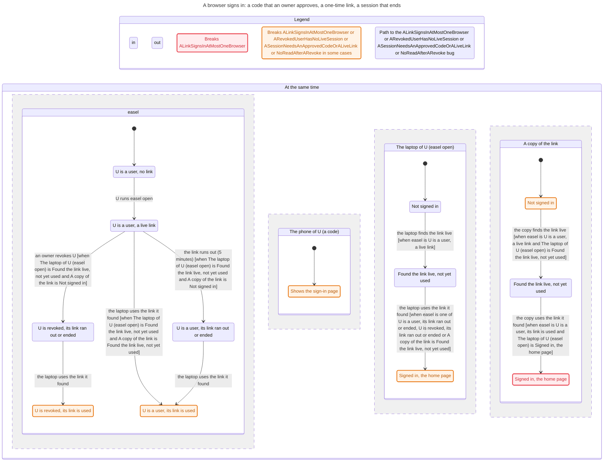

# access: a sign-in link in two steps (expected to break)

Expected to break: this is why one write checks the sign-in link, uses it and makes the session.
This is a what-if, kept as a warning. It is the [access-browser](access-browser.md) model with
`OneWrite = FALSE`: `POST /auth/open` finds the link live, then makes the session in a second write
with no new look. Two browsers that open the link at the same time both find it live, and both sign
in. A browser that found the link live before a revoke, or before the link ran out, signs in after
it, and reads a canvas of a revoked user. The model is
[models/access/Browser.tla](models/access/Browser.tla) with
[BrowserTwoStep.cfg](models/access/BrowserTwoStep.cfg). TLC reaches 739 states, more than the chart
budget of 500, so the chart draws only the bug paths. `scripts/statecharts.sh` expects this chart to
break, and fails if it ever holds. The answer is one `UPDATE ... WHERE used = 0 RETURNING` that
checks the link, its time and its user, and makes the session in the same transaction.



## Make it again

```sh
scripts/statecharts.sh access-browser-two-step
scripts/statecharts.sh --check access-browser-two-step
```
