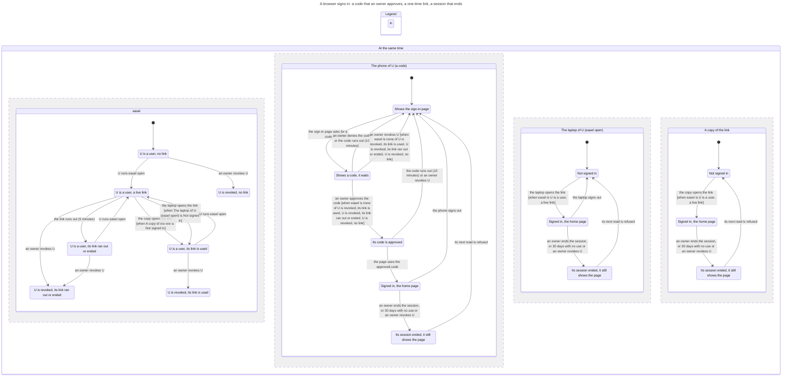

# access: a browser signs in

The chart shows how a browser of a user U signs in, and how its session ends
([SPEC-home](../../SPEC-home.md)). The phone of U shows a one-time code, and an owner approves it.
The laptop of U opens the one-time link that `easel open` printed. A copy of that link is in a third
browser: a link preview, or a message that someone sent on. A session ends when the browser signs
out, when an owner ends it, after 30 days with no use, or when an owner revokes U. The model is
[models/access/Browser.tla](models/access/Browser.tla); TLC checks every rule below on all 167 of
its states, and each one holds.



| Rule                                     | In plain words                                                                                                                    | Spec anchor                    |
| ---------------------------------------- | --------------------------------------------------------------------------------------------------------------------------------- | ------------------------------ |
| `TypeOK`                                 | Each part of the state has one of its values.                                                                                     | (model)                        |
| `ASessionNeedsAnApprovedCodeOrALiveLink` | A browser has a session only after an owner approved its code, or after it used a live sign-in link.                              | SPEC-home.md § Model, rule 1   |
| `ALinkSignsInAtMostOneBrowser`           | A sign-in link signs in at most one browser. The laptop or the copy gets the session; the second browser is refused.              | SPEC-home.md § Model, rule 2   |
| `NoReadAfterARevoke`                     | After a revoke, no browser of U reads a canvas. The revoke ends each session of U in its write, and each read checks the session. | SPEC-home.md § Model, rule 3   |
| `ARevokedUserHasNoLiveSession`           | After a revoke, no browser of U holds a live session. A browser that still shows a page is refused on its next read.              | SPEC-home.md, criterion 5      |
| `AnApprovedCodeSignsThePhoneIn`          | An approved code signs the phone in, unless the code runs out or U is revoked first.                                              | SPEC-home.md § New behavior, 1 |
| `NoDeadlock`                             | There is always a next step.                                                                                                      | (model)                        |

## What the model leaves out

- The cookie itself. A browser is "in" while it holds the cookie of a live session. That the cookie
  is `HttpOnly`, `Secure` and `SameSite=Lax`, and that the server keeps only its digest, are judged
  in code and tested.
- A new user with the name U after a revoke. The name is free again, and an approved code makes a
  new user. The model ends U for good.
- A code for a new name. An approve of a code for a name with no user makes a member (or an owner,
  with `--owner`). The model has one user, so each code is for U.
- More codes and more links at one time. Each one acts as the one in the model.
- A lost answer of the sign-in. The server made the session, but the browser did not get the
  cookie. The code is used, so the page asks for a new code. The session with no browser ends after
  30 days, or when an owner ends it.
- Time. "The code runs out" (10 minutes), "the link runs out" (5 minutes) and "30 days with no use"
  are steps.
- The rate limits of `browser.start` and `browser.wait`: they are the limits of `login.start` and
  `login.wait` (SPEC-access, judged rules 10 and 11).
- That the code page asks again: the spec assumes weak fairness on "the page uses the approved
  code". `AnApprovedCodeSignsThePhoneIn` rests on it.

## Make it again

```sh
scripts/statecharts.sh access-browser          # rewrite this page's mermaid block in place if it differs
scripts/statecharts.sh --check access-browser  # change nothing; compare the block and the verdict in charts.tsv
```
