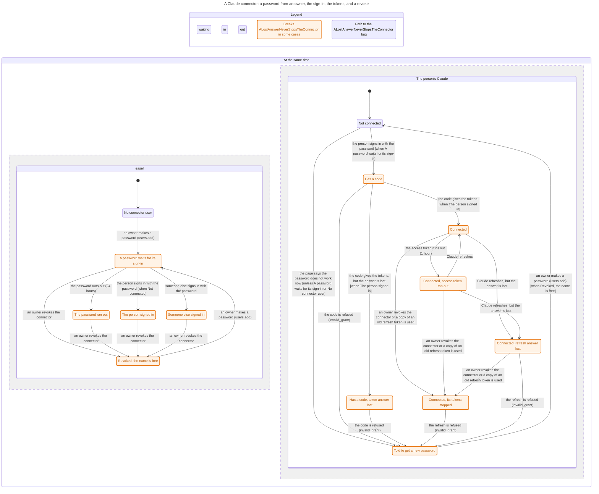

# access: a refresh token that stops at once (expected to break)

Expected to break: this is why the refresh token that was used last still works until the new one
is used. This is a what-if, kept as a warning. It is the [access-connector](access-connector.md)
model with `KeepPrevious = FALSE`: a refresh stops the old refresh token at once. When the answer
of a refresh does not reach Claude, Claude holds only the old token. Its next refresh is a reuse,
and the reuse stops the connector. The person must then get a new password from an owner. The
model is [models/access/Connector.tla](models/access/Connector.tla) with
[ConnectorStrict.cfg](models/access/ConnectorStrict.cfg). `scripts/statecharts.sh` expects this
chart to break, and fails if it ever holds. Cloudflare's `workers-oauth-provider` keeps the
previous token for the same reason.



| Rule                                                       | In plain words                                                                                                        | Spec anchor                                          |
| ---------------------------------------------------------- | --------------------------------------------------------------------------------------------------------------------- | ---------------------------------------------------- |
| `ALostAnswerNeverStopsTheConnector`                        | **Breaks.** Claude refreshes, the answer is lost, and Claude refreshes again with the old token: the connector stops. | SPEC-mcp-auth.md § The tokens of a connector, step 3 |
| The other rules of [access-connector](access-connector.md) | Hold.                                                                                                                 |                                                      |

## What the model leaves out

The same as [access-connector](access-connector.md#what-the-model-leaves-out).

## Steps the chart hides

- Steps that stay in one chart state (13). The full counterexample is in the output of the
  generator: `tlc-ALostAnswerNeverStopsTheConnector.out`.

## Make it again

```sh
scripts/statecharts.sh access-connector-strict          # rewrite this page's mermaid block in place if it differs
scripts/statecharts.sh --check access-connector-strict  # change nothing; compare the block and the verdict in charts.tsv
```
