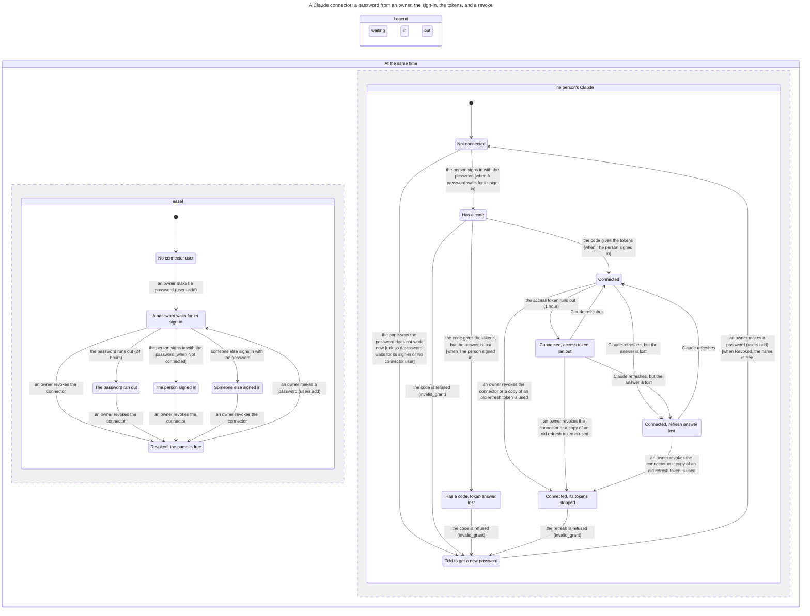

# access: a Claude connector

The chart shows the life of one connector user, `ann-claude`
([SPEC-mcp-auth](../../SPEC-mcp-auth.md)). An owner makes its password. The person signs in with
it from Claude, the code gives the tokens, and Claude refreshes them. An owner revokes it. Someone
else can get the password too: that is the accepted risk of the spec. The two regions move at the
same time: what easel keeps, and what the person's Claude sees. The model is
[models/access/Connector.tla](models/access/Connector.tla) with
[Connector.cfg](models/access/Connector.cfg). TLC checks every rule below on all 71 of its states,
and each one holds.



| Rule                                 | In plain words                                                                                                                                                                                      | Spec anchor                                         |
| ------------------------------------ | --------------------------------------------------------------------------------------------------------------------------------------------------------------------------------------------------- | --------------------------------------------------- |
| `TypeOK`                             | A connector user has a password exactly while it waits or is signed in. Claude holds a refresh token exactly while it is connected.                                                                 | SPEC-mcp-auth.md § Contract                         |
| `APasswordWorksOnce`                 | One password signs in one time: the person or someone else, never both.                                                                                                                             | § An owner makes a password, step 4; judged rule 8  |
| `ALatePasswordNeverWorks`            | A password that ran out signs no one in. By construction (judged in code): the sign-in step needs a live password, so this cannot break here.                                                       | § An owner makes a password, step 4                 |
| `ACodeWorksOnce`                     | An authorization code gives tokens one time. A second use is refused, and stops the tokens that the code gave.                                                                                      | judged rule 5                                       |
| `NoCallAfterARevoke`                 | After a revoke, or after a copy of an old refresh token stops the connector, no tool call is answered.                                                                                              | § An owner stops a connector, step 2; judged rule 7 |
| `NoRefreshAfterARevoke`              | After a revoke, no refresh is answered: Claude gets `invalid_grant`.                                                                                                                                | § An owner stops a connector, step 2; judged rule 7 |
| `ATokenWorksOnlyForAUser`            | An access token or a refresh token works only while its user is signed in. A revoke ends them in the same write.                                                                                    | § The tokens of a connector; judged rule 7          |
| `ALostAnswerNeverStopsTheConnector`  | A lost refresh answer does not stop the connector. The refresh token that was used last still works until the new one is used, so Claude asks again. Only a revoke, a copy or a used code stops it. | § The tokens of a connector, step 3                 |
| `AWorkingConnectorGetsAnAccessToken` | While its tokens work, a connected Claude gets a working access token in the end, also after a lost answer.                                                                                         | § The tokens of a connector, steps 2-3              |
| `NoDeadlock`                         | There is always a next step.                                                                                                                                                                        | (model)                                             |

## What the model leaves out

- The name and the password that are wrong: the page says so, and nothing changes. The rate limit
  of `login.setup` is a test, not a step.
- The client check, the redirect check, PKCE and `resource`: a code with a wrong verifier, for a
  different client or for a different resource, gives no tokens and changes nothing. They are
  judged rules 1, 2 and 5, and tests.
- `state` and the frame rule of the page (judged rule 4).
- The tokens of someone else who signed in. They are one flag: a revoke ends them.
- Each access token but the one that Claude holds. An old access token works until its hour ends,
  and a revoke ends it too.
- Owners, members and the guards: `users.add` and `users.revoke` are owner calls (fact rule 2).
  [access-login](access-login.md) proves the revoke and the last owner.
- The tokens of `easel login`: they do not change (SPEC-mcp-auth.md § The tokens of a connector,
  step 4).
- Time. "Runs out" is one step for the password (24 hours), the code (60 s) and the access token
  (1 hour).
- That Claude keeps asking: the spec assumes weak fairness on the refresh. Claude refreshes on a
  401, and before the access token runs out.

## Steps the chart hides

- Steps that stay in one chart state (9): Claude makes a tool call; Claude refreshes, or the
  answer is lost, when its state does not change; the password runs out, or someone else signs
  in, while Claude waits for an owner.

## What the chart shows

- A lost token answer of the code ends in "Told to get a new password". Claude asks again with the
  same code, the code is used, and its tokens stop. The password is used too, so the owner
  revokes the user and makes a new password. This is rare (Claude waits 10 s for the answer), and
  it is safe: a copy of the code cannot give tokens.
- [access-connector-strict](access-connector-strict.md) shows why the refresh token that was used
  last still works.

## Make it again

```sh
scripts/statecharts.sh access-connector          # rewrite this page's mermaid block in place if it differs
scripts/statecharts.sh --check access-connector  # change nothing; compare the block and the verdict in charts.tsv
```
