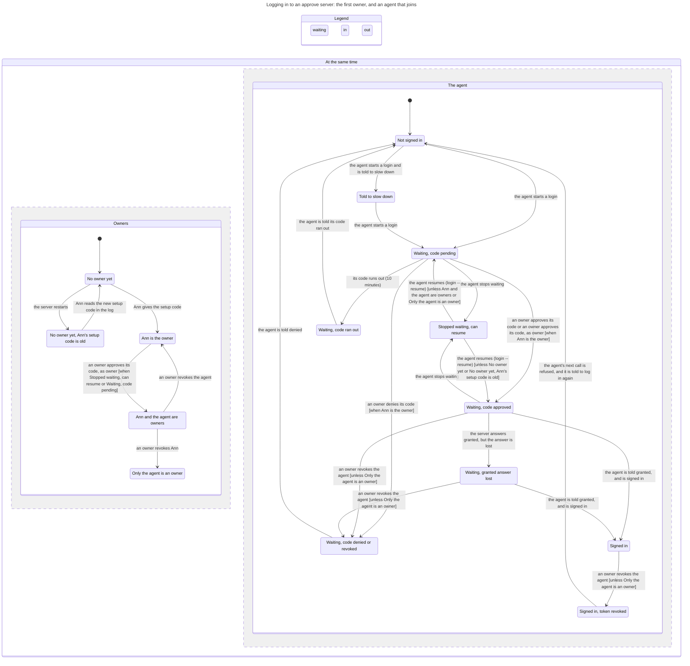

# access: logging in

The chart shows how a person becomes the first owner of an `approve` server, and how an agent
joins it: it starts a login, an owner approves or denies its code, and the agent is signed in, told
no, or told the code ran out. It also shows what a revoke does, to a signed-in agent and to one
whose approval it has not heard yet. The two regions move at the same time: who the owners are, and
what the agent's CLI sees. The model is [models/access/Login.tla](models/access/Login.tla); TLC
checks every rule below on all 90 of its states, and each one holds.



| Rule                                     | In plain words                                                                                                                                                                         | Spec line                                                                |
| ---------------------------------------- | -------------------------------------------------------------------------------------------------------------------------------------------------------------------------------------- | ------------------------------------------------------------------------ |
| `TypeOK`                                 | The CLI holds a request exactly while it waits or has stopped waiting; a lost answer is only on an approved code.                                                                      | SPEC-access.md § How a token is made, step 2; § Contract                 |
| `SetupCodeWorksOnce`                     | The setup code signs someone in once.                                                                                                                                                  | SPEC-access.md § Become the first owner, step 3; judged rule 4           |
| `SetupCodeOnlyWhileNoUser`               | The setup code works only while the server has no user. By construction (judged in code): the model's setup step needs no user, so this cannot break here.                             | SPEC-access.md, judged rule 4                                            |
| `AnOldSetupCodeNeverWorks`               | A setup code from before a restart never works; the log shows the new one. By construction (judged in code): the model's setup step needs the current code, so this cannot break here. | SPEC-access.md § How a server is set up; judged rule 4                   |
| `ACodeIsApprovedAtMostOnce`              | A second approve on a code answers `gone`.                                                                                                                                             | SPEC-access.md, judged rule 2                                            |
| `ACodeThatEndedStaysEnded`               | A denied or expired code stays so. An approved code ends only by a revoke.                                                                                                             | SPEC-access.md, judged rule 2                                            |
| `ATokenWorksOnlyForAUser`                | A token works only while its user is a user; a revoke ends it.                                                                                                                         | SPEC-access.md § Revoke a user, step 1; judged rule 8                    |
| `ARevokedUserIsNeverToldGranted`         | A revoked user is never signed in: `login.wait` answers it `denied`, even when its code was approved before the revoke.                                                                | SPEC-access.md § Revoke a user, step 2; judged rules 5 and 8             |
| `ARevokedUserIsRefused`                  | A call with a revoked user's token is never answered; it is refused, and the CLI says to log in again.                                                                                 | SPEC-access.md § Revoke a user, step 1; judged rule 8                    |
| `AWorkingTokenIsNeverDropped`            | While its token works, the agent's CLI still holds it, so a lost `granted` answer loses nothing.                                                                                       | SPEC-access.md § How a token is made, steps 2-4                          |
| `ALostGrantedAnswerStillSignsTheAgentIn` | A CLI that lost the `granted` answer and keeps waiting is signed in, unless it stops or is revoked first.                                                                              | SPEC-access.md § How a token is made, step 4; § Join a server, steps 3-4 |
| `ThereIsAlwaysAnOwner`                   | Once there is an owner, there is always one: revoking the last owner answers `last`.                                                                                                   | SPEC-access.md § Revoke a user, step 3; judged rule 9                    |
| `NoDeadlock`                             | There is always a next step.                                                                                                                                                           | (model)                                                                  |

## What the model leaves out

- `open` servers. The chart is an `approve` server.
- `taken`. There is one agent, and its name is free whenever its CLI is out. That two users never
  share a name is judged rule 7 (one write).
- The counts behind `slow`. The rate limits are one flag: the agent's address is at a limit, or
  not. The numbers (5 starts, 3 and 20 waiting, per address) are judged rules 10 and 11, and tests.
  `slow` on `login.setup` and `login.wait` is left out.
- `login.wait` answering `pending` at 50 s: it changes nothing, and the CLI asks again.
- Time. "Its code runs out" is one step; the 10 minutes are judged rule 3.
- Ann's own CLI, and Ann logging in again after a revoke.
- Members calling owner calls (the `{ owner: true }` refusal), and the guards in general: those
  are fact rules.
- A wrong or used setup code (`wrong`, `taken`): it changes nothing. So `SetupCodeOnlyWhileNoUser` and `AnOldSetupCodeNeverWorks` hold by construction: the setup step is taken only while there is no user and with the current code. The code's own check is judged, and a test must send a used and an old setup code.
- That the CLI keeps asking: the spec assumes weak fairness on "the agent is signed in" (a `granted` answer that is there to get is got in the end). `ALostGrantedAnswerStillSignsTheAgentIn` rests on it; the CLI's retry loop is judged.
- How a restart keeps users, tokens and codes: the model assumes it, and a restart changes only
  the setup code.

## Steps the chart hides

- Steps that stay in one chart state (197): a limit is reached or clears, the agent makes a call,
  the server restarts once there is a user, and an approve, deny, revoke or expiry while the agent
  has stopped waiting (it sees the change when it resumes).
- The view hides 34 steps: the agent stops waiting on a code that was already denied, revoked or
  ran out, or after its `granted` answer was lost; and the agent resumes onto a code that already
  ended. Resuming onto an approved or pending code, and stopping on one, are drawn.

## Make it again

```sh
scripts/statecharts.sh access-login          # rewrite this page's mermaid block in place if it differs
scripts/statecharts.sh --check access-login  # change nothing; compare the block and the verdict in charts.tsv
```
