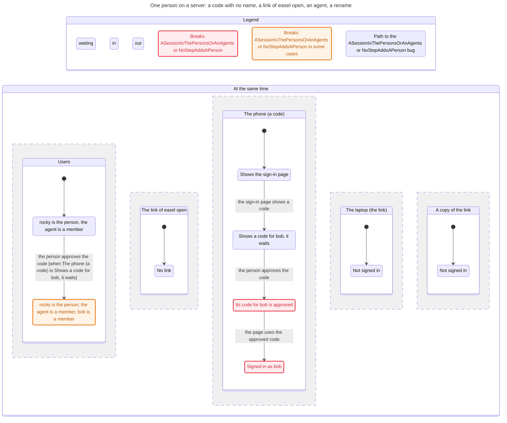

# access: one person on a server, with the steps of approve (expected to break)

Expected to break: this is why `EASEL_AUTH=single` removes the name field and the approve of a new
name. This is a what-if, kept as a warning. It is the [access-single](access-single.md) model with
`Single = FALSE`: the sign-in page asks for a name, as on an approve server, and a stranger types
`bob`. The person approves the code, as the person did on 2026-11-24 for `lagz0ne`. The approve
makes `bob` a member, and the phone signs in as `bob`. So a step adds a person, and a session
belongs to a name that is not the person and not an agent. The model is
[models/access/Single.tla](models/access/Single.tla) with
[SingleApprove.cfg](models/access/SingleApprove.cfg). `scripts/statecharts.sh` expects this chart to
break, and fails if it ever holds. The answer is a code with no name: in single, `browser.start`
takes no name, each code is for the person, and an approve never makes a user.



## Make it again

```sh
scripts/statecharts.sh access-single-approve          # rewrite this page's mermaid block in place if it differs
scripts/statecharts.sh --check access-single-approve  # change nothing; compare the block and the verdict in charts.tsv
```
