# access: one person on a server (EASEL_AUTH=single)

The chart shows how browsers sign in on a server for one person
([SPEC-single](../../SPEC-single.md)). It is the [access-browser](access-browser.md) model with the
rules of `EASEL_AUTH=single`. The sign-in page has no name field, so each code is for the person.
The person approves it with `easel users approve <code>`. The laptop opens a link of `easel open`,
and a copy of that link is in a third browser. The person or an agent runs `easel open`. The person
can revoke the agent, and `easel users rename rocky lagz0ne` gives the person a new name. The model
is [models/access/Single.tla](models/access/Single.tla); TLC checks every rule below on all 400 of
its states, and each one holds.

```mermaid
---
title: "One person on a server: a code with no name, a link of easel open, an agent, a rename"
---
stateDiagram-v2
  direction LR
  state "Legend" as legend {
    lg0: in
  }
  class lg0 teal
  state "At the same time" as all {
    state "Users" as r0 {
      s0: rocky is the person, the agent is a member
      s1: lagz0ne is the person, the agent is a member
      s2: rocky is the person, the agent is revoked
      s3: lagz0ne is the person, the agent is revoked
      [*] --> s0
      s0 --> s1: easel users rename rocky lagz0ne
      s0 --> s2: the person revokes the agent
      s1 --> s3: the person revokes the agent
      s2 --> s3: easel users rename rocky lagz0ne
    }
    --
    state "The link of easel open" as r1 {
      s4: No link
      s5: A live link of the agent
      s6: A live link of the person
      s7: The link ran out or ended
      s8: The link is used
      [*] --> s4
      s4 --> s5: the agent runs easel open [when Users is one of lagz0ne is the person, the agent is a member, rocky is the person, the agent is a member]
      s4 --> s6: the person runs easel open
      s5 --> s7: the link runs out (5 minutes) or the person revokes the agent
      s5 --> s8: the copy opens the link [when A copy of the link is Not signed in]
      s5 --> s8: the laptop opens the link [when The laptop (the link) is Not signed in]
      s6 --> s7: the link runs out (5 minutes)
      s6 --> s8: the copy opens the link [when A copy of the link is Not signed in]
      s6 --> s8: the laptop opens the link [when The laptop (the link) is Not signed in]
      s7 --> s5: the agent runs easel open [when Users is one of lagz0ne is the person, the agent is a member, rocky is the person, the agent is a member]
      s7 --> s6: the person runs easel open
      s8 --> s5: the agent runs easel open [when Users is one of lagz0ne is the person, the agent is a member, rocky is the person, the agent is a member]
      s8 --> s6: the person runs easel open
    }
    --
    state "The phone (a code)" as r2 {
      s9: Shows the sign-in page
      s10: Shows a code for the person, it waits
      s11: Its code for the person is approved
      s12: Signed in as the person
      [*] --> s9
      s9 --> s10: the sign-in page shows a code
      s10 --> s9: the person denies the code, or it runs out (10 minutes)
      s10 --> s11: the person approves the code
      s11 --> s9: the person denies the code, or it runs out (10 minutes)
      s11 --> s12: the page uses the approved code
      s12 --> s9: the phone signs out, or its session ends
    }
    --
    state "The laptop (the link)" as r3 {
      s13: Not signed in
      s14: Signed in as the agent
      s15: Signed in as the person
      [*] --> s13
      s13 --> s14: the laptop opens the link [when Users is one of lagz0ne is the person, the agent is a member, rocky is the person, the agent is a member and The link of easel open is A live link of the agent]
      s13 --> s15: the laptop opens the link [when The link of easel open is A live link of the person]
      s14 --> s13: the laptop signs out, or its session ends or the person revokes the agent
      s15 --> s13: the laptop signs out, or its session ends
    }
    --
    state "A copy of the link" as r4 {
      s16: Not signed in
      s17: Signed in as the agent
      s18: Signed in as the person
      [*] --> s16
      s16 --> s17: the copy opens the link [when Users is one of lagz0ne is the person, the agent is a member, rocky is the person, the agent is a member and The link of easel open is A live link of the agent]
      s16 --> s18: the copy opens the link [when The link of easel open is A live link of the person]
      s17 --> s16: its session ends or the person revokes the agent
      s18 --> s16: its session ends
    }
  }
  class s12 teal
  class s14 teal
  class s15 teal
  class s17 teal
  class s18 teal
```



| Rule                                     | In plain words                                                                                                        | Spec anchor                       |
| ---------------------------------------- | --------------------------------------------------------------------------------------------------------------------- | --------------------------------- |
| `TypeOK`                                 | Each part of the state has one of its values.                                                                         | (model)                           |
| `ASessionIsThePersonsOrAnAgents`         | Each session belongs to the person or to an agent, and to no other name.                                              | SPEC-single.md § Model, rule 1    |
| `NoStepAddsAPerson`                      | The server has one owner, and no member other than the agent. No code, approve or rename adds a person.               | SPEC-single.md § Model, rule 2    |
| `ASessionNeedsAnApprovedCodeOrALiveLink` | A browser has a session only after the person approved its code, or after it used a live sign-in link.                | SPEC-home.md § Model, rule 1      |
| `ALinkSignsInAtMostOneBrowser`           | A sign-in link signs in at most one browser.                                                                          | SPEC-home.md § Model, rule 2      |
| `NoReadAfterARevoke`                     | After a revoke of the agent, no browser of the agent reads a canvas.                                                  | SPEC-home.md § Model, rule 3      |
| `NoSessionOfANameThatIsGone`             | Each live session belongs to a user. A revoke ends the sessions of its user, and a rename moves them to the new name. | SPEC-single.md § New behavior, 10 |
| `AnApprovedCodeSignsThePhoneIn`          | An approved code signs the phone in, unless the code ends first. A rename does not stop it.                           | SPEC-single.md § New behavior, 2  |

## What the model leaves out

- The first owner. A single server with no user prints a setup code, as an approve server does
  (SPEC-access). The model starts after that: the person is the owner `rocky`.
- More agents. Each agent that `easel users add` makes acts as the one agent in the model.
- A CLI login with a new name (`easel login --name bob`). In single, `login.start` refuses it, so it
  is no step. A login for the name of a user is no step too: it answers `taken`, as in approve.
- `easel users approve --owner` and `easel users add --owner`. In single, both are refused, so they
  are no step.
- A revoke and a logout of the person. The person is the last owner: each one answers `last`.
- The refusal of a browser whose session ended. A session that ends goes to "Not signed in" at once.
  [access-browser](access-browser.md) shows that the next read of such a browser is refused.
- A rename of the agent, and a rename to a name in use. A name of a user, or of a code that waits,
  answers `taken`, so the model renames only `rocky` to the free name `lagz0ne`.
- Time. "The code runs out" (10 minutes) and "the link runs out" (5 minutes) are steps.
- That the code page asks again: the spec assumes weak fairness on "the page uses the approved
  code". `AnApprovedCodeSignsThePhoneIn` rests on it.

## Make it again

```sh
scripts/statecharts.sh access-single          # rewrite this page's mermaid block in place if it differs
scripts/statecharts.sh --check access-single  # change nothing; compare the block and the verdict in charts.tsv
```
