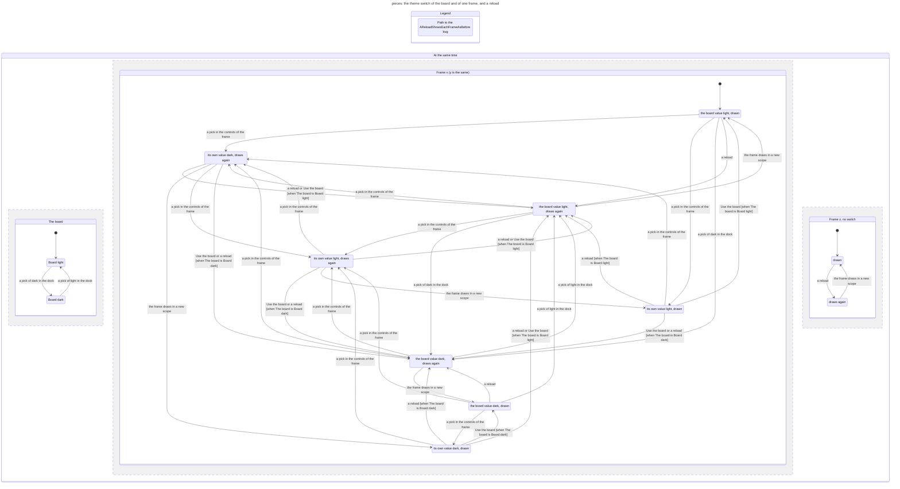

# pieces: an address that holds the board value only

This chart has the model of [board-switch](board-switch.md) with
[BoardSwitchBoardOnly.cfg](models/pieces/BoardSwitchBoardOnly.cfg) (`FrameInAddress = FALSE`):
the address holds the board value, but not the frame values. TLC finds that
`AReloadShowsEachFrameAsBefore` breaks in 2 steps:

1. The board is `light`. A person picks `dark` in the controls of frame `x`.
2. A reload. Frame `x` uses the board value again, and shows `light`.

So the address holds each frame value too (`?theme=dark&f.<frame>.theme=light`, SPEC-pieces.md §
Switches, rule 13).

| Rule                                                                                         | In plain words                               | Spec anchor                        |
| -------------------------------------------------------------------------------------------- | -------------------------------------------- | ---------------------------------- |
| `AReloadShowsEachFrameAsBefore`                                                              | Breaks: a reload loses the value of a frame. | SPEC-pieces.md § Switches, rule 13 |
| `TypeOK`, `EachFrameShowsItsValue`, `AFrameOffTheSwitchNeverDraws`, `EachFrameDrawsInTheEnd` | Hold.                                        | [board-switch](board-switch.md)    |

## What the model leaves out

The same as [board-switch](board-switch.md). TLC checks this config on 324 states.
