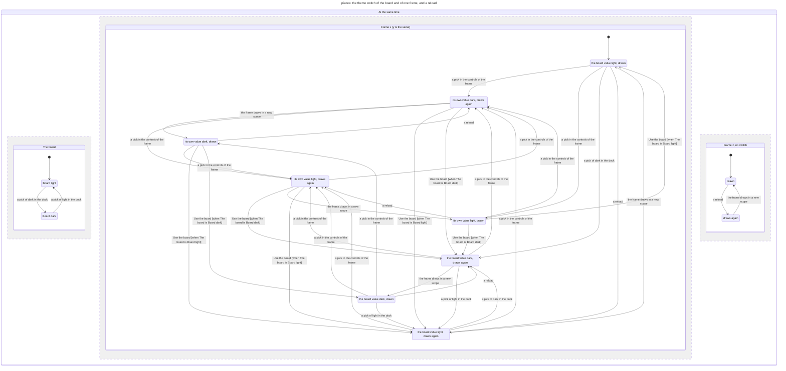

# pieces: the theme switch of the board and of one frame, and a reload

The chart shows one switch, `theme` (`light` or `dark`), in one tab
([SPEC-pieces](../../SPEC-pieces.md#switches-one-state-for-one-frame-or-for-all-frames), rules
10-13). Frames `x` and `y` take the switch; frame `z` does not. A person picks a board value in the
dock, picks a value for one frame in its controls, gives a frame the board value again (`Use the
board`), or reloads. A pick writes the address of the page. Then each frame whose value changes
draws again in a new scope, a little later. A reload takes the values from the address, and each
frame draws again. The model is [models/pieces/BoardSwitch.tla](models/pieces/BoardSwitch.tla) with
[BoardSwitch.cfg](models/pieces/BoardSwitch.cfg) (`FrameInAddress = TRUE`). TLC checks every rule
below on all 324 of its states, and each one holds. The chart draws frame `x` only: frame `y` acts
the same.

| Rule                            | In plain words                                                                                                           | Spec anchor                                                             |
| ------------------------------- | ------------------------------------------------------------------------------------------------------------------------ | ----------------------------------------------------------------------- |
| `TypeOK`                        | Each value is one that the tab can hold.                                                                                 | (model)                                                                 |
| `EachFrameShowsItsValue`        | When a frame that takes the switch drew after the last pick, it shows its own value if it has one, else the board value. | § Switches, rules 11 and 12; § Model, second model, rule 1; criterion 8 |
| `AFrameOffTheSwitchNeverDraws`  | Frame `z` draws again only for a reload, never for a pick.                                                               | § Switches, rule 11; § Model, second model, rule 2                      |
| `AReloadShowsEachFrameAsBefore` | After a reload, each frame shows the value that it showed before: the board value and each frame value.                  | § Switches, rule 13; § Model, second model, rule 3; criterion 8         |
| `EachFrameDrawsInTheEnd`        | Each frame that waits to draw again draws (with fairness on the draw).                                                   | § Switches, rule 11; criterion 8                                        |
| `NoDeadlock`                    | There is always a next step.                                                                                             | (model)                                                                 |

## What the model leaves out

- More switches and values. `locale` and `fixture` act as `theme` does. A frame with no fixture of
  the board name keeps its own value: that is a frame value here.
- More tabs. The values are of the tab, so each tab acts on its own.
- A link that opens with values in its address. It is a reload with those values.
- The pages of a canvas: a board value stays when the person goes to another page
  (SPEC-pages.md § The viewer, rule 13). [viewer-pages](viewer-pages.md) proves the page of a tab.
- The look of each theme, and how a frame draws: one new scope with the value.

## What the chart shows

- A board pick makes a frame draw again only when it uses the board value. A frame with its own
  value does not draw for a board pick.
- A frame pick and `Use the board` make only that frame draw again.
- A reload makes each frame draw again, frame `z` too, with the same values.
- [board-switch-board-only](board-switch-board-only.md) shows why the address holds the frame
  values.
