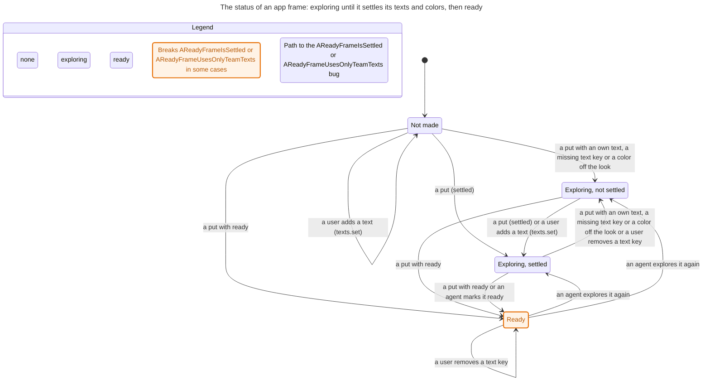

# copy: a text key that can be removed

This chart has the model of [copy-status](copy-status.md) with
[StatusRemove.cfg](models/copy/StatusRemove.cfg): a change of the texts can remove a text key.
TLC finds that `AReadyFrameIsSettled` and `AReadyFrameUsesOnlyTeamTexts` break in 3 steps:

1. A user adds a text (`texts.set`).
2. An agent puts the frame with ready. It uses that text key.
3. A user removes the text key. The frame is still ready, but it uses a text key that the team does
   not have.

So no call removes a text key (SPEC-copy.md § The texts of the team, rule 3). A remove needs a
rule for the ready frames that use it, and it is deferred.

