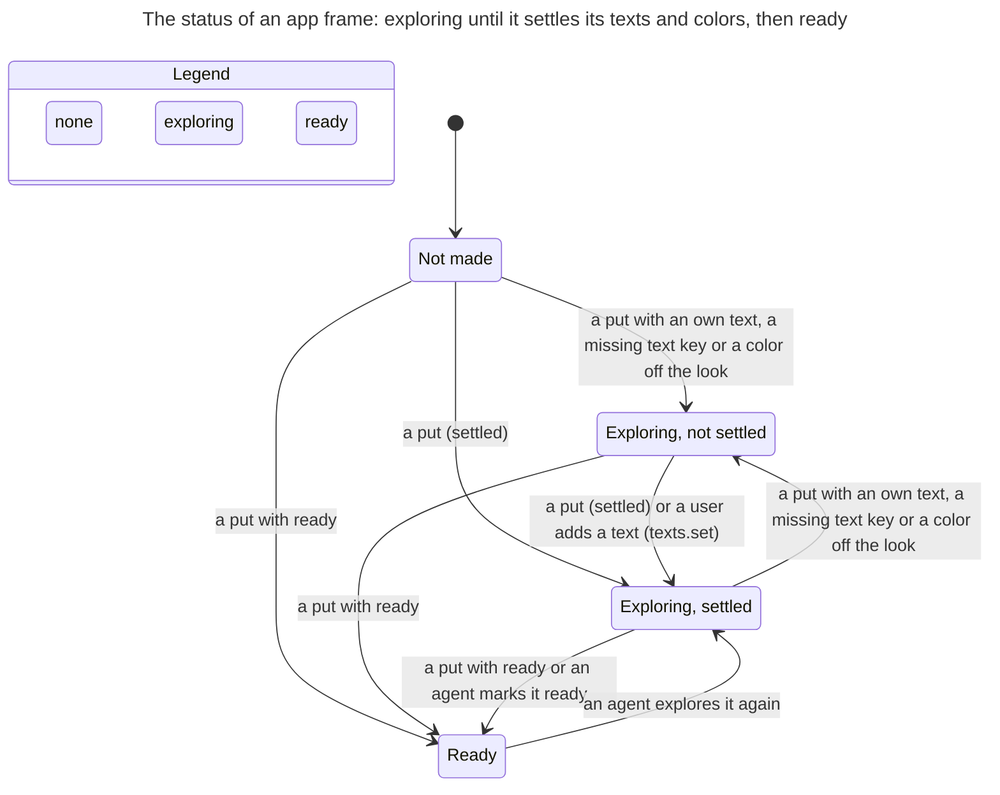

# copy: the status of an app frame

The chart shows the status of one app frame ([SPEC-copy](../../SPEC-copy.md#exploring-and-ready)).
A frame is exploring until an agent marks it ready. An exploring frame may have its own text, a
text key that the team does not have, and a color off the look. A ready frame settled them. The
model is [models/copy/Status.tla](models/copy/Status.tla) with
[Status.cfg](models/copy/Status.cfg). TLC checks every rule below on all 154 of its states, and
each one holds.

| Rule                           | In plain words                                                                                     | Spec anchor                            |
| ------------------------------ | -------------------------------------------------------------------------------------------------- | -------------------------------------- |
| `TypeOK`                       | The status is not made, exploring or ready. The frame and the team use only the two text keys.     | SPEC-copy.md § Contract                |
| `AReadyFrameIsSettled`         | A ready frame has no own text, no text key that the team does not have, and no color off the look. | § Exploring and ready, rule 15; fact 5 |
| `AReadyFrameUsesOnlyTeamTexts` | Each text key of a ready frame is in the texts of the team, also after each change of the texts.   | § The texts of the team, rule 3        |
| `NoDeadlock`                   | There is always a next step.                                                                       | (model)                                |

## What the model leaves out

- Other frames. Two frames do not share a status, so one frame is enough.
- The values of the texts and of the look. A change of a value does not change what is settled.
- The answers. A refused put and a refused mark change nothing; the findings and their fixes are
  tests.
- `stale`, `gone` and `tooBig`: [frames-writes](frames-writes.md) proves the writes of a frame.
- Each locale. A text key with no `vi` text shows its `en` text, so it is never missing.

## What the chart shows

- A put with ready goes to Ready from each state: the fixes make each color a color of the look.
  A put with an own text or a missing text key is refused, and the frame stays where it is.
- A text that a user adds can settle an exploring frame (from "not settled" to "settled"). The
  agent still marks it ready.
- [copy-status-remove](copy-status-remove.md) shows why no call removes a text key.
