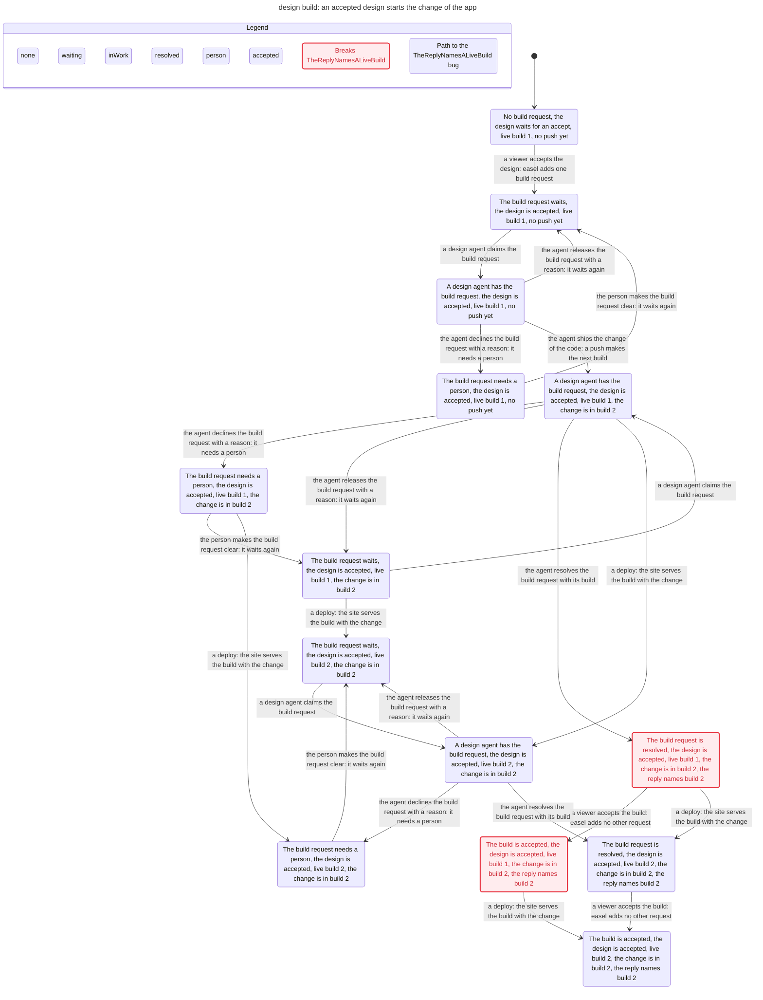

# design build: a resolve before the build is live (breaks)

This twin of [design-build](design-build.md) takes a resolve that names a build that is not live
yet. Then the reply names a build that the person cannot see, and `TheReplyNamesALiveBuild`
breaks. TLC finds the break, and the chart shows the states up to it. The model is
[models/live/DesignBuild.tla](models/live/DesignBuild.tla) with `CheckLive = FALSE`.

