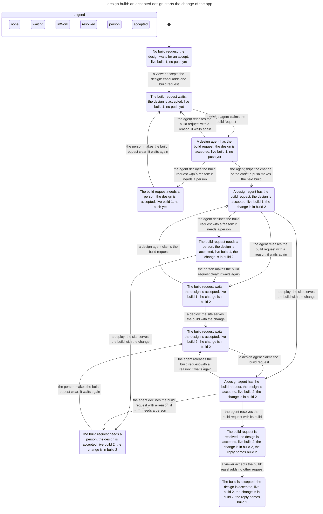

# design build: an accepted design starts the change of the app

The chart follows one design request on `product` after a design agent resolved it with a new
version of its frame ([SPEC-live-screens](../../SPEC-live-screens.md), decisions 9 and 10; E11 V4
and V7). A viewer accepts the result, and easel adds one build request on the frame. A design agent
claims it, changes the code, and ships it. The push makes a build, and a deploy puts it live. The
agent resolves the build request with that build, and easel refuses a build that is not live. The
agent can also release the build request (it waits again) or decline it (it needs a person, who
sees why). The model is [models/live/DesignBuild.tla](models/live/DesignBuild.tla); TLC checks
each rule below on all its states, and each one holds.

The rules:

- `OneBuildRequestForEachAccept`: an accept adds one build request; an accept of a build request
  adds none.
- `ABuildRequestNeedsAnAccept`: easel adds a build request only after an accept.
- `TheReplyNamesALiveBuild`: a resolved build request names a build, and that build is live (V7).
- `TheDesignStaysAccepted`: a failure of the build does not change the accept of the design.

The twin [design-build-no-check](design-build-no-check.md) takes a resolve before the build is
live, and breaks.
