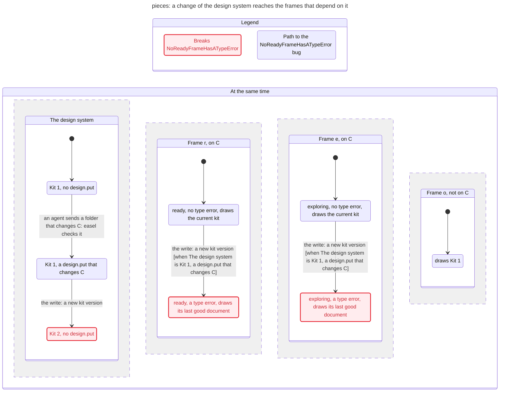

# pieces: a change of the design system that does not check the ready frames

This chart has the model of [design-change](design-change.md) with
[DesignChangeUnchecked.cfg](models/pieces/DesignChangeUnchecked.cfg) (`CheckReady = FALSE`): a
`design.put` checks the new folder, but not the ready frames that depend on a changed capsule. TLC
finds that `NoReadyFrameHasATypeError` breaks in 2 steps:

1. An agent sends a folder that changes C. Frame `r` is ready, and it is written for the old shape
   of C.
2. The write makes a new kit version. Frame `r` is ready, and it has a type error.

So `design.put` type-checks each ready frame that depends on a changed capsule, and answers
`breaks` (SPEC-pieces.md § A change of the design system, rule 17). The model has 612 states, more
than the 500 of a chart, so the chart draws only the path to the break.

| Rule                                                                 | In plain words                                                          | Spec anchor                                             |
| -------------------------------------------------------------------- | ----------------------------------------------------------------------- | ------------------------------------------------------- |
| `NoReadyFrameHasATypeError`                                          | Breaks: a ready frame has a type error against the current kit version. | SPEC-pieces.md § A change of the design system, rule 17 |
| `TypeOK`, `EachFrameOnCShowsTheNewKit`, `AFrameOffCKeepsItsDocument` | Hold.                                                                   | [design-change](design-change.md)                       |

## What the model leaves out

The same as [design-change](design-change.md).
