# pieces: a change of the design system reaches the frames that depend on it

The chart shows one `design.put` and the frames on one board
([SPEC-pieces](../../SPEC-pieces.md#a-change-of-the-design-system), rules 17-19). The design system
has one capsule, C. Frame `r` (ready) and frame `e` (exploring) depend on C. Frame `o` depends on
no capsule that changes. A `design.put` that changes C renames a prop: each frame written for the
old shape then has a type error. A `design.put` is two steps: easel checks the new folder and each
frame that depends on C, then it writes the new kit version. A frame put or a mark comes between
the two steps at any time. The write compares the frames that it checked with the frames now; if
one changed, easel checks again. The model is
[models/pieces/DesignChange.tla](models/pieces/DesignChange.tla) with
[DesignChange.cfg](models/pieces/DesignChange.cfg) (`CheckReady = TRUE`, `MaxKit = 2`). TLC
checks every rule below on all 384 of its states, and each one holds. The chart draws 17 of them.

```mermaid
---
title: "pieces: a change of the design system reaches the frames that depend on it"
---
stateDiagram-v2
  direction LR
  state "At the same time" as all {
    state "The design system" as r0 {
      s0: Kit 1, no design.put
      s1: Kit 1, a design.put that keeps C
      s2: Kit 1, a design.put that changes C
      s3: Kit 2, no design.put
      [*] --> s0
      s0 --> s1: an agent sends a folder that keeps C: easel checks it
      s0 --> s2: an agent sends a folder that changes C: easel checks it
      s1 --> s3: the write: a new kit version
      s2 --> s0: a ready frame has a type error: breaks, nothing is written [when Frame r, on C is one of ready, no type error, a new document loads, ready, no type error, draws the current kit or Frame e, on C is one of ready, no type error, a new document loads, ready, no type error, draws the current kit]
      s2 --> s3: the write: a new kit version [when Frame r, on C is one of exploring, no type error, a new document loads, exploring, no type error, draws the current kit and Frame e, on C is one of exploring, no type error, a new document loads, exploring, no type error, draws the current kit]
    }
    --
    state "Frame r, on C" as r1 {
      s4: ready, no type error, draws the current kit
      s5: exploring, no type error, draws the current kit
      s6: ready, no type error, a new document loads
      s7: exploring, no type error, a new document loads
      s8: exploring, a type error, draws its last good document
      s9: exploring, a type error, a new document loads
      [*] --> s4
      s4 --> s5: an agent marks the frame exploring
      s4 --> s6: a frame put with no type error
      s4 --> s6: the write: a new kit version [when The design system is Kit 1, a design.put that keeps C and Frame e, on C is none of exploring, a type error, a new document loads, exploring, a type error, draws its last good document]
      s5 --> s4: an agent marks the frame ready
      s5 --> s7: a frame put with no type error
      s6 --> s4: the new iframe draws, the old one goes
      s6 --> s7: an agent marks the frame exploring
      s5 --> s7: the write: a new kit version [when The design system is Kit 1, a design.put that keeps C and Frame e, on C is none of exploring, a type error, a new document loads, exploring, a type error, draws its last good document]
      s5 --> s8: the write: a new kit version [when The design system is Kit 1, a design.put that changes C and Frame e, on C is one of exploring, no type error, a new document loads, exploring, no type error, draws the current kit]
      s7 --> s5: the new iframe draws, the old one goes
      s7 --> s6: an agent marks the frame ready
      s7 --> s9: the write: a new kit version [when The design system is Kit 1, a design.put that changes C and Frame e, on C is one of exploring, no type error, a new document loads, exploring, no type error, draws the current kit]
      s8 --> s7: a frame put with no type error
      s9 --> s8: the new iframe draws, the old one goes
      s9 --> s7: a frame put with no type error
    }
    --
    state "Frame e, on C" as r2 {
      s10: exploring, no type error, draws the current kit
      s11: ready, no type error, draws the current kit
      s12: exploring, no type error, a new document loads
      s13: ready, no type error, a new document loads
      s14: exploring, a type error, draws its last good document
      s15: exploring, a type error, a new document loads
      [*] --> s10
      s10 --> s11: an agent marks the frame ready
      s10 --> s12: a frame put with no type error
      s10 --> s12: the write: a new kit version [when The design system is Kit 1, a design.put that keeps C and Frame r, on C is none of exploring, a type error, a new document loads, exploring, a type error, draws its last good document]
      s11 --> s10: an agent marks the frame exploring
      s11 --> s13: a frame put with no type error
      s12 --> s10: the new iframe draws, the old one goes
      s12 --> s13: an agent marks the frame ready
      s11 --> s13: the write: a new kit version [when The design system is Kit 1, a design.put that keeps C and Frame r, on C is none of exploring, a type error, a new document loads, exploring, a type error, draws its last good document]
      s10 --> s14: the write: a new kit version [when The design system is Kit 1, a design.put that changes C and Frame r, on C is one of exploring, no type error, a new document loads, exploring, no type error, draws the current kit]
      s13 --> s11: the new iframe draws, the old one goes
      s13 --> s12: an agent marks the frame exploring
      s12 --> s15: the write: a new kit version [when The design system is Kit 1, a design.put that changes C and Frame r, on C is one of exploring, no type error, a new document loads, exploring, no type error, draws the current kit]
      s14 --> s12: a frame put with no type error
      s15 --> s14: the new iframe draws, the old one goes
      s15 --> s12: a frame put with no type error
    }
    --
    state "Frame o, not on C" as r3 {
      s16: draws Kit 1
      [*] --> s16
    }
  }
```

| Rule                         | In plain words                                                                                                                                                                   | Spec anchor                                                                    |
| ---------------------------- | -------------------------------------------------------------------------------------------------------------------------------------------------------------------------------- | ------------------------------------------------------------------------------ |
| `TypeOK`                     | Each value is one that easel or the page can hold.                                                                                                                               | (model)                                                                        |
| `NoReadyFrameHasATypeError`  | No ready frame has a type error against the current kit version, also with a frame put or a mark between the check and the write.                                                | § A change of the design system, rule 17; § Model, rule 1; fact rule 3         |
| `EachFrameOnCShowsTheNewKit` | In the end, each live frame that depends on C and has no type error draws the current kit version. Fairness: easel ends each `design.put`, and the page draws each new document. | § A change of the design system, rules 17 and 18; § Model, rule 2; criterion 3 |
| `AFrameOffCKeepsItsDocument` | Frame `o` never gets a new document: no `design.put` changes what it depends on.                                                                                                 | § A change of the design system, rule 18; § Model, rule 3                      |
| `NoDeadlock`                 | There is always a next step.                                                                                                                                                     | (model)                                                                        |

## What the model leaves out

- More capsules, frames and kit versions. One `design.put` that writes is enough: a second one
  starts from the same states.
- The texts of the type errors, and the answer `breaks` with each frame. The finding rules and
  their fixes are tests.
- `stale`, `offKit` and `tooBig` of `design.put`: [kit-piece](kit-piece.md) proves a write with a
  base.
- The pictures of the frames, and a request that keeps the kit version that its viewer saw (rule
  19): [kit-look-unbound](kit-look-unbound.md) proves it for the look.
- A frame put with a type error: it is refused in each mode, and changes nothing.

## What the chart shows

- A `design.put` that changes C is written only when each frame on C is exploring (or written for
  the new shape). Else it answers `breaks`, and nothing changes.
- An exploring frame with a type error keeps its last good document until a frame put fixes it.
  So `EachFrameOnCShowsTheNewKit` excepts it, as rule 17 says. The literal rule of § Model
  (`EachFrameOnCShowsTheNewKitLiterally` in the model) breaks: TLC finds a frame that an agent
  never fixes.
- The old iframe stays until the new one draws ("a new document loads").
- The chart does not draw "easel checks again": it stays in one chart state. Without it, a mark
  ready between the check and the write breaks `NoReadyFrameHasATypeError` in 4 steps.
- [design-change-unchecked](design-change-unchecked.md) shows why `design.put` checks the ready
  frames.
