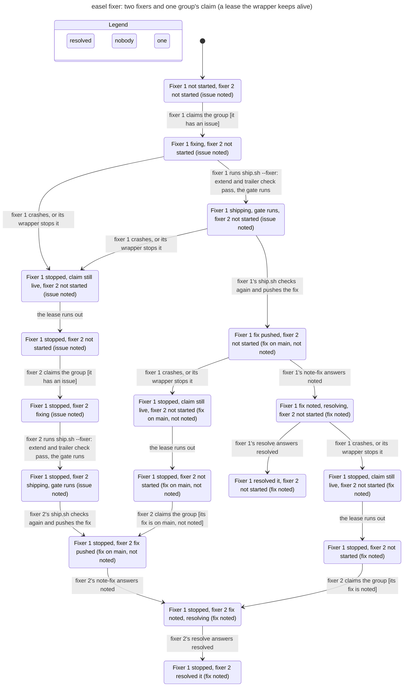

# fixer: two fixers, one group with its issue, its one fix and resolve

The chart shows two fixers started on a group that has its issue. Fixer 1 claims it, ships a fix
with `ship.sh --fixer`, notes it, and resolves the group. `ship.sh --fixer` checks (extend, and the
`Fixes-Error` trailer on main) before its gate, and checks again just before its push; the lease
can run out between the two. The wrapper stops its fixer's whole process group, so a stop takes a
running `ship.sh` with it. If it crashes, or its wrapper stops it,
its lease runs out, and fixer 2 claims the group. Fixer 2 goes on from where fixer 1 stopped: it
fixes, notes the fix it finds by the `Fixes-Error` trailer on main, or resolves the noted fix. It
never ships a second fix. The model is [models/fixer/Claim.tla](models/fixer/Claim.tla) with
[ClaimFix.cfg](models/fixer/ClaimFix.cfg); the fix's build is live at once here, and builds are in
[ops-issues](ops-issues.md). TLC checks every rule below on all 17 of its states, and each one
holds.



| Rule                          | In plain words                                                                                                         | Spec line                                                                                      |
| ----------------------------- | ---------------------------------------------------------------------------------------------------------------------- | ---------------------------------------------------------------------------------------------- |
| `NoClaimOverALiveLease`       | A fixer works only while it holds the live lease: a second fixer gets `held`.                                          | SPEC-fixer.md § A fixer holds a claim, step 1; fact rule 5                                     |
| `OneFixerAtATime`             | Two fixers never work on one group at the same time.                                                                   | SPEC-fixer.md § The tick finds work, step 2; § A fixer holds a claim, steps 2-3; judged rule 2 |
| `FixShipsOnlyUnderClaim`      | A fix ships only from the fixer that holds the group's live claim, also when the lease runs out while `ship.sh` gates. | SPEC-fixer.md § A fixer holds a claim, step 5; fact rule 3; fixer rules 1 and 3                |
| `OneFixPerGroup`              | A group gets one fix, also when its first fixer stopped between its push and its note.                                 | SPEC-fixer.md § A fixer fixes an error, step 1; fixer rules 2, 7 and 8                         |
| `ResolvedOnlyWithItsFixNoted` | A group is resolved only with its fix noted, so the attempt counts.                                                    | SPEC-fixer.md § A fixer fixes an error, step 5; fact rule 6; fixer rule 8                      |
| `NoDeadlock`                  | There is always a next step.                                                                                           | (model)                                                                                        |

## What the model leaves out

- Builds, `notLive` and `failing`: the fix's build is live at once, and the fix holds. A fix that
  does not hold is in [ops-issues](ops-issues.md), where a second fix may ship.
- Time, the extends and the 3-hour cap, as in [fixer-claim-issue](fixer-claim-issue.md).
- Fixer 2 stopping. Only fixer 1 stops; the other order adds only mirror paths.
- A `lost` answer to `note-fix` or `resolve`, and the refusal of `ship.sh --fixer` when a trailer
  commit is not noted. A fixer that holds its lease is never told `lost`, and the next fixer notes
  a trailer commit before it ships, so TLC never takes those branches. With the process-group stop
  on, the re-check before the push never refuses either: it is the second guard.
- The two guards. With one guard off, each was checked by hand with TLC (not a chart row): with the
  process-group stop (`PGID`) off and the re-check (`ReCheck`) on, every rule holds (24 states);
  with `PGID` on and `ReCheck` off, every rule holds (17 states). With both off,
  `FixShipsOnlyUnderClaim` and `OneFixPerGroup` break: the chart
  [fixer-claim-unsafe](fixer-claim-unsafe.md) shows it.
- Atomicity and timing: the re-check and the push are one step. The extend just made gives a fresh
  15-minute lease, and the push takes seconds, so the lease cannot run out between them.
- Fixer 1 always claims first, and the claim is one conditional write: no two-step claim (pick,
  then write) is modelled, as [queue-two-step](queue-two-step.md) does for comments.
- The red gate, the fixer rules of `ship.sh --fixer`, give-up and release
  ([ops-issues](ops-issues.md)).
- The tick that closes the issue after resolve.

## Steps the chart hides

- No steps stay in one chart state.
- The view hides 2 steps: the model's `Done` step, which repeats the end once a fixer resolved the
  group.

## Make it again

```sh
scripts/statecharts.sh fixer-claim-fix          # rewrite this page's mermaid block in place if it differs
scripts/statecharts.sh --check fixer-claim-fix  # change nothing; compare the block and the verdict in charts.tsv
```
