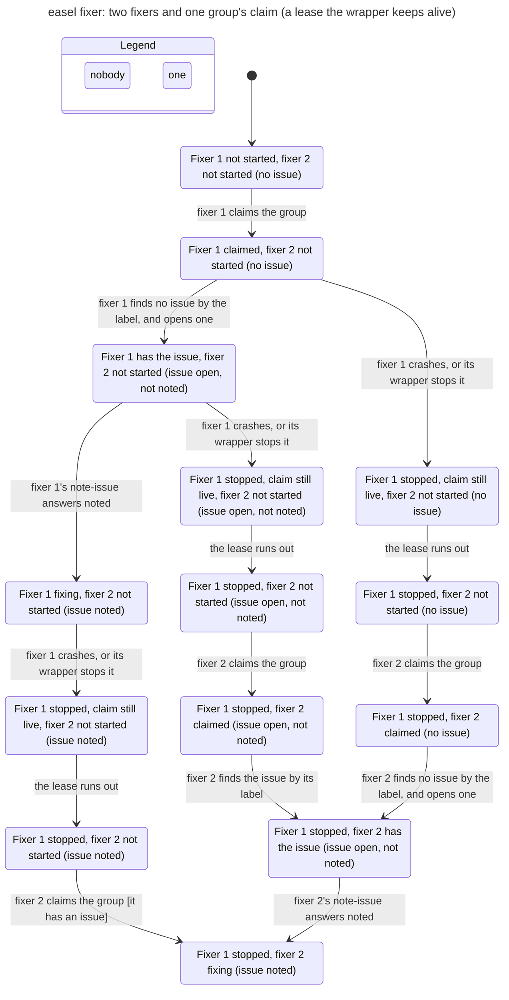

# fixer: two fixers, one new group, its claim and its one issue

The chart shows two fixers started on one new group. Fixer 1 claims it, finds no issue by the
fingerprint label and opens one, then notes it. It can crash, or its wrapper can stop it, at any
point; only then does its lease run out, and fixer 2 claims the group. Fixer 2 finds fixer 1's
issue by its label instead of opening a second one. The chart ends when a fixer is ready to write
its fix; [fixer-claim-fix](fixer-claim-fix.md) goes on from there. The model is
[models/fixer/Claim.tla](models/fixer/Claim.tla) with
[ClaimIssue.cfg](models/fixer/ClaimIssue.cfg), in which `fixer.claim` is one conditional write and
the wrapper stops its fixer before the lease can run out. TLC checks every rule below on all 14 of
its states, and each one holds.



| Rule                    | In plain words                                                                       | Spec line                                                                                      |
| ----------------------- | ------------------------------------------------------------------------------------ | ---------------------------------------------------------------------------------------------- |
| `NoClaimOverALiveLease` | A fixer works only while it holds the live lease: a second fixer gets `held`.        | SPEC-fixer.md § A fixer holds a claim, step 1; fact rule 5                                     |
| `OneFixerAtATime`       | Two fixers never work on one group at the same time.                                 | SPEC-fixer.md § The tick finds work, step 2; § A fixer holds a claim, steps 2-3; judged rule 2 |
| `OneIssuePerGroup`      | A group gets one GitHub issue, also when its first fixer stopped before it noted it. | SPEC-fixer.md § A fixer fixes an error, steps 3 and 10; judged rule 3                          |
| `NoDeadlock`            | There is always a next step.                                                         | (model)                                                                                        |

## What the model leaves out

- Time. A lease is live until its fixer stops; the wrapper's extends every 5 minutes, the 15-minute
  lease and the kill 5 minutes before `until` are what make that true (SPEC-fixer.md § A fixer holds a claim, steps
  2-3; judged rule 2). The 3-hour cap is one more way for the wrapper to stop its fixer.
- Fixer 2 stopping. Only fixer 1 stops; the fixers are alike, so the other order adds only mirror
  paths.
- Fixer 1 always claims first, and the claim is one conditional write: no two-step claim (pick,
  then write) is modelled, as [queue-two-step](queue-two-step.md) does for comments.
- A `lost` answer to `note-issue`. A fixer that holds its lease is never told `lost`, so the model
  has the branch and TLC never takes it.
- The fix, resolve, give-up and release: see [fixer-claim-fix](fixer-claim-fix.md) and
  [ops-issues](ops-issues.md).
- The tick, which starts the fixers, and the GitHub label search as a real query: the model's
  search finds the one issue, if there is one.

## Steps the chart hides

- No steps stay in one chart state.
- The view hides 1 step: the model's `Done` step, which repeats the end once a fixer is ready to
  fix.

## Make it again

```sh
scripts/statecharts.sh fixer-claim-issue          # rewrite this page's mermaid block in place if it differs
scripts/statecharts.sh --check fixer-claim-issue  # change nothing; compare the block and the verdict in charts.tsv
```
