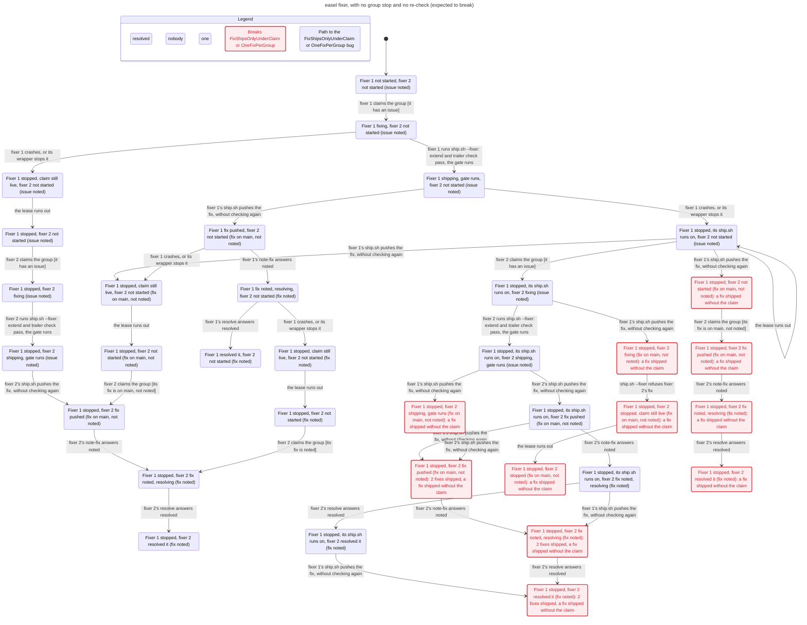

# fixer: a claim with neither guard (expected to break)

Expected to break: this is why the fixer needs one of its two guards. This is a what-if, kept as a
warning. It is the [fixer-claim-fix](fixer-claim-fix.md) model with both guards off: the wrapper
stops only its fixer, not the fixer's process group (`PGID = FALSE`), and `ship.sh --fixer` pushes
after its gate without checking again (`ReCheck = FALSE`). Fixer 1 starts its `ship.sh`, and the
wrapper stops fixer 1 while the gate runs. Its `ship.sh` runs on, the lease runs out, and the
orphaned `ship.sh` pushes a fix that no live claim covers. If fixer 2 claimed the group meanwhile,
the group gets two fixes. The model is [models/fixer/Claim.tla](models/fixer/Claim.tla) with
[ClaimUnsafe.cfg](models/fixer/ClaimUnsafe.cfg). TLC reaches 35 states; the chart draws 34.
`scripts/statecharts.sh` expects this chart to break, and fails if it ever holds. With either guard
on, every rule holds: [fixer-claim-fix](fixer-claim-fix.md#what-the-model-leaves-out) gives the
counts. The answer is SPEC-fixer.md § A fixer holds a claim, step 2 (the process group), with judged
rule 4, and fixer rule 3 (the check again before the push).



| Rule                          | In plain words                                                                                                                                          | Spec line                                                                                      |
| ----------------------------- | ------------------------------------------------------------------------------------------------------------------------------------------------------- | ---------------------------------------------------------------------------------------------- |
| `FixShipsOnlyUnderClaim`      | **Breaks** in 5 steps. Fixer 1 claims, its `ship.sh` checks, the wrapper stops fixer 1 but not its `ship.sh`, the lease runs out, the `ship.sh` pushes. | SPEC-fixer.md § A fixer holds a claim, step 5; fact rule 3; fixer rules 1 and 3                |
| `OneFixPerGroup`              | **Breaks** in 8 steps. As above, but fixer 2 claims the group after the lease runs out and pushes its own fix first; then fixer 1's `ship.sh` pushes.   | SPEC-fixer.md § A fixer fixes an error, step 1; fixer rules 2, 7 and 8                         |
| `NoClaimOverALiveLease`       | Holds.                                                                                                                                                  | SPEC-fixer.md § A fixer holds a claim, step 1; fact rule 5                                     |
| `OneFixerAtATime`             | Holds.                                                                                                                                                  | SPEC-fixer.md § The tick finds work, step 2; § A fixer holds a claim, steps 2-3; judged rule 2 |
| `ResolvedOnlyWithItsFixNoted` | Holds.                                                                                                                                                  | SPEC-fixer.md § A fixer fixes an error, step 5; fact rule 6; fixer rule 8                      |
| `NoDeadlock`                  | Holds.                                                                                                                                                  | (model)                                                                                        |

## What the model leaves out

The same as [fixer-claim-fix](fixer-claim-fix.md#what-the-model-leaves-out), but for the two guards,
which are both off here.

## Steps the chart hides

- No steps stay in one chart state.
- The view hides 5 steps: the model's `Done` step, which repeats the end once a fixer resolved the
  group.
- The full counterexamples are in the generator's output: `tlc-<rule>.out`.

## Make it again

```sh
scripts/statecharts.sh fixer-claim-unsafe          # rewrite this page's mermaid block in place if it differs
scripts/statecharts.sh --check fixer-claim-unsafe  # change nothing; compare the block and the verdict in charts.tsv
```
