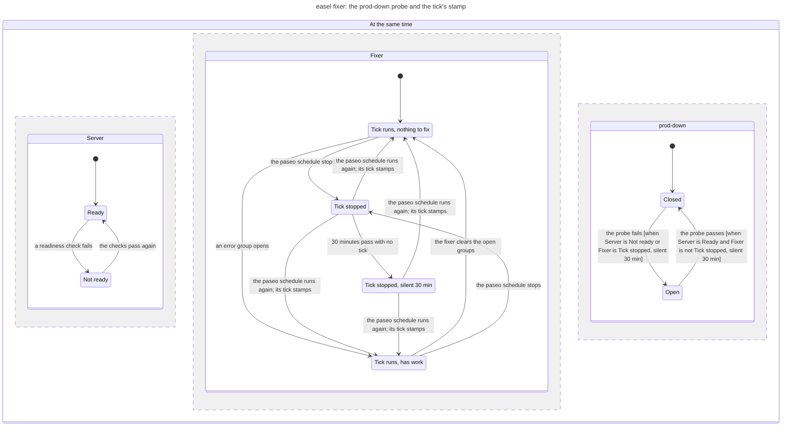

# fixer: the prod-down probe and the tick's stamp

The chart shows three things at once: the server's readiness, the fixer's 5-minute tick, and the
`prod-down` issue that the GitHub Actions probe opens and closes. The tick stamps `fixerSeen` on
every run, work or not, so the fixer is silent only after its schedule stopped for 30 minutes. The
probe opens `prod-down` when `/api/ready` is not 200 or says `fixerSilent`, and closes it when both
are well. The model is [models/fixer/Probe.tla](models/fixer/Probe.tla) with
[Probe.cfg](models/fixer/Probe.cfg). TLC checks every rule below on all 72 of its states, and each
one holds.



| Rule                            | In plain words                                                                                                                                                                                        | Spec line                                                                                                                       |
| ------------------------------- | ----------------------------------------------------------------------------------------------------------------------------------------------------------------------------------------------------- | ------------------------------------------------------------------------------------------------------------------------------- |
| `ProdDownMeansSomethingIsWrong` | `prod-down` is open only when the probe found the server not ready, or the tick's schedule had stopped. A quiet day with no errors opens nothing; it breaks if a tick stamps only when it finds work. | SPEC-fixer.md § Someone watches the watcher, steps 1-3; § Success Criteria; SPEC-ops.md § An agent checks the server, steps 3-4 |
| `NotReadyOpensProdDown`         | When the probe finds the server not ready, `prod-down` is open.                                                                                                                                       | SPEC-fixer.md § Someone watches the watcher, steps 1-2                                                                          |
| `SilentFixerOpensProdDown`      | When the probe finds the fixer silent for 30 minutes, `prod-down` is open.                                                                                                                            | SPEC-fixer.md § Someone watches the watcher, steps 1-3; SPEC-ops.md § An agent checks the server, step 3                        |
| `NoDeadlock`                    | There is always a next step.                                                                                                                                                                          | (model)                                                                                                                         |

## What the model leaves out

- Time as numbers: the 5-minute tick, the 10-minute probe and the 30 minutes are steps. The probe
  runs one at a time (`concurrency`), so it is one step.
- Which check failed. The issue's text names it; the model has one `ready` flag.
- A server restart. ops counts the 30 minutes from the stored `fixerSeen`, and from the start only
  when none is stored (SPEC-ops.md § An agent checks the server, step 3), so a restart neither
  hides a silent fixer nor resets its clock; the model has no restart.
- The `HEALTHCHECK` on `/api/health`, and the off-host backup and its `needs-human` issue
  (SPEC-fixer.md § Someone watches the watcher, step 4; § The data leaves the host).
- What the fixers do with the work: the tick only starts them ([ops-issues](ops-issues.md)).
- The design where a tick stamps only when it finds work: `StampsEveryTick = FALSE` in
  [Probe.tla](models/fixer/Probe.tla). TLC breaks `ProdDownMeansSomethingIsWrong` in 2 steps: a
  quiet day with no errors goes 30 minutes unstamped, and the probe opens `prod-down` while the
  schedule runs. Probe.cfg checks `StampsEveryTick = TRUE`.

## Steps the chart hides

- Steps that stay in one chart state (52): a probe run that leaves `prod-down` as it was and only
  records what it read.
- The view hides no steps.

## Make it again

```sh
scripts/statecharts.sh fixer-probe          # rewrite this page's mermaid block in place if it differs
scripts/statecharts.sh --check fixer-probe  # change nothing; compare the block and the verdict in charts.tsv
```
