# flows: why a put looks at the actions of the screen

This chart breaks on purpose. It is [flows-links](flows-links.md) with a put of a new version that
does not look at the actions of the screen
([LinksUnchecked.cfg](models/flows/LinksUnchecked.cfg), `CheckActions = FALSE`). A put of a with no
`send` then leaves the link `send` whole. The map shows an arrow, `flow check` is clean, and the
person meets a screen where `send` does nothing. So each put finds the state of the links of its
screen again ([SPEC-flows](../../SPEC-flows.md) rule 9). TLC finds `EachLinkShowsItsCause` broken in
1 step.

```mermaid
---
title: "flows: the links of a flow, and the changes that break them"
---
stateDiagram-v2
  state "Legend" as legend {
    lg0: Breaks EachLinkShowsItsCause
    lg1: Path to the EachLinkShowsItsCause or NoBreakWithNoCause bug
  }
  class lg0 breaks
  class lg1 bugPath
  state "The link send of a to b whole" as s0 {
    state "The link next of b to c whole" as s1 {
      state "The screens a has send, c on page 1" as s2 {
        s3: The answer of the last change no broken link
      }
      state "The screens a has no send, c on page 1" as s4 {
        s5: The answer of the last change no broken link
        [*] --> s5
      }
    }
    state "The link next of b to c broken: the screen is on another page" as s6 {
      state "The screens a has send, c on page 2" as s7 {
        s8: The answer of the last change broken: next of b to c
      }
      state "The screens a has no send, c on page 2" as s9 {
        s10: The answer of the last change broken: next of b to c
        [*] --> s10
      }
    }
    state "The link next of b to c broken: the screen is gone" as s11 {
      state "The screens a has send, c is gone" as s12 {
        s13: The answer of the last change broken: next of b to c
        s14: The answer of the last change no broken link
      }
      state "The screens a has no send, c is gone" as s15 {
        s16: The answer of the last change broken: next of b to c
        s17: The answer of the last change no broken link
      }
    }
  }
  state "The link send of a to b broken: no action send" as s18 {
    state "The link next of b to c broken: the screen is on another page" as s19 {
      state "The screens a has no send, c on page 2" as s20 {
        s21: The answer of the last change broken: send of a to b, next of b to c
        s22: The answer of the last change broken: next of b to c
      }
      state "The screens a has send, c on page 2" as s23 {
        s24: The answer of the last change broken: send of a to b, next of b to c
        s25: The answer of the last change broken: next of b to c
      }
    }
    state "The link next of b to c broken: the screen is gone" as s26 {
      state "The screens a has no send, c is gone" as s27 {
        s28: The answer of the last change broken: send of a to b, next of b to c
        s29: The answer of the last change broken: send of a to b
        s30: The answer of the last change no broken link
        s31: The answer of the last change broken: next of b to c
      }
      state "The screens a has send, c is gone" as s32 {
        s33: The answer of the last change broken: send of a to b, next of b to c
        s34: The answer of the last change broken: send of a to b
        s35: The answer of the last change no broken link
        s36: The answer of the last change broken: next of b to c
      }
    }
    state "The link next of b to c whole" as s37 {
      state "The screens a has no send, c on page 1" as s38 {
        s39: The answer of the last change broken: send of a to b
        s40: The answer of the last change no broken link
      }
      state "The screens a has send, c on page 1" as s41 {
        s42: The answer of the last change broken: send of a to b
        s43: The answer of the last change no broken link
      }
    }
  }
  [*] --> s3
  s3 --> s4: a put of a with no action send
  s3 --> s8: a move of c to page 2
  s3 --> s13: a delete of c
  s5 --> s3: a put of a with the action send
  s5 --> s21: a move of c to page 2
  s5 --> s28: a delete of c
  s8 --> s3: a move of c to page 1
  s8 --> s9: a put of a with no action send
  s8 --> s14: a delete of c
  s13 --> s16: a put of a with no action send
  s10 --> s8: a put of a with the action send
  s10 --> s39: a move of c to page 1
  s10 --> s29: a delete of c
  s16 --> s13: a put of a with the action send
  s21 --> s24: a put of a with the action send
  s28 --> s33: a put of a with the action send
  s14 --> s17: a put of a with no action send
  s39 --> s42: a put of a with the action send
  s29 --> s34: a put of a with the action send
  s40 --> s43: a put of a with the action send
  s30 --> s35: a put of a with the action send
  s17 --> s14: a put of a with the action send
  s24 --> s21: a put of a with no action send
  s33 --> s28: a put of a with no action send
  s22 --> s25: a put of a with the action send
  s31 --> s36: a put of a with the action send
  s42 --> s39: a put of a with no action send
  s34 --> s29: a put of a with no action send
  s43 --> s40: a put of a with no action send
  s35 --> s30: a put of a with no action send
  s25 --> s22: a put of a with no action send
  s36 --> s31: a put of a with no action send
  s20 --> s40: a move of c to page 1
  s20 --> s30: a delete of c
  s38 --> s22: a move of c to page 2
  s38 --> s31: a delete of c
  s23 --> s3: a move of c to page 1
  s23 --> s14: a delete of c
  s41 --> s8: a move of c to page 2
  s41 --> s13: a delete of c
  classDef breaks fill:#ffecee,stroke:#e72e3b,stroke-width:2.5px,color:#cd2834
  class s3 bugPath
  class s5 breaks
  class s5 bugPath
  class s10 breaks
  class s16 breaks
  class s17 breaks
  class s21 bugPath
  class s24 breaks
  class s24 bugPath
  class s25 breaks
  class s33 breaks
  class s34 breaks
  class s35 breaks
  class s36 breaks
  class s42 breaks
  class s43 breaks
```

## What the model leaves out

The same as [flows-links](flows-links.md).
