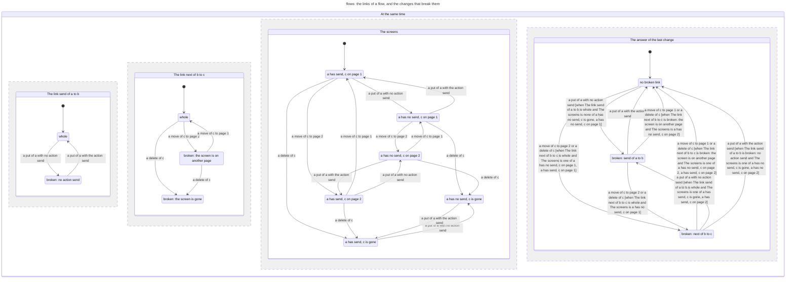

# flows: the links of a flow, and the changes that break them

The chart follows two links of a flow while an agent changes its screens
([SPEC-flows](../../SPEC-flows.md) rules 1 to 11, J6 and J8). The action `send` of screen a leads
to screen b, and the action `next` of b leads to c. The agent puts a version of a with no `send`,
and one with it again; moves c to page 2 and back; and deletes c. After each change, easel finds
the state of each link of the screen and to it again, and the answer names each link that the
change broke. The model is [models/flows/Links.tla](models/flows/Links.tla) with
[Links.cfg](models/flows/Links.cfg) (`CheckActions = TRUE`). TLC checks every rule below on all 14
of its states, and each one holds.

| Rule                    | In plain words                                                                                               | Spec line                              |
| ----------------------- | ------------------------------------------------------------------------------------------------------------ | -------------------------------------- |
| `TypeOK`                | Each value is one that the server can hold.                                                                  | (model)                                |
| `EachLinkShowsItsCause` | Each link is whole, or marked broken with its true cause: the screen is gone, on another page, or no action. | SPEC-flows.md rule 9; fact rule 2 (J8) |
| `EachBreakIsTold`       | The answer of a change names each link that the change broke.                                                | SPEC-flows.md rule 10 (J8)             |
| `NoBreakWithNoCause`    | A link breaks only with a cause: a move on one page, or a version that keeps the action, keeps it whole.     | SPEC-flows.md rule 4 (J6)              |

## What the model leaves out

- A move on one page and a new size: they change no state of a link (rule 4).
- `link.set`, `link.remove` and the flows: they change a link, but break none.
- A delete of a screen with links: its links go with it (rule 9). Here c has no link.
- The map: it draws the state that easel keeps, so a mark is true when the state is true.

## What the chart shows

- A put of a version with no `send` breaks the link `send`, and a put with it mends it.
- A move of c to page 2 breaks `next`; a move back mends it. A delete of c breaks it for good.
- [flows-links-unchecked](flows-links-unchecked.md) shows why a put looks at the actions.
