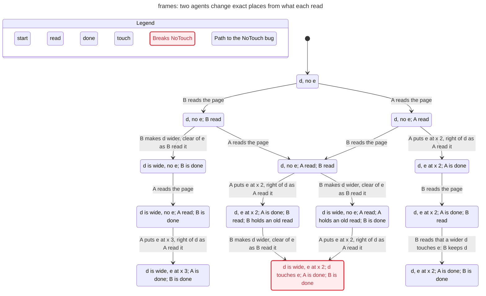

# frames: why a change of an exact place names the revision

This chart breaks on purpose. It is [frames-arrange-rev](frames-arrange-rev.md) with no revision
check ([ArrangeNoRev.cfg](models/frames/ArrangeNoRev.cfg)). Each agent is right about what it read:
A puts e right of d as d was, and B makes d wider while e is not there yet. Together, the two
changes make d touch e. So `frame.put`, `frame.move` and `section.set` take `rev`, and refuse a
change on an old revision (SPEC-arrange.md rule 21, G6). TLC finds `NoTouch` broken in 4 steps.

| Rule                    | In plain words                                           | Verdict |
| ----------------------- | -------------------------------------------------------- | ------- |
| `NoTouch`               | d and e never touch.                                     | breaks  |
| `ARefusalWritesNothing` | A change on an old revision writes nothing.              | holds   |
| `EachChangeAddsOne`     | Each change of a place or a size adds 1 to the revision. | holds   |
