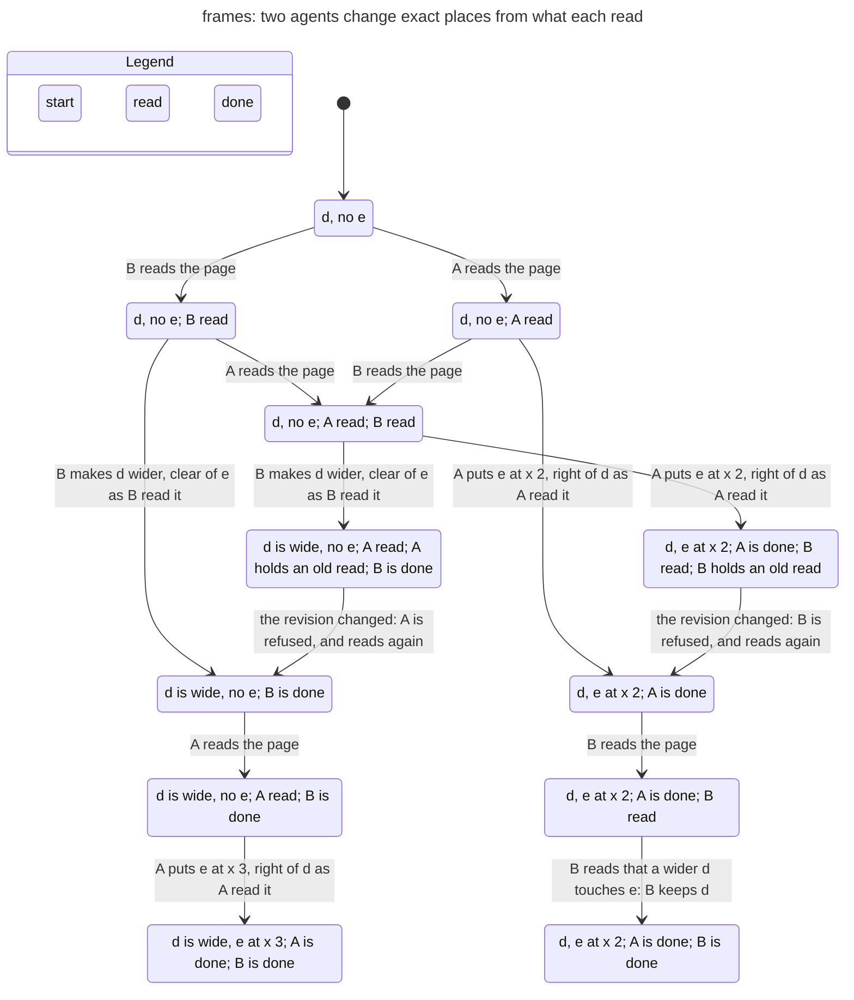

# frames: two agents change exact places, with the revision

Two agents change the exact places of one page, each from what it read (SPEC-arrange.md rules 19 to
22, G6). Agent A puts the frame e right of the frame d, at the right edge of d that A read. Agent B
makes d wider, but only when its read says that the wider d does not touch e. Each change adds 1 to
the revision of the canvas, and a change that names an old revision is refused `changed`: it writes
nothing, and the agent reads again. The model is
[models/frames/ArrangeRev.tla](models/frames/ArrangeRev.tla) with
[ArrangeRev.cfg](models/frames/ArrangeRev.cfg). TLC checks every rule below on all 13 of its
states, and each one holds.

| Rule                    | In plain words                                           | Spec line               |
| ----------------------- | -------------------------------------------------------- | ----------------------- |
| `TypeOK`                | Each value is one that the server can hold.              | (model)                 |
| `NoTouch`               | d and e never touch.                                     | SPEC-arrange.md rule 21 |
| `ARefusalWritesNothing` | A change on an old revision writes nothing.              | SPEC-arrange.md rule 21 |
| `EachChangeAddsOne`     | Each change of a place or a size adds 1 to the revision. | SPEC-arrange.md rule 19 |
| `NoDeadlock`            | There is always a next step.                             | (model)                 |

## What the model leaves out

- The relations: a relation keeps its meaning when another agent changes the page, so it needs no
  revision ([frames-arrange](frames-arrange.md)).
- The answer of each change, which lists what touches (G5).
