# frames: a section that an agent arranges by relation

The chart follows one section of a page, with two frames, a and b, that an agent places by relation
(SPEC-arrange.md rules 1 to 11). `--section` makes a new column at the end of the section,
`--after` makes a new column after the column of a frame, and `--below` puts a frame under another
in its column. easel computes each place: the columns go from left to right with one gap between
them, and the frames of a column go from top to bottom. b can get wider (`easel move --size`). An
exact frame d is at x 4: the section goes below d when it would come closer than the gap to it
(G4). The model is [models/frames/Arrange.tla](models/frames/Arrange.tla) with
[Arrange.cfg](models/frames/Arrange.cfg). TLC checks every rule below on all 24 of its states, and
each one holds.

```mermaid
---
title: "frames: a section that an agent arranges by relation, and an exact frame"
---
stateDiagram-v2
  state "Legend" as legend {
    lg0: empty
    lg1: flow
    lg2: around
  }
  class lg0 tan
  class lg1 blue
  class lg2 teal
  s0: No section
  s1: Section: a
  s2: Section: b
  s3: No section#59; exact frame d
  s4: Section: a over b
  s5: Section: a, then b
  s6: Section: b over a
  s7: Section: b, then a
  s8: Section: b#59; b is wide
  s9: Section: a#59; exact frame d
  s10: Section: b#59; exact frame d
  s11: Section: a over b#59; b is wide
  s12: Section: a, then b#59; b is wide
  s13: Section: b over a#59; b is wide
  s14: Section: b, then a#59; b is wide
  s15: Section: a over b#59; exact frame d
  s16: Section: a, then b#59; exact frame d
  s17: Section: b over a#59; exact frame d
  s18: Section: b, then a#59; exact frame d
  s19: Section: b#59; b is wide#59; exact frame d
  s20: Section: a over b#59; b is wide#59; exact frame d
  s21: Section: a, then b#59; b is wide#59; exact frame d#59; the section goes below d
  s22: Section: b over a#59; b is wide#59; exact frame d
  s23: Section: b, then a#59; b is wide#59; exact frame d#59; the section goes below d
  [*] --> s0
  s0 --> s1: put a --section
  s0 --> s2: put b --section
  s0 --> s3: put d --at 4,0
  s1 --> s0: delete a: no hole stays
  s1 --> s4: put b --below a
  s1 --> s5: put b --after a or put b --section
  s1 --> s9: put d --at 4,0
  s2 --> s0: delete b: no hole stays
  s2 --> s6: put a --below b
  s2 --> s7: put a --after b or put a --section
  s2 --> s8: b gets wider: the columns after it move
  s2 --> s10: put d --at 4,0
  s3 --> s0: delete d
  s3 --> s9: put a --section
  s3 --> s10: put b --section
  s4 --> s1: delete b: no hole stays
  s4 --> s2: delete a: no hole stays
  s4 --> s11: b gets wider: the columns after it move
  s4 --> s15: put d --at 4,0
  s5 --> s1: delete b: no hole stays
  s5 --> s2: delete a: no hole stays
  s5 --> s12: b gets wider: the columns after it move
  s5 --> s16: put d --at 4,0
  s6 --> s1: delete b: no hole stays
  s6 --> s2: delete a: no hole stays
  s6 --> s13: b gets wider: the columns after it move
  s6 --> s17: put d --at 4,0
  s7 --> s1: delete b: no hole stays
  s7 --> s2: delete a: no hole stays
  s7 --> s14: b gets wider: the columns after it move
  s7 --> s18: put d --at 4,0
  s8 --> s0: delete b: no hole stays
  s8 --> s2: b gets narrower
  s8 --> s13: put a --below b
  s8 --> s14: put a --after b or put a --section
  s8 --> s19: put d --at 4,0
  s9 --> s1: delete d
  s9 --> s3: delete a: no hole stays
  s9 --> s15: put b --below a
  s9 --> s16: put b --after a or put b --section
  s10 --> s2: delete d
  s10 --> s3: delete b: no hole stays
  s10 --> s17: put a --below b
  s10 --> s18: put a --after b or put a --section
  s10 --> s19: b gets wider: the columns after it move
  s11 --> s1: delete b: no hole stays
  s11 --> s4: b gets narrower
  s11 --> s8: delete a: no hole stays
  s11 --> s20: put d --at 4,0
  s12 --> s1: delete b: no hole stays
  s12 --> s5: b gets narrower
  s12 --> s8: delete a: no hole stays
  s12 --> s21: put d --at 4,0
  s13 --> s1: delete b: no hole stays
  s13 --> s6: b gets narrower
  s13 --> s8: delete a: no hole stays
  s13 --> s22: put d --at 4,0
  s14 --> s1: delete b: no hole stays
  s14 --> s7: b gets narrower
  s14 --> s8: delete a: no hole stays
  s14 --> s23: put d --at 4,0
  s15 --> s4: delete d
  s15 --> s9: delete b: no hole stays
  s15 --> s10: delete a: no hole stays
  s15 --> s20: b gets wider: the columns after it move
  s16 --> s5: delete d
  s16 --> s9: delete b: no hole stays
  s16 --> s10: delete a: no hole stays
  s16 --> s21: b gets wider: the columns after it move
  s17 --> s6: delete d
  s17 --> s9: delete b: no hole stays
  s17 --> s10: delete a: no hole stays
  s17 --> s22: b gets wider: the columns after it move
  s18 --> s7: delete d
  s18 --> s9: delete b: no hole stays
  s18 --> s10: delete a: no hole stays
  s18 --> s23: b gets wider: the columns after it move
  s19 --> s3: delete b: no hole stays
  s19 --> s8: delete d
  s19 --> s10: b gets narrower
  s19 --> s22: put a --below b
  s19 --> s23: put a --after b or put a --section
  s20 --> s9: delete b: no hole stays
  s20 --> s11: delete d
  s20 --> s15: b gets narrower
  s20 --> s19: delete a: no hole stays
  s21 --> s9: delete b: no hole stays
  s21 --> s12: delete d
  s21 --> s16: b gets narrower
  s21 --> s19: delete a: no hole stays
  s22 --> s9: delete b: no hole stays
  s22 --> s13: delete d
  s22 --> s17: b gets narrower
  s22 --> s19: delete a: no hole stays
  s23 --> s9: delete b: no hole stays
  s23 --> s14: delete d
  s23 --> s18: b gets narrower
  s23 --> s19: delete a: no hole stays
  class s0 tan
  class s1 blue
  class s2 blue
  class s3 tan
  class s4 blue
  class s5 blue
  class s6 blue
  class s7 blue
  class s8 blue
  class s9 blue
  class s10 blue
  class s11 blue
  class s12 blue
  class s13 blue
  class s14 blue
  class s15 blue
  class s16 blue
  class s17 blue
  class s18 blue
  class s19 blue
  class s20 blue
  class s21 teal
  class s22 blue
  class s23 teal
```

| Rule                         | In plain words                                                                     | Spec line                    |
| ---------------------------- | ---------------------------------------------------------------------------------- | ---------------------------- |
| `TypeOK`                     | Each value is one that the server can hold.                                        | (model)                      |
| `NoTouch`                    | No two frames touch: each pair is at least the gap apart on one axis.              | SPEC-arrange.md rules 10, 18 |
| `ColumnsInOrder`             | The columns are in their order, with one gap between two columns: no hole.         | SPEC-arrange.md rules 6, 11  |
| `NoEmptyColumn`              | A delete leaves no empty column.                                                   | SPEC-arrange.md rules 5, 11  |
| `RowsInOrder`                | The frames of a column are in their order, one gap apart.                          | SPEC-arrange.md rule 6       |
| `OnePlace`                   | A frame is at one place of the section only.                                       | SPEC-arrange.md fact rule 1  |
| `ASizeMovesTheColumnsAfter`  | A new width moves each column after the frame by the change of the column's width. | SPEC-arrange.md rule 11 (G2) |
| `OnlyAnAgentChangesTheOrder` | A new size, or an exact frame that comes or goes, never changes the order.         | SPEC-arrange.md fact rule 4  |
| `NoDeadlock`                 | There is always a next step.                                                       | (model)                      |

## What the model leaves out

- More than one section, a wrap, the head of a section, and a section with an exact place (`at`).
  The code computes them with the same steps, and the tests prove them.
- The heights: each frame is 1 high. A taller frame moves the frames below it as a wider one moves
  the columns after it.
- Two agents and the revision: [frames-arrange-rev](frames-arrange-rev.md).
