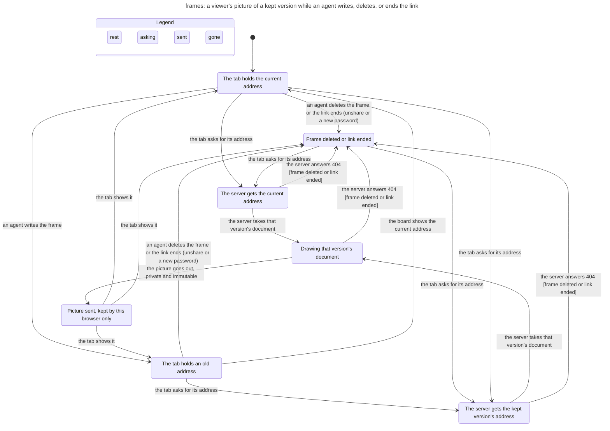

# frames: a viewer's picture of a kept version

The same tab as [frames-pictures](frames-pictures.md), with one request: a viewer asked for a change on version 1, so the server keeps that version (SPEC-frames.md judged rule 16). After an agent writes the frame, the address of version 1 is an old address, but the server does not redirect it: it draws the kept document, as it draws the current one. After an agent deletes the frame, the kept version is still drawn, at the box that the frame had; the current version that no request refers to answers 404. The model is [models/frames/Pictures.tla](models/frames/Pictures.tla) with [PicturesKept.cfg](models/frames/PicturesKept.cfg): `KeptFirst = TRUE`. [Pictures.cfg](models/frames/Pictures.cfg) runs the same model with no request. TLC checks every rule below on all 327 of its states, and each one holds.



| Rule                                         | In plain words                                                                                                | Spec line                                                                    |
| -------------------------------------------- | ------------------------------------------------------------------------------------------------------------- | ---------------------------------------------------------------------------- |
| `TypeOK`                                     | Each value is one the tab, the browser or the server can hold.                                                | (model)                                                                      |
| `APictureShowsTheVersionItsAddressNames`     | A picture sent for an address is the drawing of the version that address names, the kept one too.             | SPEC-frames.md, judged rule 7                                                |
| `AKeptPictureShowsTheVersionItsAddressNames` | A copy the browser keeps for a year shows the version its address names.                                      | SPEC-frames.md § Contract, Pictures                                          |
| `AnOldAddressIsRedirectedNotDrawn`           | The server draws only the version the address names.                                                          | SPEC-frames.md § Contract, Pictures, judged rule 7                           |
| `AKeptVersionIsDrawnNotRedirected`           | The address of a version that a request refers to is drawn, never redirected, also after a write.             | SPEC-frames.md § Contract, Pictures (a kept version), judged rule 16         |
| `ADeletedFramesPictureIsSentOnlyIfKept`      | After a delete, the server sends a picture only of a kept version; the other versions answer 404.             | SPEC-frames.md § Contract, Pictures (a deleted frame), judged rules 7, 8, 16 |
| `AnEndedViewerSeesNoNewerPicture`            | After the link ends, the viewer sees no version newer than the one it could see then, and no kept one either. | SPEC-frames.md § Contract, Pictures (the key generation), judged rule 7      |
| `NoDeadlock`                                 | There is always a next step.                                                                                  | (model)                                                                      |

## What the model leaves out

- The request itself: here it is there from the start, on version 1. The queue's triggers keep the
  version when a put replaces it or a delete removes its frame ([request-life](request-life.md),
  SPEC-queue.md judged rule 16).
- A kept version past version 1, and two requests on two versions.
- The box: a kept version is drawn at the frame's box, or at the last box of a removed frame.
- All that [frames-pictures](frames-pictures.md) leaves out.

## Where the code is

- `readPicture` in [src/frames/store.server.ts](../../src/frames/store.server.ts) takes the
  document of the current or the kept version, and the box, in one statement; `findPicture` in
  [src/frames/pictures.server.ts](../../src/frames/pictures.server.ts) draws it, or redirects an
  old version that is not kept. `readStill` checks again after the draw that the frame or the
  kept version is there.
- The board carries the key of each kept version in the cell `kept`, and the name and box of a
  removed frame in the cell `removed`: `saveFrame`, `dropFrame`, `bumpKeys` and the load set
  them. [tests/pictures.test.ts](../../tests/pictures.test.ts) § Kept versions names each test by
  its rule.

## Steps the chart hides

- The same steps as [frames-pictures](frames-pictures.md).

## Make it again

```sh
scripts/statecharts.sh frames-pictures-kept          # rewrite this page's mermaid block in place if it differs
scripts/statecharts.sh --check frames-pictures-kept  # change nothing; compare the block and the verdict in charts.tsv
```
