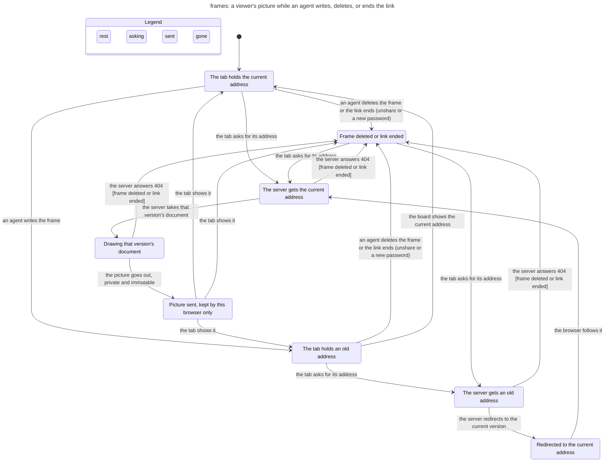

# frames: a viewer's picture while an agent writes, deletes, or ends the link

The chart shows one viewer's tab asking for a frame's picture while an agent writes the frame, deletes it, or the link ends. A picture's address names its version and carries a key made with the canvas's key generation, which goes up when the link ends or its password is set or changed. The server takes that version and its document in one read, draws it, and checks the frame and the key again before it sends. An older version's address answers a redirect to the current one, never a picture; a deleted frame or a key from before the link ended answers 404, also when that happens during the draw. Here no request refers to a version; [frames-pictures-kept](frames-pictures-kept.md) runs the same model with a kept version. A picture goes out `private` and `immutable`, so only the browser that asked keeps it. The model is [models/frames/Pictures.tla](models/frames/Pictures.tla) with [Pictures.cfg](models/frames/Pictures.cfg). TLC checks every rule below on all 291 of its states, and each one holds.



| Rule                                         | In plain words                                                                                                             | Spec line                                                               |
| -------------------------------------------- | -------------------------------------------------------------------------------------------------------------------------- | ----------------------------------------------------------------------- |
| `TypeOK`                                     | Each value is one the tab, the browser or the server can hold.                                                             | (model)                                                                 |
| `APictureShowsTheVersionItsAddressNames`     | A picture sent for an address is the drawing of the version that address names.                                            | SPEC-frames.md, judged rule 7                                           |
| `AKeptPictureShowsTheVersionItsAddressNames` | A copy the browser keeps for a year shows the version its address names, so keeping it is never wrong.                     | SPEC-frames.md § Contract, Pictures (the current version)               |
| `AnOldAddressIsRedirectedNotDrawn`           | The server draws only the version the address names; an old version that is not kept gets a redirect.                      | SPEC-frames.md § Contract, Pictures (an older version), judged rule 7   |
| `AKeptVersionIsDrawnNotRedirected`           | A version that a request refers to is drawn, never redirected. Here no version is kept: see frames-pictures-kept.          | SPEC-frames.md § Contract, Pictures (a kept version), judged rule 16    |
| `ADeletedFramesPictureIsSentOnlyIfKept`      | The server never sends a picture of a deleted frame, also when the delete lands during the draw, but of a kept version.    | SPEC-frames.md § Contract, Pictures (a deleted frame), judged rules 7-8 |
| `AnEndedViewerSeesNoNewerPicture`            | After the link ends, the viewer sees no version newer than the one it could see then: its keys stop working with its pass. | SPEC-frames.md § Contract, Pictures (the key generation), judged rule 7 |
| `NoDeadlock`                                 | There is always a next step.                                                                                               | (model)                                                                 |

## What the model leaves out

- Scales, regions and the size limits; a scale outside the four answers 400.
- The draw slots, the 5 s wait, the 20 s draw limit and the 503 answer, and `easel shot`'s retries.
- What a drawn document may load.
- Kept versions: an old version that a request refers to is drawn as the current one is, from its kept document (SPEC-frames.md judged rule 16). This config has no request (`KeptFirst = FALSE`), so every old version is not kept. [frames-pictures-kept](frames-pictures-kept.md) checks the same rules with a kept version (`KeptFirst = TRUE`).
- The two-read design: `OneRead = FALSE` in [Pictures.tla](models/frames/Pictures.tla) reads the version, then the document in a second read, and lets an agent's write land between them. TLC breaks `AnOldAddressIsRedirectedNotDrawn` in 4 steps and both picture rules in 5: the server draws version 2 for version 1's address. Pictures.cfg checks the one-read design, `OneRead = TRUE`. That the code takes both in one read stays a judged rule.
- The HMAC itself and its constant-time compare: a wrong key is the same 404 as a key from before the link ended.
- Versions past 2, more than one tab, and more than one request at a time.
- A copy a browser kept before a delete: it is that browser's own, and no shared cache holds one, since every answer is `private`.
- How the board gets to the tab: [viewer-canvas](viewer-canvas.md). How a link ends: [frames-share](frames-share.md).

## Where the code is

- The route is `pictureRoute` in [src/frames/pictures.server.ts](../../src/frames/pictures.server.ts): `findPicture` checks the key and the version (404, 307), and `drawPicture` draws and checks again (400, 503, 404). The one read is `readPicture`, and the check after the draw is `readStill`, both in [src/frames/store.server.ts](../../src/frames/store.server.ts). [tests/pictures.test.ts](../../tests/pictures.test.ts) names each test by the arrow or rule it follows.
- "the link ends" is `bumpKeys` in store.server.ts: it raises the canvas's key generation and writes the board's keys again. Its tests in tests/pictures.test.ts reach it directly. Its callers, `easel unshare` and a password set or changed, are wired in ship 5.

## Steps the chart hides

- "the tab is opened again in a browser with no copy kept": it acts as the first browser did before it kept any.
- "the end": the frame is deleted, the link has ended, and no request is out.
- Following a redirect to an address this browser already keeps: it ends where "the tab shows it" ends.
- A write while a request is out: the request's own arrows show what a newer version does.
- Steps that stay in one chart state are not drawn: the tab showing its own kept copy.

## Make it again

```sh
scripts/statecharts.sh frames-pictures          # rewrite this page's mermaid block in place if it differs
scripts/statecharts.sh --check frames-pictures  # change nothing; compare the block and the verdict in charts.tsv
```
