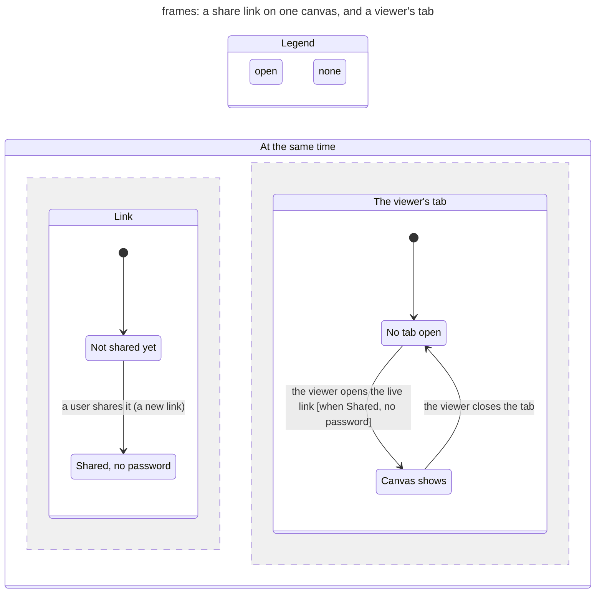

# frames: share without a password (the first slice)

The same share link as [frames-share](frames-share.md), as the first slice builds it: a canvas is
shared with no password, and nothing ends a link yet. `easel share <canvas>` makes the link, or
prints the one the canvas has. `share.open` gives a tab a pass for the live link. Passwords,
`easel unshare` and `easel canvas rm` come later, and each brings its rules into reach.

The model is [models/frames/Share.tla](models/frames/Share.tla) with
[ShareOpen.cfg](models/frames/ShareOpen.cfg): `Passwords = {"none"}` and `Unsharing = FALSE`.
[Share.cfg](models/frames/Share.cfg) runs the same model with passwords and unshare. TLC checks
every rule below on all 4 states of this slice, and each one holds. A rule that no step of the
slice reaches holds with nothing to check: its plain words say what brings it into reach.



| Rule                                            | In plain words                                                                                                                                                                       | Spec line                                                                 |
| ----------------------------------------------- | ------------------------------------------------------------------------------------------------------------------------------------------------------------------------------------ | ------------------------------------------------------------------------- |
| `TypeOK`                                        | Each value is one the link, the tab or the server can hold.                                                                                                                          | (model)                                                                   |
| `ATabShowsTheCanvasOnlyWhileItsLinkIsLive`      | A tab shows the canvas only while its link is live.                                                                                                                                  | SPEC-frames.md § Journeys, Share a canvas, step 4, and judged rule 13     |
| `ATabShowsTheCanvasOnlyUnderTheCurrentPassword` | Unreached until passwords: with no password, every pass is under the current one.                                                                                                    | SPEC-frames.md § Journeys, Share a canvas, step 3, and judged rules 12-13 |
| `SharingAgainKeepsTheLink`                      | Unreached until passwords: sharing a shared canvas again changes nothing here, so it is no step. tests/share.test.ts and tests/share-cli.test.ts check that it prints the same link. | SPEC-frames.md § Journeys, Share a canvas, step 3, and judged rule 12     |
| `AnEndedLinkStaysEnded`                         | Unreached until `easel unshare` or `easel canvas rm`: no link ends in this slice.                                                                                                    | SPEC-frames.md § Journeys, Share a canvas, step 5, and judged rule 12     |
| `SlowEvenWithTheRightPassword`                  | Unreached until passwords: a link with no password never asks one, so it never says to wait.                                                                                         | SPEC-frames.md § Journeys, Open a share link, step 2, and judged rule 14  |
| `NoMoreThan5WrongTriesAMinute`                  | Unreached until passwords: no try is wrong.                                                                                                                                          | SPEC-frames.md § Journeys, Open a share link, step 2, and judged rule 14  |
| `AnotherAddressCannotLockTheViewerOut`          | Unreached until passwords: no try is wrong, so no address waits.                                                                                                                     | SPEC-frames.md § Journeys, Open a share link, step 2, and judged rule 14  |
| `NoDeadlock`                                    | There is always a next step.                                                                                                                                                         | (model)                                                                   |

## What the model leaves out

- Everything [frames-share](frames-share.md) leaves out.
- A `password` field: `canvas.share` and `share.open` take none yet, and either call with one is
  `invalid` (SPEC-frames.md § Inputs). `easel share --password` is bad usage, 64.
- The pass after a restart: it is kept as its digest in SQLite, so it reads its canvas again
  (decision C8). The model has no restart; tests/share.test.ts checks it.
- The flood limit and the cap on passes (SPEC-frames § Inputs, judged rule 14). Past 30 opens a
  minute from one address, any link, `share.open` answers `slow` with `retryIn`. This `slow` is
  not the wrong-password lockout the model's rules speak of. A link keeps its 1000 newest passes,
  and an open past that ends the oldest. tests/share.test.ts checks both.

## Steps the chart hides

- Sharing a shared canvas: it keeps the link, so it stays in one chart state.

## Make it again

```sh
scripts/statecharts.sh frames-share-open          # rewrite this page's mermaid block in place if it differs
scripts/statecharts.sh --check frames-share-open  # change nothing; compare the block and the verdict in charts.tsv
```
