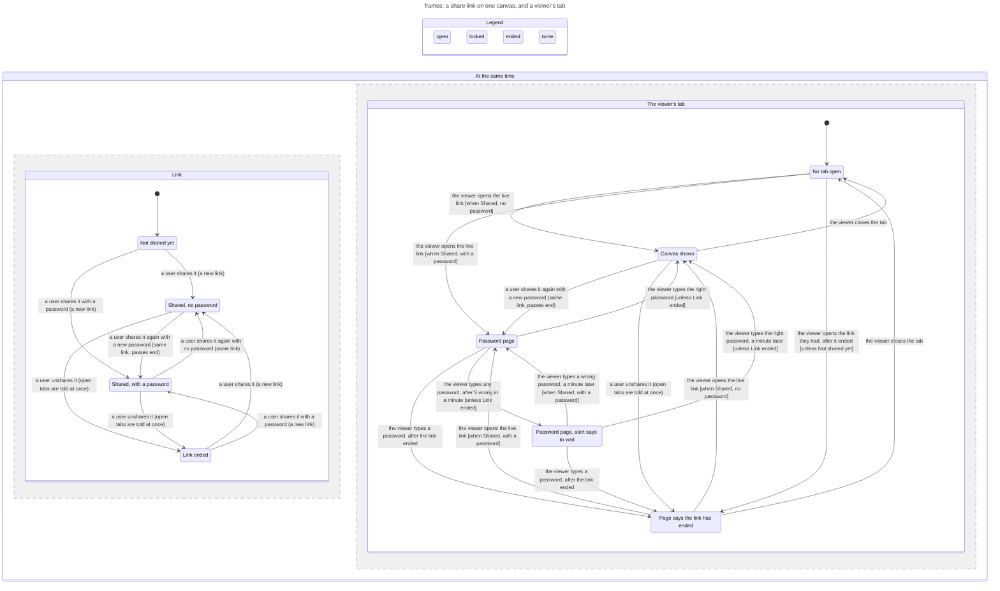

# frames: a share link on one canvas, and a viewer's tab

The chart shows a share link on one canvas, next to one viewer's tab on it. Sharing a shared canvas keeps its link: setting or changing the password ends every pass, and an open tab goes back to the password page at once; removing it ends none. Unshare ends the link, and an open tab shows at once that it has ended. Sharing after that makes a new link, and the old one stays ended. Opening a password link with no password always shows the password page. Password tries count per address and link: within a minute, tries 1 to 5 that are wrong answer `wrong`, and any try after 5 wrong ones answers `slow`, even the right password. Tries from another address do not count. The model is [models/frames/Share.tla](models/frames/Share.tla) with [Share.cfg](models/frames/Share.cfg). TLC checks every rule below on all 429 of its states, and each one holds.



| Rule                                            | In plain words                                                                                                    | Spec line                                                                 |
| ----------------------------------------------- | ----------------------------------------------------------------------------------------------------------------- | ------------------------------------------------------------------------- |
| `TypeOK`                                        | Each value is one the link, the tab or the server can hold.                                                       | (model)                                                                   |
| `ATabShowsTheCanvasOnlyWhileItsLinkIsLive`      | A tab shows the canvas only while its link is live; unshare closes it at once.                                    | SPEC-frames.md § Journeys, Share a canvas, step 4, and judged rule 13     |
| `ATabShowsTheCanvasOnlyUnderTheCurrentPassword` | A tab shows the canvas only under the link's current password, so a new password ends every pass given before it. | SPEC-frames.md § Journeys, Share a canvas, step 3, and judged rules 12-13 |
| `SharingAgainKeepsTheLink`                      | Sharing a shared canvas keeps its link.                                                                           | SPEC-frames.md § Journeys, Share a canvas, step 3, and judged rule 12     |
| `AnEndedLinkStaysEnded`                         | An ended link never comes back; sharing again makes a new one.                                                    | SPEC-frames.md § Journeys, Share a canvas, step 5, and judged rule 12     |
| `SlowEvenWithTheRightPassword`                  | While the page says to wait, even the right password does not open the canvas. By construction (judged in code).  | SPEC-frames.md § Journeys, Open a share link, step 2, and judged rule 14  |
| `NoMoreThan5WrongTriesAMinute`                  | No address gets more wrong tries in a minute than the limit.                                                      | SPEC-frames.md § Journeys, Open a share link, step 2, and judged rule 14  |
| `AnotherAddressCannotLockTheViewerOut`          | Wrong tries from another address never make the viewer wait. By construction (judged in code).                    | SPEC-frames.md § Journeys, Open a share link, step 2, and judged rule 14  |
| `NoDeadlock`                                    | There is always a next step.                                                                                      | (model)                                                                   |

## What the model leaves out

- Time, except as "a minute passes": the limit is 2 wrong tries in the model, 5 in the spec.
- `SlowEvenWithTheRightPassword` and `AnotherAddressCannotLockTheViewerOut` hold by construction: the model checks the slowed count before the password, and counts per address. No variant of the model breaks them, so the code is judged against them.
- The name, which the page asks first: [viewer-gate](viewer-gate.md).
- How a password, a link and a pass are kept and compared, and what is never logged.
- `easel canvas rm`, which ends the link as unshare does.
- Many tabs and many viewers: each acts as this one does.
- More than two links: the model stops there.
- The board read and its `mayRead` guard, and `comment.add`.

## Steps the chart hides

- "another address guesses wrong 5 times": it changes nothing the viewer sees, which is the rule.
- "a minute passes": it stays in one chart state.
- "the viewer closes the tab" from a password page: it leads where closing the canvas leads.
- "the model stops", after the last link the model makes. It is the bound, not the product.
- Steps that stay in one chart state are not drawn: sharing again with the same password or none, and a wrong try 1 to 5 in a minute (it answers `wrong`; the `alert` shows on "Password page").

## Make it again

```sh
scripts/statecharts.sh frames-share          # rewrite this page's mermaid block in place if it differs
scripts/statecharts.sh --check frames-share  # change nothing; compare the block and the verdict in charts.tsv
```
