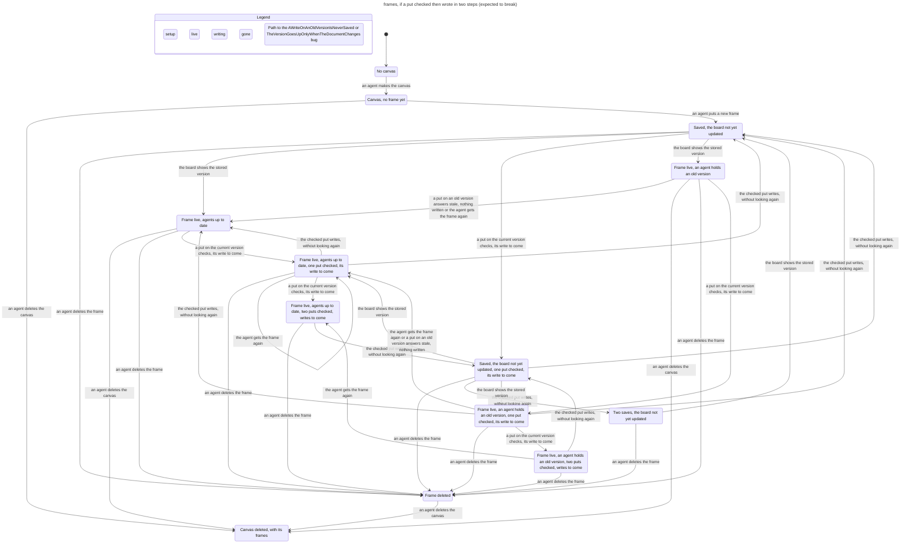

# frames: a put in two steps (expected to break)

Expected to break: this is why a put on an id is one conditional write. This is a what-if, kept as a warning. It is the [frames-writes](frames-writes.md) model with `OneWrite = FALSE`: a put reads the row and checks the base and the document, awaits, then writes without looking again. Two agents that put on the same version both pass the check, and both write: the second write lands on a version its writer never read, and the first agent's document is lost. The model is [models/frames/Writes.tla](models/frames/Writes.tla) with [WritesTwoStep.cfg](models/frames/WritesTwoStep.cfg). TLC reaches 483 states; the chart draws the 13 chart states. `scripts/statecharts.sh` expects this chart to break, and fails if it ever holds. SPEC-frames.md § Journeys, Make and change frames, step 4 (F1), and its judged rules 1-4 are the answer.



| Rule                                         | In plain words                                                                                                                                 | Spec line                                                                         |
| -------------------------------------------- | ---------------------------------------------------------------------------------------------------------------------------------------------- | --------------------------------------------------------------------------------- |
| `AWriteOnAnOldVersionIsNeverSaved`           | **Breaks.** Both agents check version 1, then both write: the second write saves on version 2, which its writer never read.                    | SPEC-frames.md § Journeys, Make and change frames, step 4, and judged rule 2      |
| `TheVersionGoesUpOnlyWhenTheDocumentChanges` | **Breaks.** Both agents write the same document: the second write raises the version and changes nothing, where one write answers `unchanged`. | SPEC-frames.md § Journeys, Make and change frames, step 5, and judged rule 3      |
| `TypeOK`                                     | Holds.                                                                                                                                         | (model)                                                                           |
| `ARefusalWritesNothing`                      | Holds.                                                                                                                                         | SPEC-frames.md, judged rule 1                                                     |
| `EachDocumentChangeRaisesTheVersionByOne`    | Holds.                                                                                                                                         | SPEC-frames.md, judged rule 3                                                     |
| `APutOnAnIdNeverMakesAFrame`                 | Holds.                                                                                                                                         | SPEC-frames.md § Journeys, Make and change frames, step 6, and § Contract, Inputs |
| `TheBoardNeverShowsAVersionNotStored`        | Holds.                                                                                                                                         | SPEC-frames.md, judged rule 4                                                     |
| `TheBoardNeverGoesBack`                      | Holds.                                                                                                                                         | SPEC-frames.md, judged rule 4                                                     |
| `AtRestTheBoardShowsTheStoredVersion`        | Holds.                                                                                                                                         | SPEC-frames.md, judged rule 4                                                     |
| `ADeletedFrameIsOffTheBoard`                 | Holds.                                                                                                                                         | SPEC-frames.md, judged rule 4                                                     |
| `ADeletedCanvasHasNoFrames`                  | Holds.                                                                                                                                         | SPEC-frames.md § Journeys, Make a canvas, step 4                                  |
| `ADeletedFrameStaysDeleted`                  | Holds.                                                                                                                                         | SPEC-frames.md § Journeys, Make and change frames, step 8, and § Contract         |
| `NoDeadlock`                                 | Holds.                                                                                                                                         | (model)                                                                           |

## What the model leaves out

The same as [frames-writes](frames-writes.md#what-the-model-leaves-out). The await between the check and the write is one step of any length: anything may happen while it lasts. A checked write that finds the frame deleted answers `gone`.

## Steps the chart hides

- The steps [frames-writes](frames-writes.md#steps-the-chart-hides) hides.
- The full counterexamples are in the generator's output: `tlc-<rule>.out`.

## Make it again

```sh
scripts/statecharts.sh frames-writes-two-step          # rewrite this page's mermaid block in place if it differs
scripts/statecharts.sh --check frames-writes-two-step  # change nothing; compare the block and the verdict in charts.tsv
```
