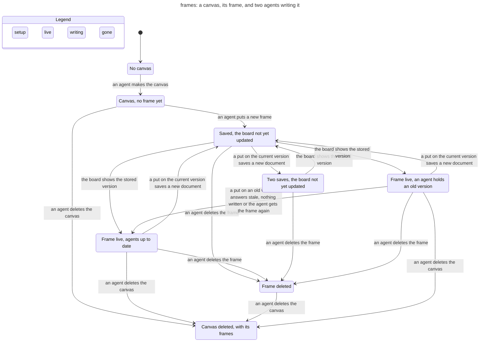

# frames: two agents write one frame

The chart shows one canvas and one frame from the moment an agent makes the canvas until it is deleted, while two agents get the frame and put it again. A put on an id is one conditional write: it saves only on the version the agent read, and only when the document changed. A put on an older version answers `stale` and writes nothing; the same document answers `unchanged` and the version stays. The row is saved first, and the board's cell is set after, from the row as it is stored then. The model is [models/frames/Writes.tla](models/frames/Writes.tla) with [Writes.cfg](models/frames/Writes.cfg), which sets `OneWrite = TRUE`. [frames-writes-two-step](frames-writes-two-step.md) is the same model with the put in two steps, and it breaks. TLC checks every rule below on all 251 of its states, and each one holds.



| Rule                                         | In plain words                                                                                                                                                                                                          | Spec line                                                                         |
| -------------------------------------------- | ----------------------------------------------------------------------------------------------------------------------------------------------------------------------------------------------------------------------- | --------------------------------------------------------------------------------- |
| `TypeOK`                                     | Each value is one the store, the board or an agent can hold.                                                                                                                                                            | (model)                                                                           |
| `AWriteOnAnOldVersionIsNeverSaved`           | A save lands only on the version its writer read, so of two puts on one version the second answers `stale` and no write is lost. Breaks with the put in two steps: [frames-writes-two-step](frames-writes-two-step.md). | SPEC-frames.md § Journeys, Make and change frames, step 4, and judged rule 2      |
| `ARefusalWritesNothing`                      | A `stale`, `gone` or `unchanged` answer changes no row and no cell.                                                                                                                                                     | SPEC-frames.md, judged rule 1                                                     |
| `EachDocumentChangeRaisesTheVersionByOne`    | Each change of the document raises the version by one.                                                                                                                                                                  | SPEC-frames.md, judged rule 3                                                     |
| `TheVersionGoesUpOnlyWhenTheDocumentChanges` | The same document answers `unchanged`, and the version stays.                                                                                                                                                           | SPEC-frames.md § Journeys, Make and change frames, step 5, and judged rule 3      |
| `APutOnAnIdNeverMakesAFrame`                 | A put on an id that is not there answers `gone`; only a put without an id makes a frame.                                                                                                                                | SPEC-frames.md § Journeys, Make and change frames, step 6, and § Contract, Inputs |
| `TheBoardNeverShowsAVersionNotStored`        | The board shows no version the store does not hold.                                                                                                                                                                     | SPEC-frames.md, judged rule 4                                                     |
| `TheBoardNeverGoesBack`                      | While the frame lives, the board never goes back to an older version.                                                                                                                                                   | SPEC-frames.md, judged rule 4                                                     |
| `AtRestTheBoardShowsTheStoredVersion`        | When no write is in flight, the board shows the stored version.                                                                                                                                                         | SPEC-frames.md, judged rule 4                                                     |
| `ADeletedFrameIsOffTheBoard`                 | A delete drops the row and the cell together.                                                                                                                                                                           | SPEC-frames.md, judged rule 4                                                     |
| `ADeletedCanvasHasNoFrames`                  | A deleted canvas keeps no frames.                                                                                                                                                                                       | SPEC-frames.md § Journeys, Make a canvas, step 4                                  |
| `ADeletedFrameStaysDeleted`                  | A deleted frame never comes back; a later put answers `gone`.                                                                                                                                                           | SPEC-frames.md § Journeys, Make and change frames, step 8, and § Contract         |
| `NoDeadlock`                                 | There is always a next step.                                                                                                                                                                                            | (model)                                                                           |

## What the model leaves out

- More than one frame and more than two agents: each frame acts the same, and two agents are enough for a race.
- Versions past 3, and documents other than two: the model stops writing there.
- `mv` and `--size`, which change the box and not the version; names; comments.
- The `taken`, `tooBig` and `invalid` answers, and the CLI's exit codes. A second `easel canvas new` answers `taken` and changes nothing, so it is no step.
- `easel canvas rm` waits in the model until no cell set and no checked write is pending, so the delete never lands between a save and its cell set. In the code the delete may land there; the cell set then finds the frame deleted and leaves it off the board, as the model draws after `easel rm`.
- A row write that throws: the spec says the cell is then unchanged, which the model does not draw.
- Pictures: [frames-pictures](frames-pictures.md). Share links: [frames-share](frames-share.md).

## Steps the chart hides

- "the end": the canvas is gone and the model stops. It is the bound, not the product.
- Steps that stay in one chart state are not drawn: a put of the same document (`unchanged`, nothing changes), a put that answers `gone` on "Frame deleted", a `stale` put or a get that leaves an agent still behind, and an agent's get when it is already up to date.
- A put that answers `gone` after a canvas delete is folded into "an agent deletes the canvas".

## Make it again

```sh
scripts/statecharts.sh frames-writes          # rewrite this page's mermaid block in place if it differs
scripts/statecharts.sh --check frames-writes  # change nothing; compare the block and the verdict in charts.tsv
```
