# kit: why the page posts close before it removes an app frame

The same model as [kit-app-frame](kit-app-frame.md), with `Close = "none"` ([AppFrameNoClose.cfg](models/kit/AppFrameNoClose.cfg)): the page removes the iframe at once, with no `close`. In an iframe that is removed, the async `scope.close()` does not end, so the app's deferred ends never run (a watch that crosses the port stays open on the other side, a last write is not sent). `TheEndsRunBeforeTheIframeGoes` breaks in 2 steps: the frame goes live, then it leaves the view. This is why the page posts `close` and waits for `closed` (at most 200 ms) first.

```mermaid
---
title: "kit: an app frame goes live, gets a new look, closes, and goes"
---
stateDiagram-v2
  state "Legend" as legend {
    lg0: first
    lg1: live
    lg2: gone
    lg3: lost
    lg4: Breaks TheEndsRunBeforeTheIframeGoes
    lg5: Path to the TheEndsRunBeforeTheIframeGoes bug
  }
  class lg0 tan
  class lg1 blue
  class lg2 teal
  class lg3 orange
  class lg4 breaks
  class lg5 bugPath
  s0: No iframe yet (the first look)#59; the page does not listen yet
  s1: No iframe yet (the first look)
  s2: No iframe yet (a new look)#59; the page does not listen yet
  s3: The app is live, with no port yet, it shows the look (the first look)#59; the page does not listen yet
  s4: No iframe yet (a new look)
  s5: The app is live, with no port yet, it shows the look (the first look)#59; it runs a long loop#59; the page does not listen yet
  s6: The iframe is gone, and the app's ends did not run (the first look)#59; the page does not listen yet
  s7: The app is live, with no port yet, it shows the look (the first look)
  s8: The app is live, with a port, it shows the look (the first look)
  s9: The app is live, with no port yet, it shows an older look (a new look)#59; the page does not listen yet
  s10: The app is live, with no port yet, it shows the look (a new look)#59; the page does not listen yet
  s11: The iframe is gone after the wait: the app did not answer (the first look)#59; it runs a long loop#59; the page does not listen yet
  s12: The app is live, with no port yet, it shows the look (the first look)#59; it runs a long loop
  s13: The app is live, with a port, it shows the look (the first look)#59; it runs a long loop
  s14: The iframe is gone, and the app's ends did not run (the first look)
  s15: The app is live, with no port yet, it shows an older look (a new look)#59; it runs a long loop#59; the page does not listen yet
  s16: The iframe is gone, and the app's ends did not run (a new look)#59; the page does not listen yet
  s17: The app is live, with no port yet, it shows an older look (a new look)
  s18: The app is live, with no port yet, it shows the look (a new look)#59; it runs a long loop#59; the page does not listen yet
  s19: The app is live, with no port yet, it shows the look (a new look)
  s20: The app is live, with a port, it shows the look (a new look)
  s21: The iframe is gone after the wait: the app did not answer (the first look)#59; it runs a long loop
  s22: The iframe is gone after the wait: the app did not answer (a new look)#59; it runs a long loop#59; the page does not listen yet
  s23: The app is live, with no port yet, it shows an older look (a new look)#59; it runs a long loop
  s24: The iframe is gone, and the app's ends did not run (a new look)
  s25: The app is live, with no port yet, it shows the look (a new look)#59; it runs a long loop
  s26: The app is live, with a port, it shows the look (a new look)#59; it runs a long loop
  s27: The iframe is gone after the wait: the app did not answer (a new look)#59; it runs a long loop
  [*] --> s0
  s0 --> s1: the page listens for hellos
  s0 --> s2: a user changes the look#59; the page sends it on the port
  s0 --> s3: the frame goes live: its app mounts and says hello
  s1 --> s4: a user changes the look#59; the page sends it on the port
  s1 --> s8: the frame goes live: its app mounts and says hello
  s2 --> s4: the page listens for hellos
  s2 --> s10: the frame goes live: its app mounts and says hello
  s3 --> s5: the app starts a long loop
  s3 --> s6: the frame leaves the view: the page removes the iframe at once, with no close
  s3 --> s7: the page listens for hellos
  s3 --> s9: a user changes the look#59; the page sends it on the port
  s4 --> s20: the frame goes live: its app mounts and says hello
  s5 --> s3: the loop ends
  s5 --> s11: the frame leaves the view: the page removes the iframe at once, with no close
  s5 --> s12: the page listens for hellos
  s5 --> s15: a user changes the look#59; the page sends it on the port
  s6 --> s14: the page listens for hellos
  s6 --> s16: a user changes the look#59; the page sends it on the port
  s7 --> s8: the app says hello again (50 ms)#59; the page gives it a port and the kit
  s7 --> s12: the app starts a long loop
  s7 --> s14: the frame leaves the view: the page removes the iframe at once, with no close
  s7 --> s17: a user changes the look#59; the page sends it on the port
  s8 --> s13: the app starts a long loop
  s8 --> s14: the frame leaves the view: the page removes the iframe at once, with no close
  s8 --> s20: a user changes the look#59; the page sends it on the port
  s9 --> s15: the app starts a long loop
  s9 --> s16: the frame leaves the view: the page removes the iframe at once, with no close
  s9 --> s17: the page listens for hellos
  s10 --> s18: the app starts a long loop
  s10 --> s16: the frame leaves the view: the page removes the iframe at once, with no close
  s10 --> s19: the page listens for hellos
  s11 --> s21: the page listens for hellos
  s11 --> s22: a user changes the look#59; the page sends it on the port
  s12 --> s7: the loop ends
  s12 --> s21: the frame leaves the view: the page removes the iframe at once, with no close
  s12 --> s23: a user changes the look#59; the page sends it on the port
  s13 --> s8: the loop ends
  s13 --> s21: the frame leaves the view: the page removes the iframe at once, with no close
  s13 --> s26: a user changes the look#59; the page sends it on the port
  s14 --> s24: a user changes the look#59; the page sends it on the port
  s15 --> s9: the loop ends
  s15 --> s22: the frame leaves the view: the page removes the iframe at once, with no close
  s15 --> s23: the page listens for hellos
  s16 --> s24: the page listens for hellos
  s17 --> s20: the app says hello again (50 ms)#59; the page gives it a port and the kit
  s17 --> s23: the app starts a long loop
  s17 --> s24: the frame leaves the view: the page removes the iframe at once, with no close
  s18 --> s10: the loop ends
  s18 --> s22: the frame leaves the view: the page removes the iframe at once, with no close
  s18 --> s25: the page listens for hellos
  s19 --> s20: the app says hello again (50 ms)#59; the page gives it a port and the kit
  s19 --> s25: the app starts a long loop
  s19 --> s24: the frame leaves the view: the page removes the iframe at once, with no close
  s20 --> s26: the app starts a long loop
  s20 --> s24: the frame leaves the view: the page removes the iframe at once, with no close
  s21 --> s27: a user changes the look#59; the page sends it on the port
  s22 --> s27: the page listens for hellos
  s23 --> s17: the loop ends
  s23 --> s27: the frame leaves the view: the page removes the iframe at once, with no close
  s25 --> s19: the loop ends
  s25 --> s27: the frame leaves the view: the page removes the iframe at once, with no close
  s26 --> s20: the loop ends
  s26 --> s27: the frame leaves the view: the page removes the iframe at once, with no close
  classDef breaks fill:#ffecee,stroke:#e72e3b,stroke-width:2.5px,color:#cd2834
  class s0 tan
  class s0 bugPath
  class s1 tan
  class s2 tan
  class s3 blue
  class s3 bugPath
  class s4 tan
  class s5 blue
  class s6 orange
  class s6 breaks
  class s6 bugPath
  class s7 blue
  class s8 blue
  class s9 blue
  class s10 blue
  class s11 teal
  class s12 blue
  class s13 blue
  class s14 orange
  class s14 breaks
  class s15 blue
  class s16 orange
  class s16 breaks
  class s17 blue
  class s18 blue
  class s19 blue
  class s20 blue
  class s21 teal
  class s22 teal
  class s23 blue
  class s24 orange
  class s24 breaks
  class s25 blue
  class s26 blue
  class s27 teal
```

| Rule                             | In plain words                                                                                     | Spec line                         |
| -------------------------------- | -------------------------------------------------------------------------------------------------- | --------------------------------- |
| `TheEndsRunBeforeTheIframeGoes`  | Breaks: the iframe goes while the app is mounted and could answer, so its deferred ends never run. | SPEC-kit.md § App frames          |
| `NoWorkIsLeftOnThePort`          | Holds: the page still ends its own work on the port. The work of the app itself is what is lost.   | SPEC-viewer.md judged rule 13     |
| The other rules of kit-app-frame | Hold.                                                                                              | [kit-app-frame](kit-app-frame.md) |

## What the model leaves out

The same as [kit-app-frame](kit-app-frame.md).
