# kit: an app frame goes live, gets a new look, closes, and goes

The chart shows one app frame in one tab (SPEC-kit.md § App frames). The frame goes live: the page makes its iframe, and its app starts its own Tinker scope, mounts its `View`, and says hello at once and again each 50 ms until the page gives it a port and the current kit. A new look goes on that port, with no reload (K7). When the page removes the frame (it leaves the view at rest, an agent deletes it, or a new version replaces it), the page posts `close`. The app runs `scope.close()`, so each deferred end runs, and posts `closed`. Then the page removes the iframe and ends its own work on the port. An app that runs a long loop cannot answer: after 200 ms the page removes the iframe all the same. The model is [models/kit/AppFrame.tla](models/kit/AppFrame.tla) with [AppFrame.cfg](models/kit/AppFrame.cfg) (`Close = "post"`, `MaxKit = 2`). TLC checks every rule below on all 95 of its states, and each one holds. The chart draws 40 of them.

```mermaid
---
title: "kit: an app frame goes live, gets a new look, closes, and goes"
---
stateDiagram-v2
  state "Legend" as legend {
    lg0: first
    lg1: live
    lg2: closing
    lg3: gone
  }
  class lg0 tan
  class lg1 blue
  class lg2 yellow
  class lg3 teal
  s0: No iframe yet (the first look)#59; the page does not listen yet
  s1: No iframe yet (the first look)
  s2: No iframe yet (a new look)#59; the page does not listen yet
  s3: The app is live, with no port yet, it shows the look (the first look)#59; the page does not listen yet
  s4: No iframe yet (a new look)
  s5: The page posted close and waits (200 ms at most) (the first look)#59; the page does not listen yet
  s6: The app is live, with no port yet, it shows the look (the first look)#59; it runs a long loop#59; the page does not listen yet
  s7: The app is live, with no port yet, it shows the look (the first look)
  s8: The app is live, with a port, it shows the look (the first look)
  s9: The app is live, with no port yet, it shows an older look (a new look)#59; the page does not listen yet
  s10: The app is live, with no port yet, it shows the look (a new look)#59; the page does not listen yet
  s11: The app closed and posted closed (the first look)#59; the page does not listen yet
  s12: The page posted close and waits (200 ms at most) (the first look)#59; it runs a long loop#59; the page does not listen yet
  s13: The page posted close and waits (200 ms at most) (the first look)
  s14: The app is live, with no port yet, it shows the look (the first look)#59; it runs a long loop
  s15: The app is live, with a port, it shows the look (the first look)#59; it runs a long loop
  s16: The page posted close and waits (200 ms at most) (a new look)#59; the page does not listen yet
  s17: The app is live, with no port yet, it shows an older look (a new look)#59; it runs a long loop#59; the page does not listen yet
  s18: The app is live, with no port yet, it shows an older look (a new look)
  s19: The app is live, with no port yet, it shows the look (a new look)#59; it runs a long loop#59; the page does not listen yet
  s20: The app is live, with no port yet, it shows the look (a new look)
  s21: The app is live, with a port, it shows the look (a new look)
  s22: The iframe is gone, after the app closed (the first look)#59; the page does not listen yet
  s23: The iframe is gone after the wait: the app did not answer (the first look)#59; it runs a long loop#59; the page does not listen yet
  s24: The app closed and posted closed (the first look)
  s25: The page posted close and waits (200 ms at most) (the first look)#59; it runs a long loop
  s26: The app closed and posted closed (a new look)#59; the page does not listen yet
  s27: The page posted close and waits (200 ms at most) (a new look)#59; it runs a long loop#59; the page does not listen yet
  s28: The page posted close and waits (200 ms at most) (a new look)
  s29: The app is live, with no port yet, it shows an older look (a new look)#59; it runs a long loop
  s30: The app is live, with no port yet, it shows the look (a new look)#59; it runs a long loop
  s31: The app is live, with a port, it shows the look (a new look)#59; it runs a long loop
  s32: The iframe is gone, after the app closed (the first look)
  s33: The iframe is gone after the wait: the app did not answer (the first look)#59; it runs a long loop
  s34: The iframe is gone, after the app closed (a new look)#59; the page does not listen yet
  s35: The iframe is gone after the wait: the app did not answer (a new look)#59; it runs a long loop#59; the page does not listen yet
  s36: The app closed and posted closed (a new look)
  s37: The page posted close and waits (200 ms at most) (a new look)#59; it runs a long loop
  s38: The iframe is gone, after the app closed (a new look)
  s39: The iframe is gone after the wait: the app did not answer (a new look)#59; it runs a long loop
  [*] --> s0
  s0 --> s1: the page listens for hellos
  s0 --> s2: a user changes the look#59; the page sends it on the port
  s0 --> s3: the frame goes live: its app mounts and says hello
  s1 --> s4: a user changes the look#59; the page sends it on the port
  s1 --> s8: the frame goes live: its app mounts and says hello
  s2 --> s4: the page listens for hellos
  s2 --> s10: the frame goes live: its app mounts and says hello
  s3 --> s5: the frame leaves the view, is deleted or replaced: the page posts close
  s3 --> s6: the app starts a long loop
  s3 --> s7: the page listens for hellos
  s3 --> s9: a user changes the look#59; the page sends it on the port
  s4 --> s21: the frame goes live: its app mounts and says hello
  s5 --> s11: the app gets close: scope.close() runs its ends
  s5 --> s12: the app starts a long loop
  s5 --> s13: the page listens for hellos
  s5 --> s16: a user changes the look#59; the page sends it on the port
  s6 --> s12: the frame leaves the view, is deleted or replaced: the page posts close
  s6 --> s3: the loop ends
  s6 --> s14: the page listens for hellos
  s6 --> s17: a user changes the look#59; the page sends it on the port
  s7 --> s8: the app says hello again (50 ms)#59; the page gives it a port and the kit
  s7 --> s13: the frame leaves the view, is deleted or replaced: the page posts close
  s7 --> s14: the app starts a long loop
  s7 --> s18: a user changes the look#59; the page sends it on the port
  s8 --> s13: the frame leaves the view, is deleted or replaced: the page posts close
  s8 --> s15: the app starts a long loop
  s8 --> s21: a user changes the look#59; the page sends it on the port
  s9 --> s16: the frame leaves the view, is deleted or replaced: the page posts close
  s9 --> s17: the app starts a long loop
  s9 --> s18: the page listens for hellos
  s10 --> s16: the frame leaves the view, is deleted or replaced: the page posts close
  s10 --> s19: the app starts a long loop
  s10 --> s20: the page listens for hellos
  s11 --> s22: the page gets closed and removes the iframe
  s11 --> s24: the page listens for hellos
  s11 --> s26: a user changes the look#59; the page sends it on the port
  s12 --> s5: the loop ends
  s12 --> s23: 200 ms with no closed: the page removes the iframe
  s12 --> s25: the page listens for hellos
  s12 --> s27: a user changes the look#59; the page sends it on the port
  s13 --> s24: the app gets close: scope.close() runs its ends
  s13 --> s25: the app starts a long loop
  s13 --> s28: a user changes the look#59; the page sends it on the port
  s14 --> s25: the frame leaves the view, is deleted or replaced: the page posts close
  s14 --> s7: the loop ends
  s14 --> s29: a user changes the look#59; the page sends it on the port
  s15 --> s25: the frame leaves the view, is deleted or replaced: the page posts close
  s15 --> s8: the loop ends
  s15 --> s31: a user changes the look#59; the page sends it on the port
  s16 --> s26: the app gets close: scope.close() runs its ends
  s16 --> s27: the app starts a long loop
  s16 --> s28: the page listens for hellos
  s17 --> s27: the frame leaves the view, is deleted or replaced: the page posts close
  s17 --> s9: the loop ends
  s17 --> s29: the page listens for hellos
  s18 --> s21: the app says hello again (50 ms)#59; the page gives it a port and the kit
  s18 --> s28: the frame leaves the view, is deleted or replaced: the page posts close
  s18 --> s29: the app starts a long loop
  s19 --> s27: the frame leaves the view, is deleted or replaced: the page posts close
  s19 --> s10: the loop ends
  s19 --> s30: the page listens for hellos
  s20 --> s21: the app says hello again (50 ms)#59; the page gives it a port and the kit
  s20 --> s28: the frame leaves the view, is deleted or replaced: the page posts close
  s20 --> s30: the app starts a long loop
  s21 --> s28: the frame leaves the view, is deleted or replaced: the page posts close
  s21 --> s31: the app starts a long loop
  s22 --> s32: the page listens for hellos
  s22 --> s34: a user changes the look#59; the page sends it on the port
  s23 --> s33: the page listens for hellos
  s23 --> s35: a user changes the look#59; the page sends it on the port
  s24 --> s32: the page gets closed and removes the iframe
  s24 --> s36: a user changes the look#59; the page sends it on the port
  s25 --> s13: the loop ends
  s25 --> s33: 200 ms with no closed: the page removes the iframe
  s25 --> s37: a user changes the look#59; the page sends it on the port
  s26 --> s34: the page gets closed and removes the iframe
  s26 --> s36: the page listens for hellos
  s27 --> s16: the loop ends
  s27 --> s35: 200 ms with no closed: the page removes the iframe
  s27 --> s37: the page listens for hellos
  s28 --> s36: the app gets close: scope.close() runs its ends
  s28 --> s37: the app starts a long loop
  s29 --> s37: the frame leaves the view, is deleted or replaced: the page posts close
  s29 --> s18: the loop ends
  s30 --> s37: the frame leaves the view, is deleted or replaced: the page posts close
  s30 --> s20: the loop ends
  s31 --> s37: the frame leaves the view, is deleted or replaced: the page posts close
  s31 --> s21: the loop ends
  s32 --> s38: a user changes the look#59; the page sends it on the port
  s33 --> s39: a user changes the look#59; the page sends it on the port
  s34 --> s38: the page listens for hellos
  s35 --> s39: the page listens for hellos
  s36 --> s38: the page gets closed and removes the iframe
  s37 --> s28: the loop ends
  s37 --> s39: 200 ms with no closed: the page removes the iframe
  class s0 tan
  class s1 tan
  class s2 tan
  class s3 blue
  class s4 tan
  class s5 yellow
  class s6 blue
  class s7 blue
  class s8 blue
  class s9 blue
  class s10 blue
  class s11 yellow
  class s12 yellow
  class s13 yellow
  class s14 blue
  class s15 blue
  class s16 yellow
  class s17 blue
  class s18 blue
  class s19 blue
  class s20 blue
  class s21 blue
  class s22 teal
  class s23 teal
  class s24 yellow
  class s25 yellow
  class s26 yellow
  class s27 yellow
  class s28 yellow
  class s29 blue
  class s30 blue
  class s31 blue
  class s32 teal
  class s33 teal
  class s34 teal
  class s35 teal
  class s36 yellow
  class s37 yellow
  class s38 teal
  class s39 teal
```

| Rule                              | In plain words                                                                                                                     | Spec line                                                                |
| --------------------------------- | ---------------------------------------------------------------------------------------------------------------------------------- | ------------------------------------------------------------------------ |
| `TypeOK`                          | Each value is one that the page or the app can hold.                                                                               | (model)                                                                  |
| `TheEndsRunBeforeTheIframeGoes`   | The iframe goes only after the app's scope closed and its deferred ends ran, or, when the app is busy, after the 200 ms wait.      | SPEC-kit.md § App frames, "Close before the iframe goes"; judged rule 17 |
| `NoWorkIsLeftOnThePort`           | When the iframe goes, the page has no work left on its port: it sends no kit there, and it ends each subscription that crosses it. | SPEC-kit.md § App frames; SPEC-viewer.md judged rule 13                  |
| `AnAppClosesOnlyWhenAsked`        | An app closes its scope only after the page posted `close`.                                                                        | SPEC-kit.md § App frames                                                 |
| `ACloseEnds`                      | The page never waits for `closed` forever: each close ends with the iframe removed.                                                | SPEC-kit.md § App frames (200 ms at most)                                |
| `AnAppShowsOnlyAStoredKitVersion` | An app shows only a kit version that is stored.                                                                                    | SPEC-kit.md § compose (K7)                                               |
| `ALiveAppShowsTheNewLook`         | Each live app comes to show the newest kit version with no reload, also one that started before the page listened.                 | SPEC-kit.md § compose; SPEC-viewer.md judged rule 12 (K7)                |
| `NoDeadlock`                      | There is always a next step.                                                                                                       | (model)                                                                  |

## What the model leaves out

- More than one frame, and the 12 live frames of a tab: each frame acts as the one here.
- A new version of the frame: the page removes the old iframe with this life, and the new iframe starts it again.
- The board worker (build order item 7): it is not built yet. When a frame's `logic` runs there, the worker also ends the frame's watches when the page closes the frame's port.
- How fast: the model says that the page waits for `closed`, not that 200 ms passed. A browser test measures the time.
- An app that answers `closed` after the page removed the iframe: no window is left to post it, so it changes nothing.
- The hello of a window that is not one of the page's own live iframes: the page does not answer it (SPEC-viewer judged rule 12).
