# kit: a docked column of controls is open only while its frame is in use

The chart shows one column of controls, docked at the left or the right edge of an app frame (SPEC-kit.md § The capsules, "The place of a control"; the user's report of 2026-11-24 on the canvas `capsule-frames`). A column lies over the frame beside it, so it is open only while its frame is in use, as Figma shows the tools of a frame on selection. The frame is in use while the pointer is on the frame or on the column, the shown focus is on a control of the column, the frame has the mark of Find, or a press on the tab opened the column. Out of use, the column folds to a small tab at that edge of the frame. When the pointer leaves, the column stays open for 300 ms, so a move out and back does not fold it. A touch screen has no pointer that hovers: a tap on the tab opens the column, and a tap out of it folds it. The model is [models/kit/ControlFold.tla](models/kit/ControlFold.tla) with [ControlFold.cfg](models/kit/ControlFold.cfg).

```mermaid
---
title: "kit: a docked column of controls is open only while its frame is in use"
---
stateDiagram-v2
  state "Legend" as legend {
    lg0: folded
    lg1: open
    lg2: delay
  }
  class lg0 tan
  class lg1 teal
  class lg2 yellow
  s0: Mouse: folded to its tab
  s1: Touch: folded to its tab
  s2: Mouse: open, a press on the tab
  s3: Touch: open, a press on the tab
  s4: Mouse: open, the mark of Find
  s5: Touch: open, the mark of Find
  s6: Mouse: open, the pointer is on the column
  s7: Mouse: open, the pointer is on the frame
  s8: Mouse: open, the focus is on a control
  s9: Touch: open, the focus is on a control
  s10: Mouse: open, the delay after the pointer left
  [*] --> s0
  [*] --> s1
  s0 --> s2: a press on the tab
  s0 --> s4: Find marks the frame
  s0 --> s6: the pointer comes onto the column
  s0 --> s7: the pointer comes onto the frame
  s1 --> s3: a press on the tab
  s1 --> s5: Find marks the frame
  s2 --> s0: a press out of the column or a second press on the tab or the focus leaves or the delay ends
  s2 --> s8: the focus comes onto a control
  s2 --> s6: the pointer comes onto the column
  s2 --> s7: the pointer comes onto the frame
  s3 --> s1: a press out of the column or a second press on the tab or the focus leaves
  s3 --> s9: the focus comes onto a control
  s4 --> s0: the mark ends
  s4 --> s8: the focus comes onto a control
  s4 --> s2: a press on the tab
  s4 --> s6: the pointer comes onto the column
  s4 --> s7: the pointer comes onto the frame
  s5 --> s1: the mark ends
  s5 --> s9: the focus comes onto a control
  s5 --> s3: a press on the tab
  s6 --> s7: the pointer comes onto the frame
  s6 --> s10: the pointer leaves: the delay starts
  s7 --> s6: the pointer comes onto the column
  s7 --> s10: the pointer leaves: the delay starts
  s8 --> s0: the focus leaves or a press out of the column or the focus comes onto the tab
  s8 --> s2: the focus comes onto the tab or the focus leaves
  s8 --> s6: the pointer comes onto the column
  s8 --> s7: the pointer comes onto the frame
  s9 --> s1: the focus leaves or a press out of the column or the focus comes onto the tab
  s9 --> s3: the focus comes onto the tab
  s10 --> s0: the delay ends
  s10 --> s6: the pointer comes onto the column
  s10 --> s7: the pointer comes onto the frame
  s10 --> s8: the focus comes onto a control
  s10 --> s2: a press on the tab
  s10 --> s4: Find marks the frame
  s8 --> s4: the focus leaves or a press out of the column or the focus comes onto the tab
  s9 --> s5: the focus leaves or a press out of the column or the focus comes onto the tab
  s2 --> s4: a press out of the column or a second press on the tab or the focus leaves or the delay ends
  s3 --> s5: a press out of the column or a second press on the tab or the focus leaves
  s6 --> s8: the pointer leaves: the delay starts
  s6 --> s2: the pointer leaves: the delay starts
  s6 --> s4: the pointer leaves: the delay starts
  s7 --> s8: the pointer leaves: the delay starts
  s7 --> s2: the pointer leaves: the delay starts
  s7 --> s4: the pointer leaves: the delay starts
  s8 --> s10: the focus leaves or a press out of the column or the focus comes onto the tab
  s2 --> s10: a press out of the column or a second press on the tab
  s4 --> s10: the mark ends
  class s0 tan
  class s1 tan
  class s2 teal
  class s3 teal
  class s4 teal
  class s5 teal
  class s6 teal
  class s7 teal
  class s8 teal
  class s9 teal
  class s10 yellow
```

## The rules

- **OpenOnlyInUse**: the column is open only while its frame is in use, or for the delay after the pointer left.
- **OutOfUseItFolds**: out of use, the column folds. It never stays open over the frame beside it.
- **OnePressOnTheTabOpens**: from the tab, one press (a click, Enter, Space or a tap) opens a folded column.
- **AControlCanBePressed**: a control of the open column can always be pressed: with the pointer on it, after a tap, or with the focus on it.
- **FromTheFrameToTheColumnItStaysOpen**: a move of the pointer from the frame to the column does not fold it. The column's box touches the frame: its 8 px edge is part of it.

## What the model leaves out

- The values and the runs of the controls: [kit-frame-controls](kit-frame-controls.md). A folded column keeps its controls and its panes; it only hides them.
- The controls of the place `top` and `panel`: they do not fold.
- The other column of the same frame: the pointer and the mark open both; the focus and a press open one.
- The focus that the browser does not show (`:focus-visible`), such as after a click on a button: it does not keep the column open.
