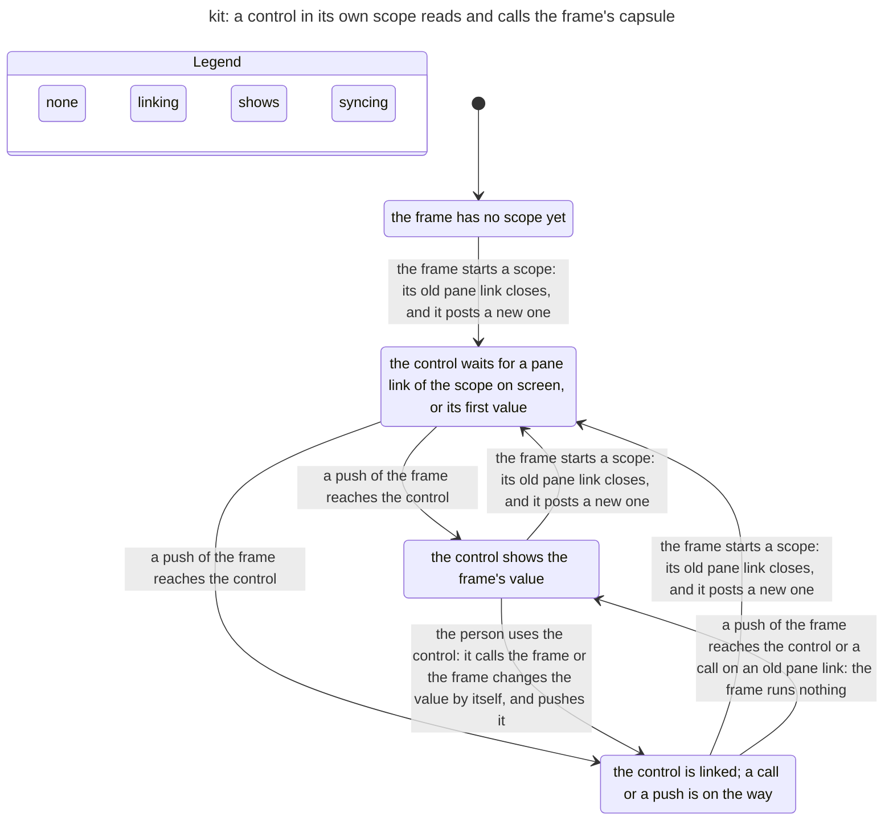

# kit: a control in its own scope reads and calls the frame's capsule

The chart shows one app frame and one control of it, each in its own iframe and its own scope (SPEC-kit.md § The capsules, "A control in its own scope"). The frame shares a part of its capsule: its cells as `remoteData` and its operations as `rpc`. After each start of a scope, the frame makes a new pane link: it serves one end in that scope, and it posts the other end to the page. The page keeps the newest end until the control is there, then gives it to the control. The page reads nothing on the pane link. The control makes a new scope on each pane link. Its cells are a mirror of the frame's cells, and it can change the frame only with a call that the frame runs. A new look draws the frame in a new scope, and the pane link of the old scope closes, so a message on it is lost. The model is [models/kit/ControlLink.tla](models/kit/ControlLink.tla) with [ControlLink.cfg](models/kit/ControlLink.cfg).

## The rules

- **TheMirrorIsOfTheLinkedScope**: the control shows only values of the scope that its pane link reaches.
- **WhenQuietTheControlShowsTheValue**: with nothing on the way, a control linked to the scope on screen shows the frame's value.
- **AClosedScopeKeepsItsValue**: the cell of a closed scope never changes, so a call on an old pane link runs nothing.
- **TheControlComesToTheScopeOnScreen**: after the frame starts a scope, the control comes to be linked to it.
- **TheControlComesToShowTheValue**: a control that shows another value than the frame comes to show it.
