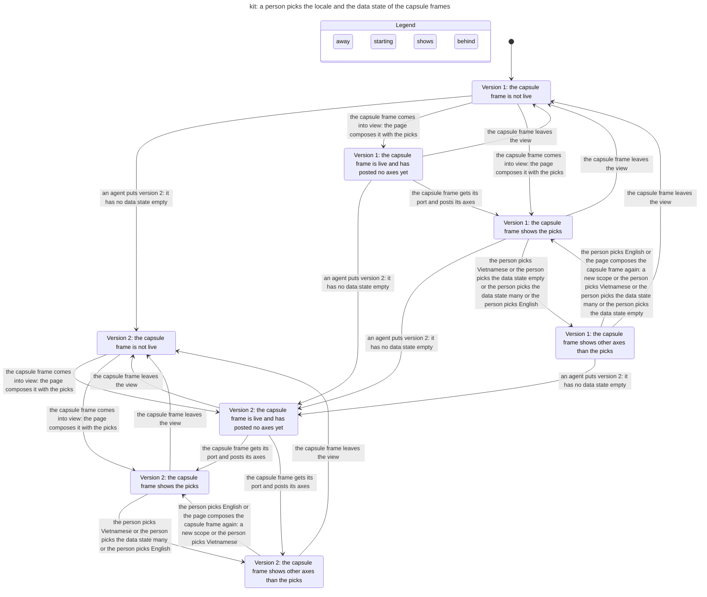

# kit: a person picks the locale and the data state of the capsule frames

The chart shows the capsule frames of one canvas in one tab (SPEC-kit.md § The capsules, "The axes in the viewer"). A capsule frame tells the page what it can show: when it gets its port, it posts its axes, the locales and the values of its capsule's config. The locale is one pick for the canvas, and the data state is a pick for each frame. The page composes a frame with the picks only after that frame version posted its axes, and only with the values that it posted. A pick that differs from the live document gives a new document, so the frame draws in a new scope. A frame that posts no axes is never composed again for a pick. A new version can drop a data state: a pick of it falls back to the frame's default. The model is [models/kit/FrameAxes.tla](models/kit/FrameAxes.tla) with [FrameAxes.cfg](models/kit/FrameAxes.cfg).

## Rules

- **APlainFrameIgnoresThePicks:** a frame that posts no axes is never composed again for a pick, so a pick does not reload it.
- **ADocumentShowsOnlyOfferedValues:** a document shows only a data state that its version posted.
- **APickIsAValueOfTheVersion:** the pick of a data state is always one that the current version has, or none.
- **ALiveFrameComesToShowThePicks:** a live frame whose document differs from the picks comes to show them, unless it leaves the view first.

## What the model leaves out

- The close of the old document before the new one goes. That is the chart [kit-app-frame](kit-app-frame.md), and the page does not do it yet (SPEC-kit § The capsules, "The axes in the viewer").
- The picture of a frame that is not live. It shows the frame's default axes.
- More than two locales, more than one config key, and other tabs: each tab keeps its own picks.
