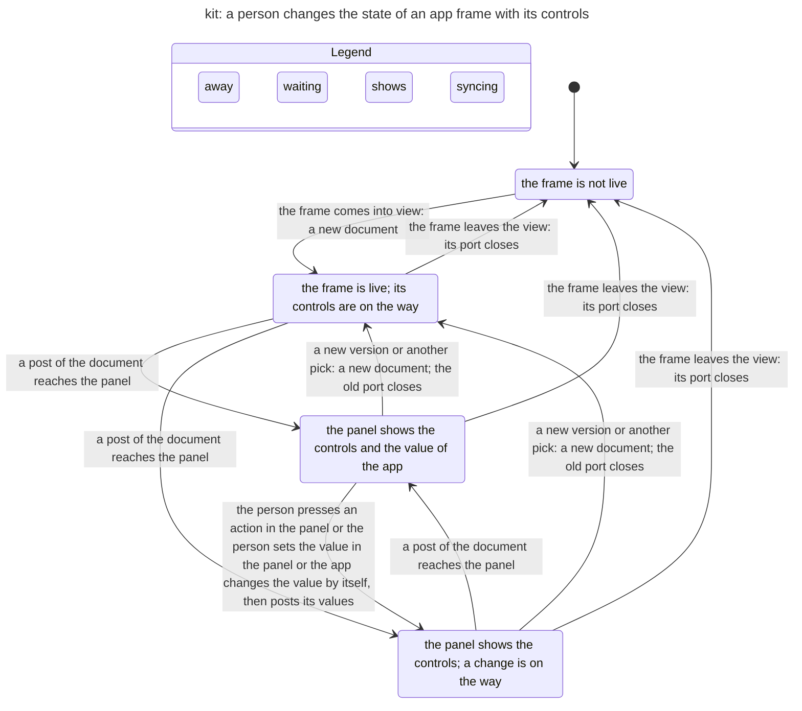

# kit: a person changes the state of an app frame with its controls

The chart shows the controls of one app frame in one tab (SPEC-kit.md § The capsules, "The controls in the viewer"). The frame's file declares its controls: each one runs an operation of the frame, and it can show the value of a cell. When a document gets its port, it posts its controls with their values. After each change of a value, it posts the values again. The page draws the controls in a panel. A change in the panel goes on the port and runs the operation in the live scope, so the frame is not composed again. A new version, another pick of the axes, or a return into view gives a new document, whose values start again. The page takes posts only from the current document, and the port of an old document closes, so a message on it is lost. The model is [models/kit/FrameControls.tla](models/kit/FrameControls.tla) with [FrameControls.cfg](models/kit/FrameControls.cfg).

## The rules

- **TheControlsAreOfTheCurrentDocument**: the panel shows only the controls of the frame's current document.
- **AControlGoesOnlyToTheCurrentDocument**: a message from the page goes only to the current document, whose controls the panel shows.
- **WhenQuietThePanelShowsTheValue**: with no message on the way, the panel shows the value that the app has.
- **ThePanelComesToShowTheValue**: a panel that shows another value than the app comes to show it, unless the document goes first.
