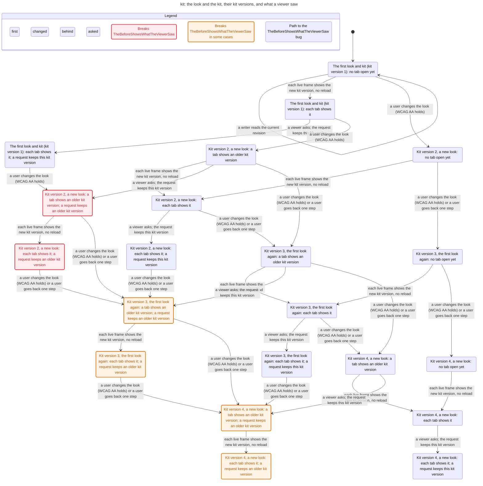

# kit: why a request keeps its kit version

The same model as [kit-look](kit-look.md), with `KeepKit = FALSE` ([KitLookUnbound.cfg](models/kit/KitLookUnbound.cfg)): a request keeps only the frame version, so its Before is drawn with the current kit version. After a change of the look, the Before shows a look that the viewer never saw, and `TheBeforeShowsWhatTheViewerSaw` breaks. This is why a request, a claim and a result keep their kit version.

| Rule                                 | In plain words                                                                                                                                                                                                                  | Spec line                                                      |
| ------------------------------------ | ------------------------------------------------------------------------------------------------------------------------------------------------------------------------------------------------------------------------------- | -------------------------------------------------------------- |
| `TypeOK`                             | Each value is one the store, a tab or a writer can hold.                                                                                                                                                                        | (model)                                                        |
| `AChangeOnAnOldRevisionIsNeverSaved` | A change lands only on the revision its writer read, so of two changes on one revision the second answers `stale`, and no change is lost.                                                                                       | SPEC-kit.md § Add to the kit, step 5, and judged rule 2 (K14)  |
| `ARefusalWritesNothing`              | A `stale` or `unreadable` answer changes no look, no piece and no kit version.                                                                                                                                                  | SPEC-kit.md, judged rule 1                                     |
| `EachChangeMakesOneKitVersion`       | Each change of the look or of a piece makes exactly one new kit version.                                                                                                                                                        | SPEC-kit.md, judged rule 3 (K7, K13)                           |
| `TheNewestKitVersionIsTheStoredOne`  | The current kit version holds the stored look and the stored piece.                                                                                                                                                             | SPEC-kit.md, judged rule 4                                     |
| `AKitVersionNeverChanges`            | A kit version never changes after it is written, and none goes away.                                                                                                                                                            | SPEC-kit.md, judged rule 4 (K10, K11)                          |
| `NoStoredLookIsUnreadable`           | No kit version holds a look whose text fails WCAG AA.                                                                                                                                                                           | SPEC-kit.md, judged rule 7 (K8)                                |
| `UndoGivesTheLookBefore`             | One step back gives the look from before the last change of the look, as a new kit version.                                                                                                                                     | SPEC-kit.md § Change the look, step 6, and judged rule 8 (K9)  |
| `ATabShowsOnlyAStoredKitVersion`     | A tab shows only a kit version that is stored.                                                                                                                                                                                  | SPEC-kit.md, judged rule 6                                     |
| `ATabNeverGoesBack`                  | A tab never goes back to an older kit version.                                                                                                                                                                                  | SPEC-kit.md, judged rule 6 (K7)                                |
| `TheBeforeShowsWhatTheViewerSaw`     | The Before of a request shows the look and the kit that the viewer saw when they asked, after any later change. **Breaks here**: the request keeps only the frame version, so its Before is drawn with the current kit version. | SPEC-kit.md § Change the look, step 7, and SPEC-queue.md (K10) |
| `NoDeadlock`                         | There is always a next step.                                                                                                                                                                                                    | (model)                                                        |

## What the model leaves out

- More than one piece and more than two writers: each piece acts the same, and two writers are enough for a race.
- The board's cell set after the row: the frames model ([frames-writes](frames-writes.md)) shows that pattern; here a tab reads the stored kit version in one step.
- The `taken`, `gone`, `offLook`, `tooBig`, `unchanged` and `invalid` answers. `unreadable` is a step that changes nothing, so it draws no arrow.
- Frames: no frame is written by a change of the kit, so the model has no frame. The picture of a frame in a kit version is in [frames-pictures](frames-pictures.md).
- The make step, the piece script and `compose`: a kit version holds its made CSS, and `compose`
  adds stored text only (SPEC-kit judged rules 5 and 9).
