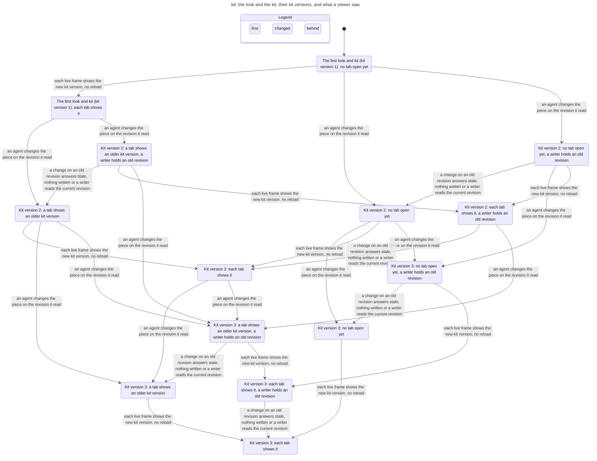

# kit: two agents change one piece

The chart shows one piece of the kit, from the seed (kit version 1) until kit version 3, while two agents read it and change it. A change is one conditional write on the revision that the agent read: the first change on a revision wins and makes a new kit version; a later change on the same revision answers `stale` and writes nothing. Each live frame then shows the new kit version, and no frame is written. The model is [models/kit/Kit.tla](models/kit/Kit.tla) with [KitPiece.cfg](models/kit/KitPiece.cfg) (`Part = "piece"`). TLC checks every rule below on all 51 of its states, and each one holds.

| Rule                                 | In plain words                                                                                                                            | Spec line                                                      |
| ------------------------------------ | ----------------------------------------------------------------------------------------------------------------------------------------- | -------------------------------------------------------------- |
| `TypeOK`                             | Each value is one the store, a tab or a writer can hold.                                                                                  | (model)                                                        |
| `AChangeOnAnOldRevisionIsNeverSaved` | A change lands only on the revision its writer read, so of two changes on one revision the second answers `stale`, and no change is lost. | SPEC-kit.md § Add to the kit, step 5, and judged rule 2 (K14)  |
| `ARefusalWritesNothing`              | A `stale` or `unreadable` answer changes no look, no piece and no kit version.                                                            | SPEC-kit.md, judged rule 1                                     |
| `EachChangeMakesOneKitVersion`       | Each change of the look or of a piece makes exactly one new kit version.                                                                  | SPEC-kit.md, judged rule 3 (K7, K13)                           |
| `TheNewestKitVersionIsTheStoredOne`  | The current kit version holds the stored look and the stored piece.                                                                       | SPEC-kit.md, judged rule 4                                     |
| `AKitVersionNeverChanges`            | A kit version never changes after it is written, and none goes away.                                                                      | SPEC-kit.md, judged rule 4 (K10, K11)                          |
| `NoStoredLookIsUnreadable`           | No kit version holds a look whose text fails WCAG AA.                                                                                     | SPEC-kit.md, judged rule 7 (K8)                                |
| `UndoGivesTheLookBefore`             | One step back gives the look from before the last change of the look, as a new kit version.                                               | SPEC-kit.md § Change the look, step 6, and judged rule 8 (K9)  |
| `ATabShowsOnlyAStoredKitVersion`     | A tab shows only a kit version that is stored.                                                                                            | SPEC-kit.md, judged rule 6                                     |
| `ATabNeverGoesBack`                  | A tab never goes back to an older kit version.                                                                                            | SPEC-kit.md, judged rule 6 (K7)                                |
| `TheBeforeShowsWhatTheViewerSaw`     | The Before of a request shows the look and the kit that the viewer saw when they asked, after any later change.                           | SPEC-kit.md § Change the look, step 7, and SPEC-queue.md (K10) |
| `NoDeadlock`                         | There is always a next step.                                                                                                              | (model)                                                        |

## What the model leaves out

- More than one piece and more than two writers: each piece acts the same, and two writers are enough for a race.
- The board's cell set after the row: the frames model ([frames-writes](frames-writes.md)) shows that pattern; here a tab reads the stored kit version in one step.
- The `taken`, `gone`, `offLook`, `tooBig`, `unchanged` and `invalid` answers. `unreadable` is a step that changes nothing, so it draws no arrow.
- Frames: no frame is written by a change of the kit, so the model has no frame. The picture of a frame in a kit version is in [frames-pictures](frames-pictures.md).
- The make step, the piece script and `compose`: a kit version holds its made CSS, and `compose`
  adds stored text only (SPEC-kit judged rules 5 and 9).
