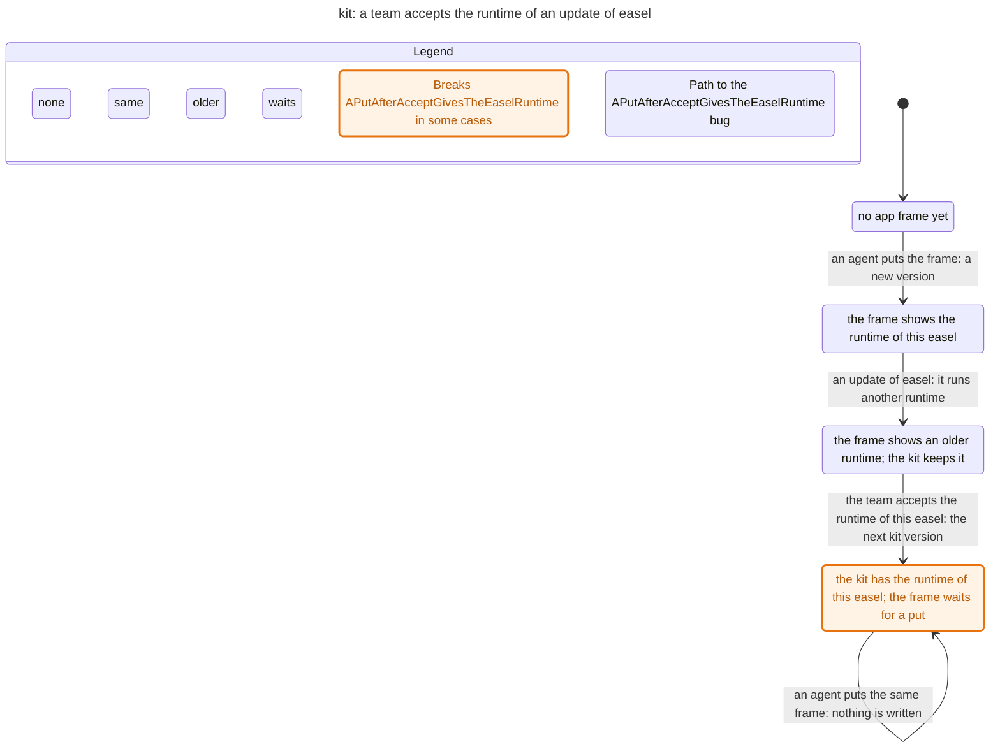

# kit: why the same TSX on another runtime is a new frame version

The same model as [kit-runtime](kit-runtime.md), with `Same = "text"` ([KitRuntimeSameText.cfg](models/kit/KitRuntimeSameText.cfg)): a put of the same TSX answers `unchanged`, on any runtime. That was the rule before the accept. `APutAfterAcceptGivesTheEaselRuntime` breaks in 4 steps: an agent puts the frame, easel updates, the team accepts, and the agent puts the same frame again. The put writes nothing, so the frame stays on the older runtime. This is why the same document of an app frame is the same text on the same runtime.

| Rule                                  | In plain words                                                                     | Spec line                     |
| ------------------------------------- | ---------------------------------------------------------------------------------- | ----------------------------- |
| `APutAfterAcceptGivesTheEaselRuntime` | Breaks: the put after the accept writes nothing, so the frame keeps the older one. | SPEC-kit.md § App frames      |
| The other rules of kit-runtime        | Hold.                                                                              | [kit-runtime](kit-runtime.md) |

## What the model leaves out

The same as [kit-runtime](kit-runtime.md).
