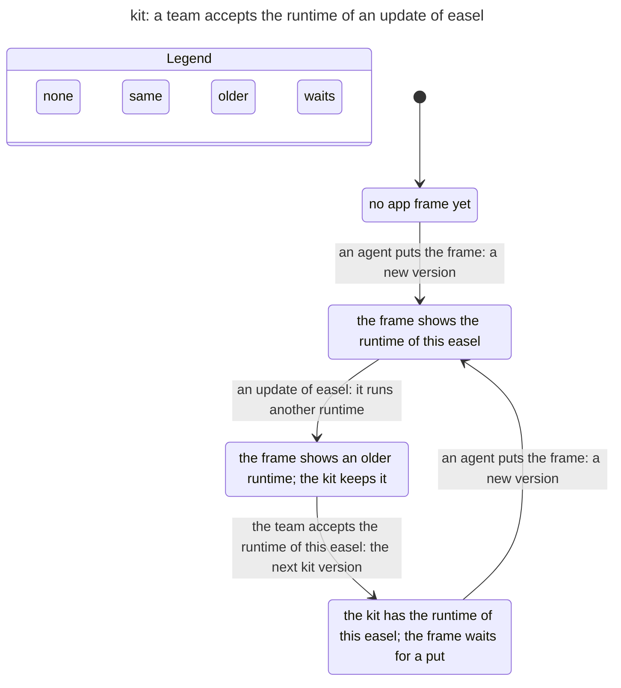

# kit: a team accepts the runtime of an update of easel

The chart shows the runtime of each kit version, one app frame, and one update of easel (SPEC-kit.md § App frames, "The runtime" and "Accept the runtime of this easel"). A kit version gets the runtime of the easel that runs at its first use, and keeps it (K11). A change of the look copies the runtime of the kit version before it. So after an update, a team keeps the runtime that it has. When the team accepts the runtime of this easel, one statement writes the next kit version: the current one, with this runtime. It writes only when the current kit version has a runtime and that runtime is another one. A frame keeps its kit version until a put. A put of the same TSX on a kit version with another runtime is a new frame version. The model is [models/kit/KitRuntime.tla](models/kit/KitRuntime.tla) with [KitRuntime.cfg](models/kit/KitRuntime.cfg).

## The rules

- **AStoredRuntimeNeverChanges**: K11: a runtime that a kit version has never changes, also after an update of easel.
- **AFrameKeepsItsRuntimeUntilAPut**: a frame shows the runtime of its kit version until a put gives it a new version.
- **APutAfterAcceptGivesTheEaselRuntime**: after the team accepts, the next put of an app frame gives it the runtime of this easel.
- **AnAcceptChangesTheRuntime**: an accepted kit version has another runtime than the one before it, so an accept with nothing to change writes nothing.
- **ANewVersionShowsAnotherDocument**: a put of the same document writes nothing: a new frame version shows another document.

## What the model leaves out

- More than one frame, and HTML frames: an HTML frame has no runtime, and its same document is the same text.
- Another text: a put of another TSX is a new version, as before.
- Two accepts at once: one SQL statement writes the kit version, so the model takes it as one step. The second accept sees the new kit version and answers `unchanged`.
- The look: a change of the look and an accept both write the next kit version, and each keeps the look, the kit's CSS and the pieces of the other.
