# live screens: one take on the page Live, after each deploy

The chart follows one take of one live screen on the page `Live` of `product`
([SPEC-live-screens](../../SPEC-live-screens.md), decision 6). After each deploy, the job takes the
screen of the live build, and finds the After of that take by its name. A take of a newer build
moves the After to the Before and puts the take as the After. A take of the build that the After
already has puts nothing: the same pixels say `same`, other pixels say `differs`, a finding. A
failed take puts nothing, so the last good After stays. The model is
[models/live/LiveScreens.tla](models/live/LiveScreens.tla); TLC checks each rule below on all its
states, and each one holds.

```mermaid
---
title: "live screens: one take on the page Live, after each deploy"
---
stateDiagram-v2
  state "Legend" as legend {
    lg0: none
    lg1: new
    lg2: next
    lg3: same
    lg4: differs
    lg5: failed
  }
  class lg0 tan
  class lg1 teal
  class lg2 blue
  class lg3 teal
  class lg4 orange
  class lg5 pink
  s0: No take yet, live build 1, no After, no Before
  s1: Take failed: the last good stays, live build 1, no After, no Before
  s2: Take new: the first After, live build 1, After of build 1, no Before
  s3: No take yet, live build 2, no After, no Before
  s4: Take differs: nothing put, a finding, live build 1, After of build 1, no Before
  s5: Take failed: the last good stays, live build 1, After of build 1, no Before
  s6: Take same: nothing put, live build 1, After of build 1, no Before
  s7: Take failed: the last good stays, live build 2, no After, no Before
  s8: Take new: the first After, live build 2, After of build 1, no Before
  s9: Take new: the first After, live build 2, After of build 2, no Before
  s10: No take yet, live build 3, no After, no Before
  s11: Take differs: nothing put, a finding, live build 2, After of build 1, no Before
  s12: Take failed: the last good stays, live build 2, After of build 1, no Before
  s13: Take same: nothing put, live build 2, After of build 1, no Before
  s14: Take differs: nothing put, a finding, live build 2, After of build 2, no Before
  s15: Take failed: the last good stays, live build 2, After of build 2, no Before
  s16: Take same: nothing put, live build 2, After of build 2, no Before
  s17: Take next: the After moved to the Before, live build 2, After of build 2, Before of build 1
  s18: Take failed: the last good stays, live build 3, no After, no Before
  s19: Take new: the first After, live build 3, After of build 1, no Before
  s20: Take new: the first After, live build 3, After of build 2, no Before
  s21: Take new: the first After, live build 3, After of build 3, no Before
  s22: Take differs: nothing put, a finding, live build 2, After of build 2, Before of build 1
  s23: Take failed: the last good stays, live build 2, After of build 2, Before of build 1
  s24: Take same: nothing put, live build 2, After of build 2, Before of build 1
  s25: Take differs: nothing put, a finding, live build 3, After of build 1, no Before
  s26: Take failed: the last good stays, live build 3, After of build 1, no Before
  s27: Take same: nothing put, live build 3, After of build 1, no Before
  s28: Take differs: nothing put, a finding, live build 3, After of build 2, no Before
  s29: Take failed: the last good stays, live build 3, After of build 2, no Before
  s30: Take same: nothing put, live build 3, After of build 2, no Before
  s31: Take next: the After moved to the Before, live build 3, After of build 2, Before of build 1
  s32: Take differs: nothing put, a finding, live build 3, After of build 3, no Before
  s33: Take failed: the last good stays, live build 3, After of build 3, no Before
  s34: Take same: nothing put, live build 3, After of build 3, no Before
  s35: Take next: the After moved to the Before, live build 3, After of build 3, Before of build 1
  s36: Take next: the After moved to the Before, live build 3, After of build 3, Before of build 2
  s37: Take differs: nothing put, a finding, live build 3, After of build 2, Before of build 1
  s38: Take failed: the last good stays, live build 3, After of build 2, Before of build 1
  s39: Take same: nothing put, live build 3, After of build 2, Before of build 1
  s40: Take differs: nothing put, a finding, live build 3, After of build 3, Before of build 1
  s41: Take failed: the last good stays, live build 3, After of build 3, Before of build 1
  s42: Take same: nothing put, live build 3, After of build 3, Before of build 1
  s43: Take differs: nothing put, a finding, live build 3, After of build 3, Before of build 2
  s44: Take failed: the last good stays, live build 3, After of build 3, Before of build 2
  s45: Take same: nothing put, live build 3, After of build 3, Before of build 2
  [*] --> s0
  s0 --> s1: the take fails: the status names the screen and the reason
  s0 --> s2: the job takes the screen: no After yet, it puts the take as the After
  s0 --> s3: a deploy: the site serves the next build
  s1 --> s2: the job takes the screen: no After yet, it puts the take as the After
  s1 --> s7: a deploy: the site serves the next build
  s2 --> s4: the job takes the screen again on the same build: other pixels
  s2 --> s5: the take fails: the status names the screen and the reason
  s2 --> s6: the job takes the screen again on the same build: the same pixels
  s2 --> s8: a deploy: the site serves the next build
  s3 --> s7: the take fails: the status names the screen and the reason
  s3 --> s9: the job takes the screen: no After yet, it puts the take as the After
  s3 --> s10: a deploy: the site serves the next build
  s4 --> s5: the take fails: the status names the screen and the reason
  s4 --> s6: the job takes the screen again on the same build: the same pixels
  s4 --> s11: a deploy: the site serves the next build
  s5 --> s4: the job takes the screen again on the same build: other pixels
  s5 --> s6: the job takes the screen again on the same build: the same pixels
  s5 --> s12: a deploy: the site serves the next build
  s6 --> s4: the job takes the screen again on the same build: other pixels
  s6 --> s5: the take fails: the status names the screen and the reason
  s6 --> s13: a deploy: the site serves the next build
  s7 --> s9: the job takes the screen: no After yet, it puts the take as the After
  s7 --> s18: a deploy: the site serves the next build
  s8 --> s12: the take fails: the status names the screen and the reason
  s8 --> s17: the job takes the screen of a newer build: the After goes to the Before, the take is the After
  s8 --> s19: a deploy: the site serves the next build
  s9 --> s14: the job takes the screen again on the same build: other pixels
  s9 --> s15: the take fails: the status names the screen and the reason
  s9 --> s16: the job takes the screen again on the same build: the same pixels
  s9 --> s20: a deploy: the site serves the next build
  s10 --> s18: the take fails: the status names the screen and the reason
  s10 --> s21: the job takes the screen: no After yet, it puts the take as the After
  s11 --> s12: the take fails: the status names the screen and the reason
  s11 --> s17: the job takes the screen of a newer build: the After goes to the Before, the take is the After
  s11 --> s25: a deploy: the site serves the next build
  s12 --> s17: the job takes the screen of a newer build: the After goes to the Before, the take is the After
  s12 --> s26: a deploy: the site serves the next build
  s13 --> s12: the take fails: the status names the screen and the reason
  s13 --> s17: the job takes the screen of a newer build: the After goes to the Before, the take is the After
  s13 --> s27: a deploy: the site serves the next build
  s14 --> s15: the take fails: the status names the screen and the reason
  s14 --> s16: the job takes the screen again on the same build: the same pixels
  s14 --> s28: a deploy: the site serves the next build
  s15 --> s14: the job takes the screen again on the same build: other pixels
  s15 --> s16: the job takes the screen again on the same build: the same pixels
  s15 --> s29: a deploy: the site serves the next build
  s16 --> s14: the job takes the screen again on the same build: other pixels
  s16 --> s15: the take fails: the status names the screen and the reason
  s16 --> s30: a deploy: the site serves the next build
  s17 --> s22: the job takes the screen again on the same build: other pixels
  s17 --> s23: the take fails: the status names the screen and the reason
  s17 --> s24: the job takes the screen again on the same build: the same pixels
  s17 --> s31: a deploy: the site serves the next build
  s18 --> s21: the job takes the screen: no After yet, it puts the take as the After
  s19 --> s26: the take fails: the status names the screen and the reason
  s19 --> s35: the job takes the screen of a newer build: the After goes to the Before, the take is the After
  s20 --> s29: the take fails: the status names the screen and the reason
  s20 --> s36: the job takes the screen of a newer build: the After goes to the Before, the take is the After
  s21 --> s32: the job takes the screen again on the same build: other pixels
  s21 --> s33: the take fails: the status names the screen and the reason
  s21 --> s34: the job takes the screen again on the same build: the same pixels
  s22 --> s23: the take fails: the status names the screen and the reason
  s22 --> s24: the job takes the screen again on the same build: the same pixels
  s22 --> s37: a deploy: the site serves the next build
  s23 --> s22: the job takes the screen again on the same build: other pixels
  s23 --> s24: the job takes the screen again on the same build: the same pixels
  s23 --> s38: a deploy: the site serves the next build
  s24 --> s22: the job takes the screen again on the same build: other pixels
  s24 --> s23: the take fails: the status names the screen and the reason
  s24 --> s39: a deploy: the site serves the next build
  s25 --> s26: the take fails: the status names the screen and the reason
  s25 --> s35: the job takes the screen of a newer build: the After goes to the Before, the take is the After
  s26 --> s35: the job takes the screen of a newer build: the After goes to the Before, the take is the After
  s27 --> s26: the take fails: the status names the screen and the reason
  s27 --> s35: the job takes the screen of a newer build: the After goes to the Before, the take is the After
  s28 --> s29: the take fails: the status names the screen and the reason
  s28 --> s36: the job takes the screen of a newer build: the After goes to the Before, the take is the After
  s29 --> s36: the job takes the screen of a newer build: the After goes to the Before, the take is the After
  s30 --> s29: the take fails: the status names the screen and the reason
  s30 --> s36: the job takes the screen of a newer build: the After goes to the Before, the take is the After
  s31 --> s36: the job takes the screen of a newer build: the After goes to the Before, the take is the After
  s31 --> s38: the take fails: the status names the screen and the reason
  s32 --> s33: the take fails: the status names the screen and the reason
  s32 --> s34: the job takes the screen again on the same build: the same pixels
  s33 --> s32: the job takes the screen again on the same build: other pixels
  s33 --> s34: the job takes the screen again on the same build: the same pixels
  s34 --> s32: the job takes the screen again on the same build: other pixels
  s34 --> s33: the take fails: the status names the screen and the reason
  s35 --> s40: the job takes the screen again on the same build: other pixels
  s35 --> s41: the take fails: the status names the screen and the reason
  s35 --> s42: the job takes the screen again on the same build: the same pixels
  s36 --> s43: the job takes the screen again on the same build: other pixels
  s36 --> s44: the take fails: the status names the screen and the reason
  s36 --> s45: the job takes the screen again on the same build: the same pixels
  s37 --> s36: the job takes the screen of a newer build: the After goes to the Before, the take is the After
  s37 --> s38: the take fails: the status names the screen and the reason
  s38 --> s36: the job takes the screen of a newer build: the After goes to the Before, the take is the After
  s39 --> s36: the job takes the screen of a newer build: the After goes to the Before, the take is the After
  s39 --> s38: the take fails: the status names the screen and the reason
  s40 --> s41: the take fails: the status names the screen and the reason
  s40 --> s42: the job takes the screen again on the same build: the same pixels
  s41 --> s40: the job takes the screen again on the same build: other pixels
  s41 --> s42: the job takes the screen again on the same build: the same pixels
  s42 --> s40: the job takes the screen again on the same build: other pixels
  s42 --> s41: the take fails: the status names the screen and the reason
  s43 --> s44: the take fails: the status names the screen and the reason
  s43 --> s45: the job takes the screen again on the same build: the same pixels
  s44 --> s43: the job takes the screen again on the same build: other pixels
  s44 --> s45: the job takes the screen again on the same build: the same pixels
  s45 --> s43: the job takes the screen again on the same build: other pixels
  s45 --> s44: the take fails: the status names the screen and the reason
  class s0 tan
  class s1 pink
  class s2 teal
  class s3 tan
  class s4 orange
  class s5 pink
  class s6 teal
  class s7 pink
  class s8 teal
  class s9 teal
  class s10 tan
  class s11 orange
  class s12 pink
  class s13 teal
  class s14 orange
  class s15 pink
  class s16 teal
  class s17 blue
  class s18 pink
  class s19 teal
  class s20 teal
  class s21 teal
  class s22 orange
  class s23 pink
  class s24 teal
  class s25 orange
  class s26 pink
  class s27 teal
  class s28 orange
  class s29 pink
  class s30 teal
  class s31 blue
  class s32 orange
  class s33 pink
  class s34 teal
  class s35 blue
  class s36 blue
  class s37 orange
  class s38 pink
  class s39 teal
  class s40 orange
  class s41 pink
  class s42 teal
  class s43 orange
  class s44 pink
  class s45 teal
```

The rules:

- `AfterIsNotNewerThanLive`: the After is never of a build that is not live yet.
- `BeforeIsTheBuildBeforeAfter`: the Before is of an older build than the After (V3).
- `ABeforeNeedsAnAfter`: a Before shows only beside an After.
- `ATakeOfTheSameBuildPutsNothing`: two takes of one build put one image (V2).
- `AFailedTakeKeepsTheLastGood`: a failed take changes no image frame.

The twin [live-screens-put-each-take](live-screens-put-each-take.md) puts each take again, and
breaks.
