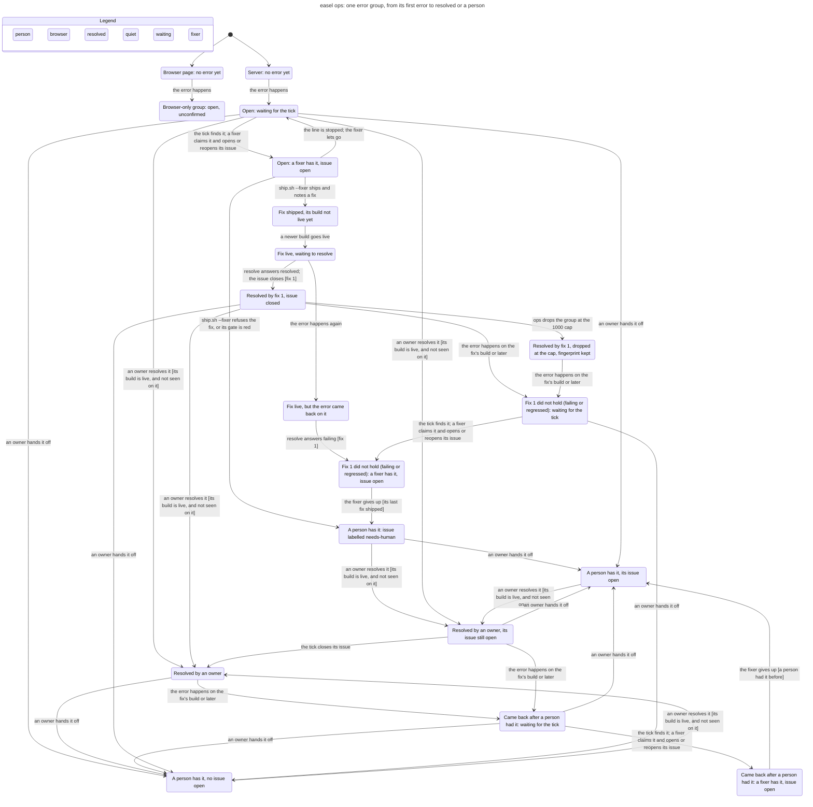

# ops: an error group that a person resolves or takes

The same error group as [ops-issues](ops-issues.md), with an owner who acts on it by hand:
`easel errors resolve <fingerprint> --build <n>` (`ops.resolveError`) and
`easel errors hand-off <fingerprint> --reason <text>` (`ops.handOff`), with no claim. ops never
touches a GitHub issue, so an issue the fixer opened stays open until the tick closes it. Once a
person has resolved or taken the group, a regression goes back to a person: the fixer's stop check
gives up at once, and ships no further fix. The stop check reads two signs that a person had
the group (SPEC-fixer.md § A fixer fixes an error, step 1):

- its `reason` is set: an owner handed it off;
- its `fixedIn` is none of the fixes the fixer noted: an owner resolved it.

The model is
[models/ops/Lifecycle.tla](models/ops/Lifecycle.tla) with
[LifecyclePerson.cfg](models/ops/LifecyclePerson.cfg): `People = TRUE`, builds 1 to 2, and one fix
(`Cap = 1`), so it stays under the chart budget. TLC checks every rule below on all 106 of its
states, and each one holds.



| Rule                         | In plain words                                                                                                                                      | Spec line                                                                    |
| ---------------------------- | --------------------------------------------------------------------------------------------------------------------------------------------------- | ---------------------------------------------------------------------------- |
| `BrowserGroupGetsNoFix`      | A browser-only group never starts a fix, also after an owner resolved it and it came back.                                                          | SPEC-ops.md § An error is recorded, step 5                                   |
| `BrowserGroupOpensNoIssue`   | A browser-only group opens no issue.                                                                                                                | SPEC-ops.md § An error is recorded, step 5                                   |
| `ResolvedOnlyWhenFixIsLive`  | An owner resolves a group only once the live build is the given build or later: `notLive` otherwise.                                                | SPEC-ops.md § An error group moves through its states, step 2; judged rule 7 |
| `ResolvedNotAlreadyFailing`  | An owner never resolves a group already seen on the given build or later: `failing`.                                                                | SPEC-ops.md § An error group moves through its states, step 2; judged rule 7 |
| `RegressedOnlyAfterFix`      | A group an owner resolved is marked regressed only when seen on a build at or after its `fixedIn`.                                                  | SPEC-ops.md § An error group moves through its states, step 3; judged rule 6 |
| `OpenMeansNeverResolved`     | A group an owner resolved never comes back as new, also after it was dropped at the cap: it is regressed.                                           | SPEC-ops.md § An error group moves through its states, step 3; judged rule 4 |
| `ResolvedClosesIssue`        | Once a fixer resolves a group, its issue is closed. An owner's resolve leaves an issue as it was.                                                   | SPEC-fixer.md § A fixer fixes an error, step 6                               |
| `ResolvedIssueGetsClosed`    | A resolved group whose issue is still open gets it closed by the tick (only the tick is fair).                                                      | SPEC-fixer.md § The tick finds work, step 1.2                                |
| `PersonSeesAnOpenIssue`      | A group a fixer hands to a person has an open issue that says so. An owner who hands it off is the person, so ops opens none.                       | SPEC-ops.md § An error group moves through its states, step 4                |
| `NoFixAfterSecondRegression` | No fix ships once the cap of regressions is reached. A regression after a person had it never reaches a ship: the fixer gives up first.             | SPEC-fixer.md § A fixer fixes an error, steps 1 and 8                        |
| `AtMostTwoFixTries`          | `ship.sh --fixer` gates at most the cap of fixes for one group, also when a person resolved it between them. Without the stop check, TLC breaks it. | SPEC-fixer.md § A fixer fixes an error, steps 1 and 8                        |
| `HumanStaysHuman`            | A group handed to a person stays with the person: an error seen again and the fixers leave it `human`. Only an owner's resolve moves it on.         | SPEC-ops.md § An error group moves through its states, step 4                |
| `NoDeadlock`                 | There is always a next step.                                                                                                                        | (model)                                                                      |

## What the model leaves out

- `held`: while a fixer holds a lease, an owner's `resolve` and `hand-off` answer `held` and change
  nothing, so they are no step. The owner's actions need the fixer idle.
- `notLive`, `failing` and `gone` for an owner's resolve: they change nothing, so they are no
  step. The resolve's guard is the build check (`live >= n`, never seen on `n` or later).
- An owner acting on a dropped group answers `gone`: a group dropped at the cap is in no list, so
  an owner cannot see it. Its resolve and hand-off change nothing, so they are no step: the model's
  `OwnerResolves` and `OwnerHandsOff` need `~dropped`. Once it is seen again on a build at or
  after its fix, it is back as `regressed`, and an owner can act on it.
- A browser group that has regressed or gone `human` can be dropped at the cap too, and it comes
  back as a new `open` group: only a dropped `resolved` group keeps its fingerprint and `fixedIn`
  (SPEC-ops.md, judged rules 3 and 4). The model drops only `resolved` groups.
- A second fix. With builds 1 to 2 and `Cap = 1`, one fix ships; [ops-issues](ops-issues.md)
  checks two fixes with no owner's actions. Both run the same model.
- How the fixer knows a person had the group: in ops, its `reason` is set (a hand-off), or its
  `fixedIn` is none of its noted fixes (an owner's resolve). Here it is one flag, `person`.
- The retired list's size and the `dropped` counter, as in [ops-issues](ops-issues.md).

## Steps the chart hides

- A group dropped at the cap after a person had it shows as the same state: it comes back the same
  way, as [ops-issues](ops-issues.md) shows.
- The model's `Done` step, which repeats the end once no build is left to ship or deploy.

## Make it again

```sh
scripts/statecharts.sh ops-issues-person          # rewrite this page's mermaid block in place if it differs
scripts/statecharts.sh --check ops-issues-person  # change nothing; compare the block and the verdict in charts.tsv
```
