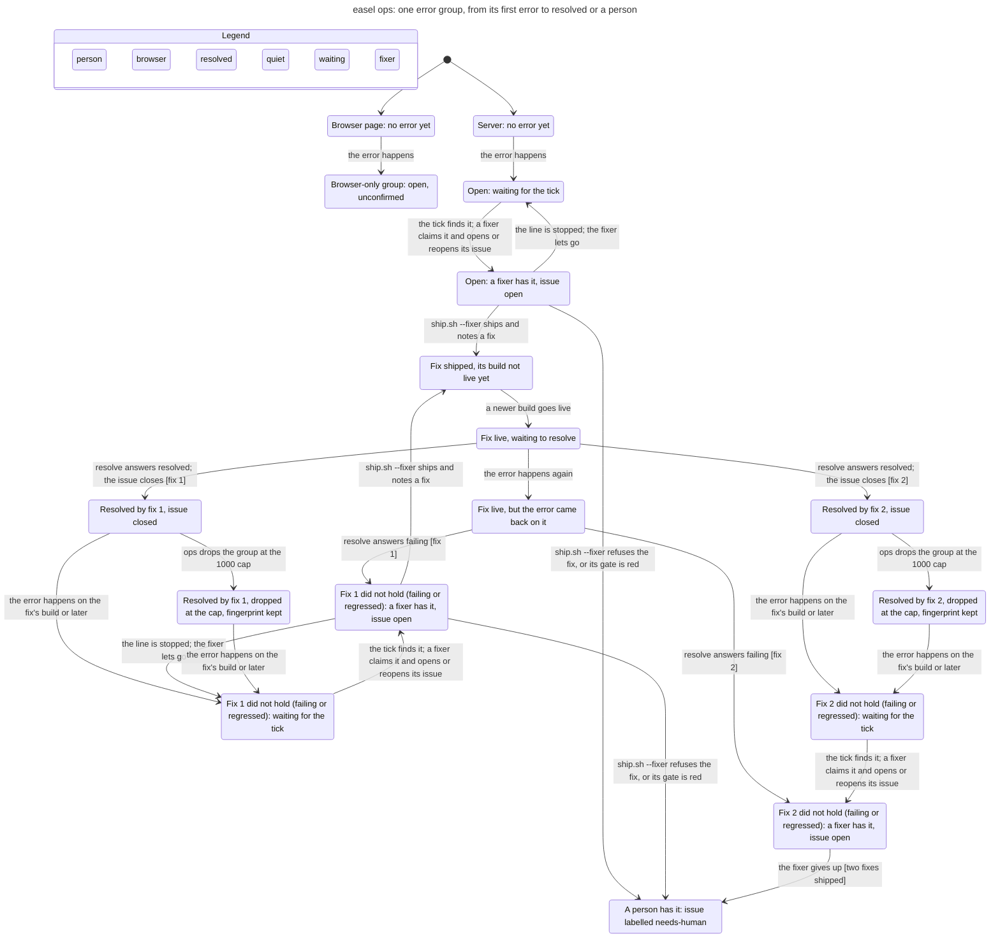

# ops: an error group, from its first error to resolved or a person

The chart shows one error group: its first sighting, the fixer that claims it, ships a fix and
proves it live, and the way back when the fix does not hold. A browser-only group stays open and
unconfirmed, and never reaches a fixer. After two shipped fixes that did not hold, or one fix that
`ship.sh --fixer` refused, a person takes it. One fixer acts at a time here; two fixers and their
claim are in [fixer-claim-issue](fixer-claim-issue.md) and [fixer-claim-fix](fixer-claim-fix.md).
The model is [models/ops/Lifecycle.tla](models/ops/Lifecycle.tla) with
[Lifecycle.cfg](models/ops/Lifecycle.cfg): builds 1 to 3 on one straight main line, and at most 2
fixes. An error may be seen on the live build or an older one still running. TLC checks every rule
below on all 167 of its states, and each one holds.



| Rule                         | In plain words                                                                                                                                                                                                       | Spec line                                                                                                                   |
| ---------------------------- | -------------------------------------------------------------------------------------------------------------------------------------------------------------------------------------------------------------------- | --------------------------------------------------------------------------------------------------------------------------- |
| `BrowserGroupGetsNoFix`      | A browser-only group never starts a fix.                                                                                                                                                                             | SPEC-ops.md § An error is recorded, step 5; SPEC-fixer.md § The tick finds work, step 1.3; § A fixer fixes an error, step 1 |
| `BrowserGroupOpensNoIssue`   | A browser-only group opens no issue.                                                                                                                                                                                 | SPEC-ops.md § An error is recorded, step 5; SPEC-fixer.md § The tick finds work, step 1.3; § A fixer fixes an error, step 1 |
| `ResolvedOnlyWhenFixIsLive`  | A group is resolved only once the live build is the fix's build or later.                                                                                                                                            | SPEC-ops.md § An error group moves through its states, step 2; judged rule 7                                                |
| `ResolvedNotAlreadyFailing`  | A group is never resolved when it was already seen on the fix's build or later: resolve answers `failing`.                                                                                                           | SPEC-ops.md § An error group moves through its states, step 2; judged rule 7                                                |
| `RegressedOnlyAfterFix`      | A group is marked regressed only when seen on a build at or after its `fixedIn`; an error from an older build still running changes nothing. Without that check TLC breaks it in 6 steps.                            | SPEC-ops.md § An error group moves through its states, step 3; judged rule 6                                                |
| `OpenMeansNeverResolved`     | A group that was resolved never comes back as new, also after it was dropped at the cap: it is regressed.                                                                                                            | SPEC-ops.md § An error group moves through its states, step 3; judged rule 4                                                |
| `ResolvedClosesIssue`        | Once resolved, the group's issue is closed.                                                                                                                                                                          | SPEC-fixer.md § The tick finds work, step 1.2; § A fixer fixes an error, step 6                                             |
| `PersonSeesAnOpenIssue`      | A group handed to a person has an open issue that says so.                                                                                                                                                           | SPEC-ops.md § An error group moves through its states, step 4; SPEC-fixer.md § A fixer fixes an error, step 8               |
| `NoFixAfterSecondRegression` | After the second fix did not hold, no fix ships; a person takes it. By construction (judged in code): a regression follows a shipped fix, and the stop check after two fixes comes first, so this cannot break here. | SPEC-fixer.md § A fixer fixes an error, steps 1 and 8; § Success Criteria                                                   |
| `AtMostTwoFixTries`          | `ship.sh --fixer` gates at most two fixes for one group; a refusal or a red gate hands it to a person, and a stopped line gates nothing.                                                                             | SPEC-fixer.md § A fixer fixes an error, steps 1, 8 and 9                                                                    |
| `HumanStaysHuman`            | A group handed to a person stays with the person: an error seen again and the fixers leave it `human`.                                                                                                               | SPEC-ops.md § An error group moves through its states, step 4                                                               |
| `NoDeadlock`                 | There is always a next step.                                                                                                                                                                                         | (model)                                                                                                                     |

## What the model leaves out

- Two fixers, the claim and its lease. One fixer acts at a time here; the claim, the issue
  search by label and the `Fixes-Error` trailer are in the fixer-claim charts.
- `notLive`. It changes nothing, so it is no step: the fixer waits until a build is live. A
  release after 1800 s of `notLive` leaves the fix noted, and the next fixer goes to resolve, so
  the chart's "Fix shipped, its build not live yet" covers it.
- The other reasons to give up: the error rate rose after a fix (it reverts first), and a cause
  that is not in the code (SPEC-fixer.md § A fixer fixes an error, step 8). Both end in the same `human` state.
- A person who resolves a `human` group. `human` is the end here, so `HumanStaysHuman` checks only that no fixer and no error takes it out.
- Builds as real numbers. The model has builds 1 to 3, so at most two fixes ship; the spec's cap
  is 2 as well.
- The retired list's size (10 000, oldest out). The model keeps the dropped group's fingerprint
  for ever. A group pushed out of that list would come back as a new `open` group.
- Unconfirmed groups dropped at the cap, and the `dropped` counter (SPEC-ops.md, judged rule 3).
- The tick that closes the issue of a resolved group whose fixer stopped before it closed it. Here
  resolve and close are one step.

## Steps the chart hides

- Steps that stay in one chart state (278): the error seen again, on the live build or an older one, while a group is open, waiting
  for the tick, with a person, or browser-only; another agent's ship; and a deploy while no fix
  waits.
- The view hides 53 steps: the model's `Done` step, which repeats the end once no build is left to
  ship or deploy.

## Make it again

```sh
scripts/statecharts.sh ops-issues          # rewrite this page's mermaid block in place if it differs
scripts/statecharts.sh --check ops-issues  # change nothing; compare the block and the verdict in charts.tsv
```
