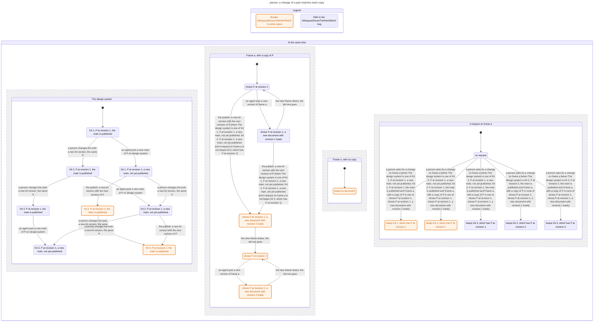

# pieces: a part that is not in the kit version

This chart has the model of [part-copies](part-copies.md) with
[PartCopiesOutsideKit.cfg](models/pieces/PartCopiesOutsideKit.cfg) (`PartsInKit = FALSE`): easel
keeps only the newest part, so a picture takes the part of the current kit version. TLC finds
that `ARequestShowsThePartOfItsKit` breaks in 3 steps:

1. A person asks for a change on frame `a`. The request keeps Kit 1, with P at revision 1.
2. An agent puts a new main of P on `design-system`.
3. The publish makes Kit 2, with P at revision 2. The picture of the request now shows revision 2,
   which the person did not see.

So each kit version keeps the revision of each part, and a picture uses the part of the kit
version in its address ([SPEC-pieces-base](../../SPEC-pieces-base.md), § New, rule 2).

