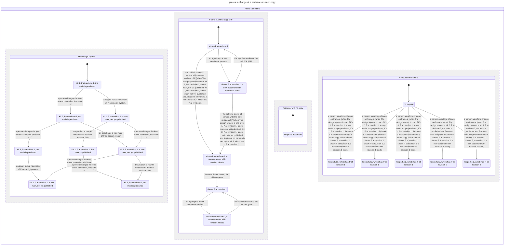

# pieces: a change of a part reaches each copy

The chart shows one part of the design system and its copies in HTML frames
([SPEC-pieces-base](../../SPEC-pieces-base.md)). The part P has one source frame, its main, on the
canvas `design-system`. Frame `a` on `product` holds a copy of P. Frame `o` holds no copy. A put of
the main and its publish are two writes, so a publish can come late; each start of easel publishes
a main that is not yet in the kit. A change of the look also makes a new kit version, with the
same revision of P. A request keeps the kit version of the tab. The model is
[models/pieces/PartCopies.tla](models/pieces/PartCopies.tla) with
[PartCopies.cfg](models/pieces/PartCopies.cfg) (`PartsInKit = TRUE`, `MaxKit = 3`, `MaxRev = 2`).
TLC checks every rule below on all 69 of its states, and each one holds.

| Rule                               | In plain words                                                                                                                                        | Spec anchor                                 |
| ---------------------------------- | ----------------------------------------------------------------------------------------------------------------------------------------------------- | ------------------------------------------- |
| `TypeOK`                           | Each value is one that easel or the page can hold.                                                                                                    | (model)                                     |
| `TheMainReachesThePart`            | In the end, the part in the current kit version is the main on `design-system`. Fairness: easel publishes each main, at the put or at the next start. | § New, rules 4 and 5                        |
| `EachCopyShowsTheCurrentPart`      | In the end, the copy in frame `a` shows the part of the current kit version. Fairness: the page draws each new document.                              | § New, rules 6 and 8; § Success criteria, 1 |
| `AFrameWithNoCopyKeepsItsDocument` | Frame `o` never gets a new document: no publish changes what it shows.                                                                                | § New, rule 8; § Success criteria, 3        |
| `ARequestShowsThePartOfItsKit`     | The picture of a request shows the copy with the part of the kit version that the request keeps, not of the current one.                              | § New, rules 2 and 9; § Success criteria, 4 |
| `NoDeadlock`                       | There is always a next step.                                                                                                                          | (model)                                     |

## What the model leaves out

- An edited copy (§ New, rule 7). It shows as it is written, and no publish changes it. Tests hold
  it: a copy with an edit outside its props, overrides and slots keeps each byte.
- More parts, more copies, and copies in a copy (a Count in the slot of the Dock). Each copy
  follows the same steps.
- The first link of a part (`parts.publish`): it is a publish with no revision before it.
- A put of the main with a base (`stale`): [frames-writes](frames-writes.md) proves it.

## What the chart shows

- After a put of the main, the part waits for the publish ("a new main, not yet published"). The
  publish makes a new kit version, and frame `a` loads a new document at the same step.
- A change of the look makes a new kit version, and frame `a` keeps its document: the look goes to
  the tab as a message.
- The old iframe stays until the new one draws ("a new document loads").
- [part-copies-outside-kit](part-copies-outside-kit.md) shows why the part is in the kit version.
