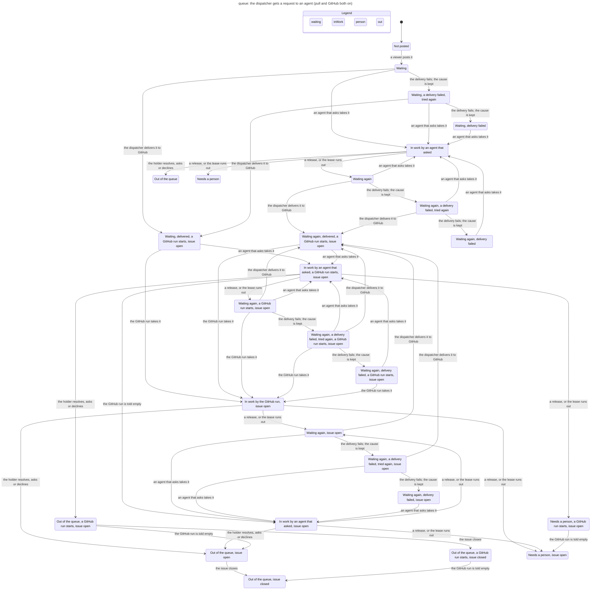

# queue: the dispatcher

The chart shows how a waiting request gets to an agent when two ways are on: an agent that asks
for work (pull), and a GitHub channel. The dispatcher delivers the request to GitHub one time for
each waiting period. GitHub starts a run, and the run asks for this request only. An agent that asks can take
the request first; then the run is told `empty`. A delivery only tells: the claim decides who
works, so the request has one outcome. A delivery that fails is tried again, then marked failed
with its cause, and the request still waits for an agent that asks. The issue closes when the
request leaves the queue.

The model is [models/queue/Dispatch.tla](models/queue/Dispatch.tla) with
[Dispatch.cfg](models/queue/Dispatch.cfg). The claim itself is the one conditional write of
[queue-lease](queue-lease.md); this model takes it as given. TLC checks every rule below on all 58
states of this model, and each one holds.

## Rules

| Rule                                   | In plain words                                                                                  | Spec line                                                  |
| -------------------------------------- | ----------------------------------------------------------------------------------------------- | ---------------------------------------------------------- |
| `TypeOK`                               | Each value is one that the tables can hold.                                                     | SPEC-queue.md § Contract                                   |
| `ARequestIsHeldByAtMostOneAgent`       | With two ways on, one agent holds the request. The GitHub run works only while it holds it.     | SPEC-queue.md, judged rules 19, 21; E4.5 D8                |
| `ARequestHasAtMostOneOutcome`          | The request is done one time only.                                                              | SPEC-queue.md, judged rule 19; E4.5 D8                     |
| `AtMostOneDeliveryForEachPeriod`       | The dispatcher delivers at most one time for each waiting period.                               | SPEC-queue.md § The dispatcher, step 2; judged rule 20     |
| `FailedDeliveriesStopAtTheCap`         | A delivery that fails is tried again only up to the cap, then it is failed.                     | SPEC-queue.md § The dispatcher, step 5; judged rule 20     |
| `NoDeadlock`                           | There is always a next step.                                                                    | (model)                                                    |
| `ADeliveryChangesNoRequest`            | A delivery, sent or failed, changes nothing on the request. Only a claim does.                  | SPEC-queue.md, judged rule 19                              |
| `OnlyAWaitingRequestIsDelivered`       | A request in work, out of the queue, or that needs a person gets no delivery.                   | SPEC-queue.md § The dispatcher, step 1; judged rule 20     |
| `ARunThatFindsNoRequestChangesNothing` | A GitHub run that finds the request taken or gone is told `empty`, and changes nothing.         | SPEC-queue.md § The dispatcher, step 4; judged rule 21     |
| `AWaitingRequestIsDeliveredOrTaken`    | A waiting request is delivered, taken, or its delivery is marked failed. It never waits unseen. | SPEC-queue.md § The dispatcher, steps 2, 5, 7; E4.5 D6, D9 |
| `TheIssueClosesWhenTheRequestIsOut`    | When the request leaves the queue, its issue closes.                                            | SPEC-queue.md § The dispatcher, step 6; E4.5 D10           |
| `AStartedRunIsNotLeftHanging`          | Each GitHub run takes the request or ends.                                                      | SPEC-queue.md § The dispatcher, step 4                     |

## What the model leaves out

- The claim, the handle and the lease as numbers. They are in [queue-lease](queue-lease.md). Here a
  try ends with an outcome, or with no outcome (a release or a lease that runs out).
- Edit, answer and reopen. Each one starts a new waiting period, as a release does. The states after an
  outcome are in [request-life](request-life.md).
- More than one GitHub run at one time. Two runs that ask for the same request act as one: the
  claim lets one take it, and the other is told `empty`.
- Time as numbers: the 5 s of the dispatcher, the 10 s and 30 s before an attempt again, and the 10 s limit on a
  call to GitHub.
- The check of the repository at each attempt. A public repository is one cause of a failed
  attempt.
- A second issue after a crash (judged rule 24). It is one more delivery, and the claim still
  gives one outcome.
- The cap of tries and of attempts: the spec says 3 and 3. The model uses 2 and 2, so the chart
  stays small. The rules do not depend on the numbers.
