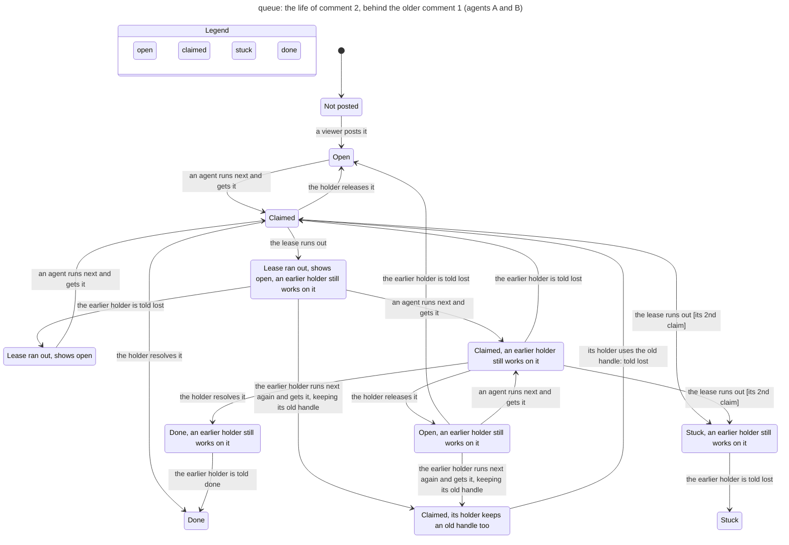

# queue: the lease on a comment

The chart shows the life of one comment in the queue: a viewer posts it, an agent claims it with a
lease, and the agent resolves it, releases it, or lets the lease run out. After three claims run
out, it is stuck. It follows comment 2, behind an older comment 1, with two agents A and B working
the queue, so the chart shows a release going to the back and an agent whose lease ran out while it
still works. That agent is told `lost`, or `done` when another agent finished the comment. Each
claim gets a fresh handle, so an agent that runs `next` again and gets the same comment back
cannot use its old handle: it is told `lost`. Extend keeps a live lease live; with a stale handle
it answers `lost`, and on a done comment `done`. The model is [models/queue/Queue.tla](models/queue/Queue.tla) with
[Queue.cfg](models/queue/Queue.cfg), in which `comment.next` claims in one conditional write. TLC
checks every rule below on all 493 of its states, and each one holds.



| Rule                                                 | In plain words                                                                                                                          | Spec line                                                                                                                  |
| ---------------------------------------------------- | --------------------------------------------------------------------------------------------------------------------------------------- | -------------------------------------------------------------------------------------------------------------------------- |
| `TypeOK`                                             | Each value is one the board can hold; `attempts` never passes the stuck count.                                                          | SPEC-queue.md § Contract (the comment, its states); judged rule 10                                                         |
| `ACommentIsHeldByAtMostOneAgent`                     | Two agents never hold a live claim on one comment, even when both call `comment.next` at once.                                          | SPEC-queue.md § An agent works the queue, step 9; judged rule 6                                                            |
| `AnUnclaimedCommentHasNoClaim`                       | A comment no agent has claimed has no `claimedBy` and no lease.                                                                         | SPEC-queue.md, judged rule 5                                                                                               |
| `ATabShowsClaimedOnlyWhileTheLeaseIsLive`            | A tab shows a comment claimed exactly while `claimedUntil` is ahead of the server's time; past it, the tab shows it open with no write. | SPEC-queue.md § An agent works the queue, steps 3, 7; § Contract (its states); judged rule 7                               |
| `AWaitingAgentIsWokenWhenACommentCanBeTaken`         | An agent waits only while nothing can be taken: an add, a release or a lease that runs out wakes it.                                    | SPEC-queue.md § An agent works the queue, step 2; judged rule 9                                                            |
| `AttemptsCountClaimsThatRanOut`                      | `attempts` is the claims that ran out, plus the live one. A release gives its attempt back.                                             | SPEC-queue.md § A comment no agent finishes; judged rule 10                                                                |
| `ACommentIsStuckOnlyOnceItsClaimsRanOut`             | A comment shows stuck once enough of its claims ran out, and only then.                                                                 | SPEC-queue.md § A comment no agent finishes, step 1; § Contract (its states); judged rule 10                               |
| `NoDeadlock`                                         | There is always a next step.                                                                                                            | (model)                                                                                                                    |
| `OnlyTheHolderCanFinishIt`                           | Only the agent with the live claim marks a comment done.                                                                                | SPEC-queue.md, judged rule 8                                                                                               |
| `AStaleClaimFinishesNothing`                         | A claim whose lease ran out can neither resolve nor release, also when nobody took the comment since.                                   | SPEC-queue.md § An agent works the queue, step 7; judged rule 8                                                            |
| `ALiveHolderIsNeverToldLost`                         | An agent whose lease is still live is never told `lost`.                                                                                | SPEC-queue.md § An agent works the queue, steps 4-6; judged rule 8                                                         |
| `AHandleOnADoneCommentIsToldDone`                    | A claim on a done comment is told `done`, never `lost`.                                                                                 | SPEC-queue.md § An agent works the queue, step 8; judged rule 8                                                            |
| `TheOldestCommentIsTakenFirst`                       | `comment.next` gives the first comment in queue order it can take. A released comment goes to the back.                                 | SPEC-queue.md § An agent works the queue, steps 1, 6; § Contract (the queue's order); judged rules 6, 11                   |
| `AStuckCommentIsNeverGiven`                          | `comment.next` never gives a stuck comment.                                                                                             | SPEC-queue.md § A comment no agent finishes, step 1; judged rule 10                                                        |
| `ARefusalWritesNothing`                              | `lost` and `done` refuse the call and write nothing; `empty` is a success, an answer that writes nothing.                               | SPEC-queue.md § An agent works the queue, steps 2, 7, 8; judged rule 1                                                     |
| `ADoneCommentStaysDone`                              | A done comment stays done.                                                                                                              | SPEC-queue.md § An agent works the queue, step 8                                                                           |
| `OldHandleIsRefused`                                 | A handle from an earlier claim is refused, even when the same agent claimed the same comment again since: each claim's handle is new.   | SPEC-queue.md § An agent works the queue, steps 1, 7; judged rule 8                                                        |
| `AStaleHandleCannotExtend`                           | Extend with a handle whose lease ran out answers `lost`, and the lease does not start again.                                            | SPEC-queue.md § An agent works the queue, steps 5, 7; judged rule 8                                                        |
| `ExtendOnADoneCommentAnswersDone`                    | Extend (as resolve and release) on a done comment answers `done`.                                                                       | SPEC-queue.md § An agent works the queue, step 8; judged rule 8                                                            |
| `ACommentWhoseLeaseRanOutIsTakenAgainOrBecomesStuck` | A comment whose lease ran out is taken again, or becomes stuck. It is never left behind while agents keep working.                      | SPEC-queue.md § An agent works the queue, step 7; § A comment no agent finishes, step 1; judged rule 7; § Success Criteria |

## What the model leaves out

- What an extend moves. An extend moves `claimedUntil`; time is not a number here, so a live
  lease stays live, and the step stays in one state. Its refusals are in the model.
- Model size, to stay under the 500-state chart budget: only agent A runs `next` again while it
  keeps an old handle, only to get comment 2 back, and it uses that old handle before its new
  lease runs out. Agent B lets go of each handle before it claims again. A handle is
  `<<agent, n>>`, where n flips on each claim A makes while it holds a handle, which is fresh
  against every handle A still holds. A variant that checks the agent and not the handle breaks
  `OldHandleIsRefused`.
- Time as numbers. A lease is live, then out. The 300 s default, the 30 to 3600 s bounds and the
  50 s wait are inputs (SPEC-queue.md § Contract, its inputs).
- The stuck count. The spec says 3, and the model uses 2, so the chart stays under 500 states.
  The chart's "[its 2nd claim]" is the claim that makes the comment stuck. With 3, TLC reaches
  1,051 states, and every rule holds.
- `comment.add` beyond posting: the client key, `full`, `slow`, `gone`, and the input caps. These
  are judged rules 12 and 13, and tests.
- `gone`: no frame is deleted. Moving a frame needs no comment write (judged rule 4).
- Canvases and `--canvas`. The queue spans all canvases, and the model has one queue of two
  comments.
- Clock skew. Tabs and agents read the server's time through the board's clock offset, so a lease
  runs out for all of them in one step: the model gives them one shared clock.
- The wake's timing. A waiting `comment.next` wakes in the same step as the add, release or
  run-out that makes a comment takeable. In the code it wakes a moment later and asks again.
- Who may call. The `user` guard and `mayRead` are fact rules.
- What a claim allows: its own frame only (judged rule 14).

## Steps the chart hides

- Steps that stay in one chart state (1,061): everything that happens to comment 1 while comment 2
  stays put (posted, claimed, released, resolved, run out, stuck), an agent that finds nothing and
  waits, a wait that ends `empty`, an extend, and an old handle on comment 1 told `lost`.
- The view hides no steps.

## Make it again

```sh
scripts/statecharts.sh queue-lease          # rewrite this page's mermaid block in place if it differs
scripts/statecharts.sh --check queue-lease  # change nothing; compare the block and the verdict in charts.tsv
```
