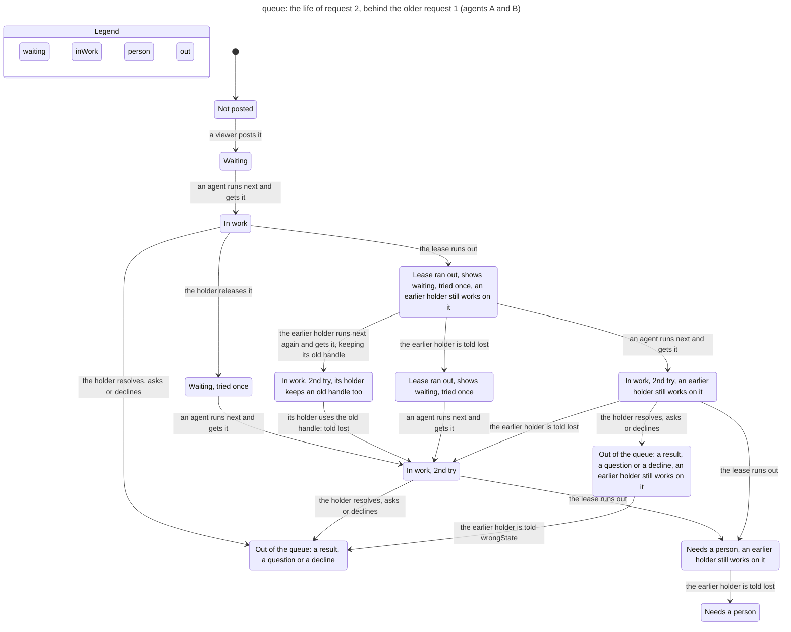

# queue: the lease on a request

The chart shows the life of one request in the queue. A viewer posts it. An agent claims it with a
lease. The agent ends the try with an outcome (a result, a question or a decline), releases it, or
lets the lease run out. After 2 tries with no outcome (3 in the spec), the request needs a person.
The chart follows request 2, behind an older request 1, with two agents A and B. So it shows a
release that goes to the back, and an agent that still works after its lease ran out. That agent
is told `lost`, or `wrongState` when the request left the queue. Each claim gets a new handle. An
agent that runs `next` again and gets the same request back cannot use its old handle: it is told
`lost`.

The model is [models/queue/Queue.tla](models/queue/Queue.tla) with
[Queue.cfg](models/queue/Queue.cfg), in which `request.next` claims in one conditional write. The
model puts the three outcomes into one state, "out of the queue". The chart
[request-life](request-life.md) shows those states, and how a viewer sends a request back. TLC
checks every rule below on all 379 states of this model, and each one holds.



## Rules

| Rule                                                 | In plain words                                                                                               | Spec line                                                                                                    |
| ---------------------------------------------------- | ------------------------------------------------------------------------------------------------------------ | ------------------------------------------------------------------------------------------------------------ |
| `TypeOK`                                             | Each value is one that the board can hold. `tries` never goes past the cap.                                  | SPEC-queue.md § Contract; judged rule 11                                                                     |
| `ARequestIsHeldByAtMostOneAgent`                     | Two agents never hold a live claim on one request, also when both call `request.next` at the same time.      | SPEC-queue.md § An agent works the queue, step 9; judged rule 6                                              |
| `AnUnclaimedRequestHasNoClaim`                       | A request that no agent claimed has no `claimedBy` and no lease.                                             | SPEC-queue.md, judged rule 5                                                                                 |
| `ATabShowsInWorkOnlyWhileTheLeaseIsLive`             | A tab shows a request in work while `claimedUntil` is ahead of the time. After it, the tab shows it waiting. | SPEC-queue.md § An agent works the queue, steps 3, 7; judged rule 7                                          |
| `AWaitingAgentIsWokenWhenARequestCanBeTaken`         | An agent waits only while nothing can be taken. An add, a release or a lease that runs out wakes it.         | SPEC-queue.md § An agent works the queue, step 2; judged rule 12                                             |
| `TriesCountTriesWithNoOutcome`                       | `tries` is the tries that ended with no outcome (a release or a lease that ran out), plus the live one.      | SPEC-queue.md § A request no agent finishes, step 1; judged rule 11                                          |
| `ARequestNeedsAPersonOnlyAfterTriesWithNoOutcome`    | A request needs a person when enough tries ended with no outcome, and only then.                             | SPEC-queue.md § A request no agent finishes, step 2; judged rule 11                                          |
| `NoDeadlock`                                         | There is always a next step.                                                                                 | (model)                                                                                                      |
| `OnlyTheHolderEndsATry`                              | Only the agent with the live claim resolves, asks or declines.                                               | SPEC-queue.md, judged rules 8, 10                                                                            |
| `AStaleClaimEndsNothing`                             | A claim whose lease ran out cannot end the try or release, also when no agent took the request since.        | SPEC-queue.md § An agent works the queue, step 7; judged rule 8                                              |
| `ALiveHolderIsNeverToldLost`                         | An agent whose lease is still live is never told `lost`.                                                     | SPEC-queue.md § An agent works the queue, steps 4-6; judged rule 8                                           |
| `AHandleOnARequestOutOfTheQueueIsToldWrongState`     | A claim on a request that left the queue is told `wrongState`, never `lost`.                                 | SPEC-queue.md § An agent works the queue, step 8; judged rule 8                                              |
| `TheOldestRequestIsTakenFirst`                       | `request.next` gives the first request in queue order that it can take. A released request goes to the back. | SPEC-queue.md § An agent works the queue, steps 1, 6; § Contract (the order); judged rule 6                  |
| `ARequestThatNeedsAPersonIsNeverGiven`               | `request.next` never gives a request that needs a person.                                                    | SPEC-queue.md § A request no agent finishes, step 2; judged rule 11                                          |
| `ARefusalWritesNothing`                              | `lost` and `wrongState` refuse the call and write nothing. `empty` is a success that writes nothing.         | SPEC-queue.md § An agent works the queue, steps 2, 7, 8; judged rule 1                                       |
| `OldHandleIsRefused`                                 | A handle from an earlier claim is refused, also when the same agent claimed the same request again since.    | SPEC-queue.md § An agent works the queue, steps 1, 7; judged rule 8                                          |
| `AStaleHandleCannotExtend`                           | Extend with a handle whose lease ran out is refused, and the lease does not start again.                     | SPEC-queue.md § An agent works the queue, steps 5, 7; judged rule 8                                          |
| `ARequestWhoseLeaseRanOutIsTakenAgainOrNeedsAPerson` | A request whose lease ran out is taken again, or needs a person. It never goes round the queue with no end.  | SPEC-queue.md § An agent works the queue, step 7; § A request no agent finishes; § Success Criteria; E4.3 P1 |

## What the model leaves out

- The states after an outcome, and the way back to the queue (edit, answer, reopen). They are in
  [request-life](request-life.md). A request that comes back is a new request to this model.
- What an extend moves. An extend moves `claimedUntil`. Time is not a number here, so a live lease
  stays live, and the step stays in one state. Its refusals are in the model.
- Model size, to stay under the chart budget of 500 states:
  - Only agent A runs `next` again while it keeps an old handle, only to get request 2 back. It
    uses that old handle before its new lease runs out. Agent B lets go of each handle before it
    claims again. A handle is `<<agent, n>>`, where n flips on each claim that A makes while it
    holds a handle. A variant that checks the agent and not the handle breaks
    `OldHandleIsRefused`.
  - A release is the first try with no outcome. A lease that runs out makes the second.
- Time as numbers. A lease is live, then out. The 300 s default, the 30 to 3600 s bounds and the
  50 s wait are inputs (SPEC-queue.md § Contract).
- The cap. The spec says 3, and the model uses 2, so the chart stays small. The rules do not
  depend on the number.
- `request.add` past the post: the client key, `full`, `slow`, `gone`, and the input limits.
  These are judged rules 13 and 14, and tests.
- `gone`: no frame or canvas is removed. A move of a frame needs no request write (judged rule 4).
- Canvases and `--canvas`. The queue spans all canvases, and the model has one queue of two
  requests.
- Clock skew. Tabs and agents read the time of the server through the clock offset on the board,
  so a lease runs out for all of them in one step.
- The time of the wake. A waiting `request.next` wakes in the same step as the add, release or
  run-out that makes a request waiting. In the code it wakes a moment later and asks again.
- Who may call. The `user` guard and `mayRead` are fact rules.
- What a claim allows: its own frame only (judged rule 15).

## Steps the chart hides

- Steps that stay in one chart state (816): all that happens to request 1 while request 2 stays
  as it is, an agent that finds nothing and waits, a wait that ends `empty`, an extend, and an old
  handle on request 1 told `lost`.
- The view hides no steps.

## Make it again

```sh
scripts/statecharts.sh queue-lease          # rewrite this page's mermaid block in place if it differs
scripts/statecharts.sh --check queue-lease  # change nothing; compare the block and the verdict in charts.tsv
```
