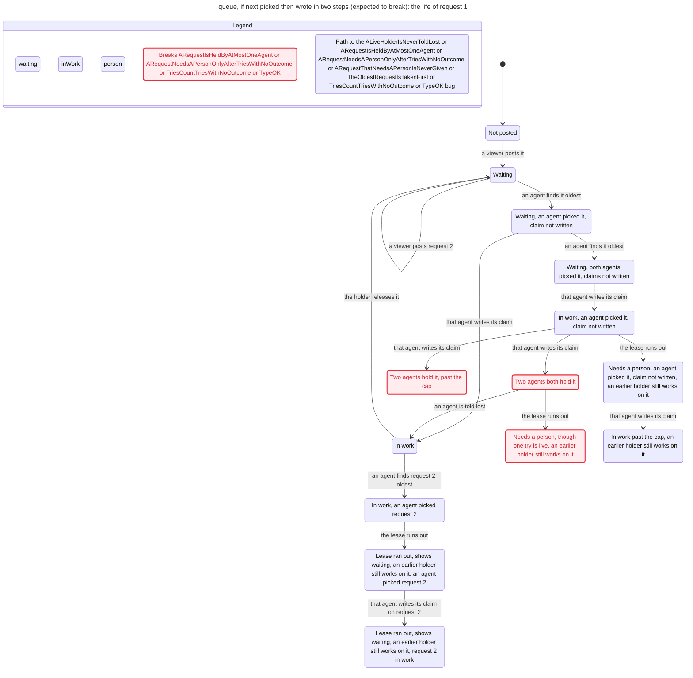

# queue: a claim in two steps (expected to break)

Expected to break: this is why the claim is one write. This is a what-if, kept as a warning. It is
the [queue-lease](queue-lease.md) model with `ATOMIC = FALSE`: `request.next` finds the oldest
request it can take, awaits, then writes its claim without looking again. Two agents that call at
the same time both find request 1, and both write. The model is
[models/queue/Queue.tla](models/queue/Queue.tla) with
[QueueTwoStep.cfg](models/queue/QueueTwoStep.cfg). TLC reaches 4,199 states, more than the chart
budget of 500, so the chart draws only the paths to the rules that break. It follows request 1.
`scripts/statecharts.sh` expects this chart to break, and fails if it ever holds. SPEC-queue.md,
judged rule 6, and the forced race in its success criteria are the answer.



| Rule                                              | In plain words                                                                                                                    | Spec line                                                       |
| ------------------------------------------------- | --------------------------------------------------------------------------------------------------------------------------------- | --------------------------------------------------------------- |
| `ARequestIsHeldByAtMostOneAgent`                  | **Breaks.** Both agents find request 1, then both write their claim: two agents hold it.                                          | SPEC-queue.md § An agent works the queue, step 9; judged rule 6 |
| `TriesCountTriesWithNoOutcome`                    | **Breaks.** The two writes count two tries for one live lease.                                                                    | SPEC-queue.md, judged rule 11                                   |
| `ARequestNeedsAPersonOnlyAfterTriesWithNoOutcome` | **Breaks.** Two tries and one lease that ran out: the request needs a person after one try with no outcome.                       | SPEC-queue.md, judged rule 11                                   |
| `TypeOK`                                          | **Breaks.** An agent that found the request before it reached the cap writes its claim after: `tries` goes past the cap.          | SPEC-queue.md § Contract; judged rule 11                        |
| `ALiveHolderIsNeverToldLost`                      | **Breaks.** Of two agents that both hold it, the one whose handle was written over is told `lost` while its own lease is live.    | SPEC-queue.md, judged rule 8                                    |
| `TheOldestRequestIsTakenFirst`                    | **Breaks.** An agent finds request 2 while 1 is in work. The lease on 1 runs out before the write, and the agent claims 2 over 1. | SPEC-queue.md § Contract (the order); judged rule 6             |
| `ARequestThatNeedsAPersonIsNeverGiven`            | **Breaks.** An agent finds request 1. It reaches the cap before the write, and the agent claims it all the same.                  | SPEC-queue.md, judged rule 11                                   |
| The other rules of [queue-lease](queue-lease.md)  | Hold.                                                                                                                             |                                                                 |

## What the model leaves out

The same as [queue-lease](queue-lease.md#what-the-model-leaves-out). The await between the find
and the write is one step of any length: anything can happen while it lasts.

## Steps the chart hides

- Every state that is not on the shortest path to a rule that breaks: TLC reaches 4,199 states,
  and the chart draws 14.
- The full counterexamples are in the output of the generator: `tlc-<rule>.out`.

## Make it again

```sh
scripts/statecharts.sh queue-two-step          # rewrite this page's mermaid block in place if it differs
scripts/statecharts.sh --check queue-two-step  # change nothing; compare the block and the verdict in charts.tsv
```
