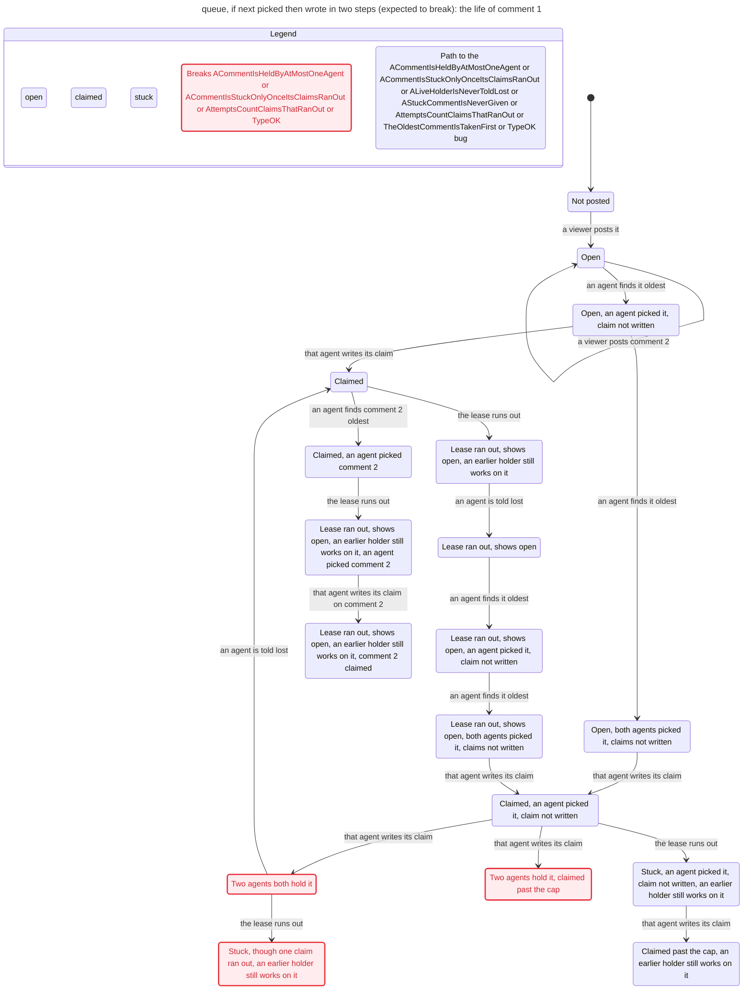

# queue: a claim in two steps (expected to break)

Expected to break: this is why the claim is one write. This is a what-if, kept as a warning. It is
the [queue-lease](queue-lease.md) model with `ATOMIC = FALSE`: `comment.next` picks the oldest
comment it can take, awaits, then writes its claim without looking again. Two agents that call at
once both pick comment 1, and both write. The model is
[models/queue/Queue.tla](models/queue/Queue.tla) with
[QueueTwoStep.cfg](models/queue/QueueTwoStep.cfg). TLC reaches 11,393 states, more than the
chart's budget of 500, so the chart draws only the paths to the rules that break. It follows
comment 1. `scripts/statecharts.sh` expects this chart to break, and fails if it ever holds.
SPEC-queue.md, judged rule 6, and the forced race in its success criteria
(SPEC-queue.md § Success Criteria) are the answer.



| Rule                                                 | In plain words                                                                                                                                 | Spec line                                                                                                                  |
| ---------------------------------------------------- | ---------------------------------------------------------------------------------------------------------------------------------------------- | -------------------------------------------------------------------------------------------------------------------------- |
| `ACommentIsHeldByAtMostOneAgent`                     | **Breaks.** Both agents pick comment 1, then both write their claim: two agents hold it.                                                       | SPEC-queue.md § An agent works the queue, step 9; judged rule 6                                                            |
| `AttemptsCountClaimsThatRanOut`                      | **Breaks.** The two writes count two attempts for one live lease.                                                                              | SPEC-queue.md § A comment no agent finishes; judged rule 10                                                                |
| `ACommentIsStuckOnlyOnceItsClaimsRanOut`             | **Breaks.** Two attempts and one run-out lease: the comment shows stuck after one claim ran out.                                               | SPEC-queue.md § A comment no agent finishes, step 1; § Contract (its states); judged rule 10                               |
| `TypeOK`                                             | **Breaks.** An agent that picked before the comment got stuck writes its claim after: `attempts` passes the stuck count.                       | SPEC-queue.md § Contract (the comment, its states); judged rule 10                                                         |
| `ALiveHolderIsNeverToldLost`                         | **Breaks.** Of two agents that both hold it, the one whose handle was overwritten is told `lost` while its own lease is live.                  | SPEC-queue.md § An agent works the queue, steps 4-6; judged rule 8                                                         |
| `TheOldestCommentIsTakenFirst`                       | **Breaks.** An agent picks comment 2 while 1 is claimed; 1's lease runs out before the write, and the agent claims 2 over the older 1.         | SPEC-queue.md § An agent works the queue, steps 1, 6; § Contract (the queue's order); judged rules 6, 11                   |
| `AStuckCommentIsNeverGiven`                          | **Breaks.** An agent picks comment 1, it becomes stuck before the write, and the agent claims it anyway.                                       | SPEC-queue.md § A comment no agent finishes, step 1; judged rule 10                                                        |
| `AnUnclaimedCommentHasNoClaim`                       | Holds. A comment no agent has claimed has no `claimedBy` and no lease.                                                                         | SPEC-queue.md, judged rule 5                                                                                               |
| `ATabShowsClaimedOnlyWhileTheLeaseIsLive`            | Holds. A tab shows a comment claimed exactly while `claimedUntil` is ahead of the server's time; past it, the tab shows it open with no write. | SPEC-queue.md § An agent works the queue, steps 3, 7; § Contract (its states); judged rule 7                               |
| `AWaitingAgentIsWokenWhenACommentCanBeTaken`         | Holds. An agent waits only while nothing can be taken: an add, a release or a lease that runs out wakes it.                                    | SPEC-queue.md § An agent works the queue, step 2; judged rule 9                                                            |
| `NoDeadlock`                                         | Holds. There is always a next step.                                                                                                            | (model)                                                                                                                    |
| `OnlyTheHolderCanFinishIt`                           | Holds. Only the agent with the live claim marks a comment done.                                                                                | SPEC-queue.md, judged rule 8                                                                                               |
| `AStaleClaimFinishesNothing`                         | Holds. A claim whose lease ran out can neither resolve nor release, also when nobody took the comment since.                                   | SPEC-queue.md § An agent works the queue, step 7; judged rule 8                                                            |
| `AHandleOnADoneCommentIsToldDone`                    | Holds. A claim on a done comment is told `done`, never `lost`.                                                                                 | SPEC-queue.md § An agent works the queue, step 8; judged rule 8                                                            |
| `ARefusalWritesNothing`                              | Holds. `lost` and `done` refuse the call and write nothing; `empty` is a success, an answer that writes nothing.                               | SPEC-queue.md § An agent works the queue, steps 2, 7, 8; judged rule 1                                                     |
| `ADoneCommentStaysDone`                              | Holds. A done comment stays done.                                                                                                              | SPEC-queue.md § An agent works the queue, step 8                                                                           |
| `OldHandleIsRefused`                                 | Holds. A handle from an earlier claim is refused, even when the same agent claimed the same comment again since.                               | SPEC-queue.md § An agent works the queue, steps 1, 7; judged rule 8                                                        |
| `AStaleHandleCannotExtend`                           | Holds. Extend with a handle whose lease ran out answers `lost`.                                                                                | SPEC-queue.md § An agent works the queue, steps 5, 7; judged rule 8                                                        |
| `ExtendOnADoneCommentAnswersDone`                    | Holds. Extend (as resolve and release) on a done comment answers `done`.                                                                       | SPEC-queue.md § An agent works the queue, step 8; judged rule 8                                                            |
| `ACommentWhoseLeaseRanOutIsTakenAgainOrBecomesStuck` | Holds. A comment whose lease ran out is taken again, or becomes stuck. It is never left behind while agents keep working.                      | SPEC-queue.md § An agent works the queue, step 7; § A comment no agent finishes, step 1; judged rule 7; § Success Criteria |

## What the model leaves out

The same as [queue-lease](queue-lease.md#what-the-model-leaves-out). The await between the pick
and the write is one step of any length: anything may happen while it lasts.

## Steps the chart hides

- Every state that is not on the shortest path to a rule that breaks: TLC reaches 11,393 states,
  and the chart draws 18.
- The full counterexamples are in the generator's output: `tlc-<rule>.out`.

## Make it again

```sh
scripts/statecharts.sh queue-two-step          # rewrite this page's mermaid block in place if it differs
scripts/statecharts.sh --check queue-two-step  # change nothing; compare the block and the verdict in charts.tsv
```
